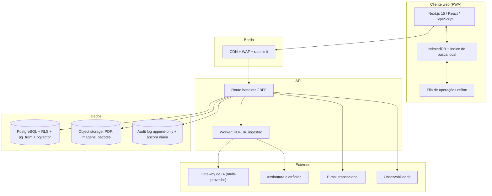

# PrescriMed — Especificação de Produto, Dados e Arquitetura

| Campo | Valor |
|---|---|
| Versão | 1.0 |
| Data | 2026-11-05 |
| Status | Especificação para construção — sujeita a aprovação do Comitê Clínico |
| Público | Produto, Design, Engenharia, Curadoria Clínica, Segurança/LGPD, Gestão hospitalar |
| Classificação | Interno — Confidencial |
| Escopo deste documento | Produto, requisitos, dados, arquitetura, IA, curadoria, UX, governança, fases, backlog e stack |

**Regra editorial deste documento.** Nenhuma dose, posologia, conduta, protocolo ou interpretação clínica é definida aqui. Onde o produto exige conteúdo clínico, este documento define **estrutura, fonte obrigatória, versionamento e gate de validação** — nunca o valor clínico. Qualquer número clínico citado é exemplo de *formato de campo*, não recomendação.

## Convenções de leitura

| Marcador | Significado |
|---|---|
| **[Fato]** | Verificável em norma, padrão técnico ou comportamento já definido do produto |
| **[Premissa]** | Suposição adotada para permitir decisão; se falsa, a decisão muda |
| **[Recomendação]** | Decisão proposta pelo arquiteto, sujeita a aprovação |
| **[Verificar]** | Exige confirmação jurídica, regulatória, clínica ou de fornecedor antes de produção |

**Padrão de IDs.** `RF-<MÓDULO>-nn` (requisito funcional), `RNF-nn` (não funcional), `CA-<MÓDULO>-nn` (critério de aceite), `FL-nn` (fluxo), `RS-nn` (risco), `D-nn` (decisão aberta), `US-nn` (história de usuário), `Mnn` (módulo), `E-nn` (entidade).

---

# 1. Resumo executivo

**Visão.** Ser a camada de confiança entre o raciocínio clínico e o documento assinado: o médico decide em segundos, o sistema garante que o que foi decidido está correto, completo, localmente aplicável, assinado por quem decidiu e reconstruível anos depois.

1. **O que é.** O PrescriMed é um web app SaaS de **prescrição e documentação clínica de urgência/emergência**, multi-tenant (organização → unidade → turno → profissional), que transforma condições clínicas selecionadas em conjuntos de condutas revisáveis — prescrições, exames, documentos, anamnese dirigida, scores, encaminhamentos e admissão — com conteúdo curado, versionado, imprimível e auditável.
2. **O que não é.** Não é prontuário eletrônico completo, não é sistema de faturamento, não é motor de decisão autônomo, não emite ordem clínica sem ato humano, não substitui avaliação médica e não interpreta exame como laudo. A fronteira com o PEP é decisão jurídica e de produto registrada em **D-01**.
3. **Para quem.** Médicos de pronto-socorro, sala vermelha, observação e admissão; coordenadores clínicos e curadores que respondem pelo conteúdo; gestores e TI hospitalar que respondem por disponibilidade, integração e conformidade; auditores que precisam reconstruir o que foi feito, quando e com qual versão de conteúdo.
4. **Problema que resolve.** O plantonista gasta tempo desproporcional redigindo documentos repetitivos em ferramentas genéricas (editor de texto, PEP lento, prescrição em papel), sob pressão, com conteúdo que não reflete o protocolo local nem os recursos da unidade. O resultado é variabilidade, retrabalho, texto genérico, risco de dose e perda de rastreabilidade — não por falta de conhecimento, mas por atrito operacional.
5. **Valor clínico.** Conteúdo específico por condição (nunca modal genérico), filtros de segurança determinísticos (alergia, peso, gestação, função renal/hepática, dose máxima, interação, duplicidade) com severidade calibrada, sinais de alarme e critérios explícitos de alta/observação/retorno/transferência. O julgamento permanece humano e registrado; o sistema reduz omissão e inconsistência.
6. **Valor operacional.** Poucos toques para o documento pronto: busca tolerante a erro em português clínico real, modais por condição, deduplicação automática na combinação de condições, reaproveitamento de dados do atendimento, impressão com carimbo e código de verificação, e funcionamento degradado quando a rede cai. Meta: caso simples documentado em **≤ 5 min**, busca com resultado útil em **≤ 3 s**.
7. **Valor de segurança e auditabilidade.** Toda linha clínica referencia a **versão exata do conteúdo** usada no momento; toda decisão sobre alerta gera `override` com motivo; todo documento assinado é imutável, com hash, autor, data/hora e código de verificação; a trilha de auditoria é append-only encadeada por hash e permite **reconstruir a tela que o médico viu**. Sem isso, o produto não é defensável em auditoria nem em revisão de incidente.
8. **Riscos centrais.** (a) erro de dose por conteúdo desatualizado ou regra mal calibrada; (b) confiança cega na ferramenta, agravada por IA mal enquadrada; (c) excesso de alertas levando à ignorância generalizada; (d) busca que não encontra a condição crítica; (e) configuração de unidade errada (medicamento/exame inexistente); (f) falha de disponibilidade em momento crítico; (g) classificação regulatória incorreta (SaMD/PEP). Mitigações na seção 17.
9. **Condições de sucesso (não negociáveis).** Responsável técnico clínico nomeado; 100% do conteúdo publicado com fonte e revisor humano; versão de conteúdo imutável e fixada por atendimento; RLS testada por suíte automatizada de isolamento; modo offline essencial assinado e expirável; critérios de aceite clínicos assinados; avaliação regulatória concluída antes de qualquer claim diagnóstico; nenhum alerta crítico sem revisão de fadiga a cada ciclo.
10. **Estratégia de construção.** Arquitetura final definida desde a Fase 0 (multi-tenant, versionamento, auditoria, offline, IA como camada opcional). Execução em 6 fases incrementais que entregam fatias verticais reais — não protótipos descartáveis — com gate clínico, gate de segurança e gate de auditoria em cada fase (seção 18).

**Premissas estruturais** (se falsas, revisar as decisões indicadas):

- **[Premissa]** O cliente opera em unidade com internet instável, mas não necessariamente com rede interna confiável — offline é requisito, não luxo.
- **[Premissa]** O PrescriMed **não** substitui o PEP nesta fase; documentos são exportados/integrados (D-01).
- **[Premissa]** O conteúdo clínico é fornecido e validado por um RT clínico e curadores do produto/cliente, não gerado pelo time de engenharia.
- **[Premissa]** O formulário farmacológico é responsabilidade da unidade, atualizado com periodicidade definida.
- **[Premissa]** O piloto ocorre em 1–2 unidades com patrocínio da coordenação clínica.
- **[Premissa]** A arquitetura de referência (seção 20) usa região brasileira para dados de produção [Verificar disponibilidade contratual].

---

# 2. Princípios de produto

Cada princípio tem um **teste de aderência**: se a decisão de design/engenharia não passa no teste, ela é rejeitada ou escalada ao Comitê Clínico.

| ID | Princípio | Implicação de decisão | Teste de aderência |
|---|---|---|---|
| P1 | **Médico no controle** | Nenhuma ordem é criada, alterada ou enviada sem ato explícito do profissional. IA e conteúdo apenas propõem. | É possível identificar, para cada item prescrito, o humano que o aceitou e o momento exato? |
| P2 | **IA como apoio, nunca autoridade** | Toda saída de IA é rotulada, citada, incerta e descartável; nunca calcula dose nem assina. | A saída de IA aparece com origem, limitação e necessidade de validação? Existe caminho manual equivalente? |
| P3 | **Conteúdo validado antes de produção** | Não existe publicação sem fonte, revisor e decisão registrada. Estado `publicado` é o único visível ao assistencial. | Todo item visível em produção tem `source_id`, `reviewer_id`, `published_at`? |
| P4 | **Menos cliques, não menos segurança** | Cada campo só existe se muda a conduta ou o documento. Defaults vêm do protocolo local. | Um caso simples (buscar → prescrever → assinar → imprimir) cabe em ≤ 12 toques? |
| P5 | **Falha segura e transparente** | Indisponibilidade, conteúdo expirado ou IA offline produzem aviso claro + caminho alternativo; nunca silêncio. | O usuário sabe, sem ambiguidade, o que está degradado e o que pode fazer agora? |
| P6 | **Auditoria por padrão** | Auditoria é requisito de arquitetura, não feature. Eventos clínicos e de acesso são registrados na mesma transação. | Consegue-se reconstruir uma prescrição de 6 meses atrás com versão, alertas e overrides? |
| P7 | **Localidade importa** | Medicamentos, exames, protocolos, capacidades e impressão são por unidade; nada global "vaza" para o local. | Um medicamento removido da unidade desaparece da prescrição e gera alerta de indisponível? |
| P8 | **Offline/degradado quando possível** | Pacote essencial local, assinado, com expiração; fila de sincronização idempotente; conflito visível. | Com rede cortada, é possível buscar condição crítica e gerar documento em ≤ 10 s? |
| P9 | **Sem texto genérico em modal clínico** | Todo texto é vinculado a condição + contexto (idade, gestação, função renal). Texto coringa é bloqueado na curadoria. | Um revisor consegue apontar qual condição/segmento justifica cada frase exibida? |
| P10 | **Tudo editável antes da assinatura** | Síntese, prescrição, documento e anamnese são editáveis até o ato de assinar; depois, só correção versionada. | O médico consegue alterar qualquer campo antes de assinar, sem perder o rascunho? |
| P11 | **Severidade calibrada, não alarmismo** | Três níveis visuais (grave/precaução/informativo); bloqueio só com regra crítica justificada; fadiga de alerta é medida. | A taxa de override por regra é monitorada e regras ruidosas são revisadas/retiradas? |
| P12 | **Densidade com hierarquia** | Informação crítica primeiro; nada de dashboards decorativos; uma ação primária por tela. | Em 3 s de olhar, o médico identifica paciente, alergia, peso e ação principal? |

**Trade-offs assumidos explicitamente.** Velocidade nunca autoriza: (a) assinar sem revisão; (b) ocultar alerta grave; (c) usar conteúdo sem fonte; (d) gravar PHI fora do tenant. Se uma otimização exigir um desses, ela é rejeitada.

---

# 3. Personas e cenários de uso

## 3.1 Personas funcionais

| Persona | Objetivo | Dor atual | Tarefa crítica | Métrica de sucesso | Risco se falhar |
|---|---|---|---|---|---|
| **Médico de pronto-socorro** | Resolver o caso e documentar rápido, sem perder segurança | Repetir texto, procurar protocolo, prescrever em sistema lento | Buscar condição → prescrever → alta com orientações → imprimir | Condição encontrada ≤ 3 s; documento assinado ≤ 5 min | Atraso no fluxo, prescrição incompleta, texto genérico |
| **Médico de sala vermelha** | Ação imediata com apoio visual, mãos ocupadas | Falta de checklist acessível, cálculo sob pressão, iluminação ruim | Abrir card crítico (via aérea, DVA, cardioversão) e registrar tempos | Card crítico ≤ 2 toques; tempo de abertura ≤ 1,5 s | Erro em sequência crítica, omissão de etapa |
| **Coordenador clínico** | Padronizar conduta e responder por conteúdo e incidentes | Conteúdo disperso, versões conflitantes, sem rastro de quem aprovou | Revisar/approvar conteúdo, analisar incidentes, definir protocolo local | 100% do conteúdo crítico dentro do SLA de revisão | Responsabilidade sem controle; variabilidade entre plantões |
| **Curador clínico** | Produzir conteúdo correto, estruturado e referenciado | Pesquisa manual, fontes conflitantes, retrabalho de formatação | Transformar fonte em item estruturado com `evidence_ref` | Item publicado com fonte em ≤ 1 ciclo; 0 retrabalho por dado faltante | Conteúdo errado em produção; retrabalho caro |
| **Gestor hospitalar** | Reduzir tempo de permanência e risco jurídico/assistencial | Falta de indicadores de processo e de aderência | Ver indicadores, custo, adesão e incidentes por unidade | Relatório mensal com 100% das métricas da seção 16 | Decisão sem dado; custo invisível |
| **Administrador institucional** | Configurar unidade, recursos, usuários e perfis | Configuração por suporte, planilhas, contaminação entre unidades | Configurar medicamentos, exames, capacidades, layout de impressão | Configuração aplicada ≤ 5 min, com versão e log | Unidade prescrevendo item inexistente; impressão inválida |
| **TI/suporte** | Manter disponível, integrar e diagnosticar | Falta de observabilidade, acesso amplo demais, incidentes opacos | Diagnosticar degradação, restaurar, integrar PEP/FHIR | MTTR ≤ 30 min; 0 acesso indevido | Indisponibilidade em horário crítico; vazamento |
| **Auditor clínico** | Reconstruir decisões e verificar aderência | Logs incompletos, versões sobrescritas, autoria dúbia | Investigar um caso e emitir parecer rastreável | Reconstrução completa em ≤ 10 min por caso | Impossibilidade de defesa técnica; reincidência |

## 3.2 Cenários-âncora (usados em teste de usabilidade e aceite)

1. **Plantão noturno, 23h40, UPA municipal, tablet, internet instável.** Médico atende cefaleia + diarreia. Busca "dor de cabeça", seleciona duas condições, recebe síntese com conflito de orientações, resolve, assina dois documentos e imprime em impressora térmica A4. A rede cai no meio: rascunho persiste, sincroniza ao voltar.
2. **Sala vermelha, 04h10, baixa luminosidade.** Paciente em parada. Médico abre card de reanimação em 2 toques, inicia timer, registra drogas administradas, usa checklist. Nenhuma dose é sugerida automaticamente sem fonte e confirmação.
3. **Auditoria, 6 meses depois.** Auditor recebe denúncia sobre uma prescrição. Em ≤ 10 min, reconstrói: versão de conteúdo usada, dados do paciente no momento (peso, ClCr), alertas exibidos, override com justificativa, autor, hash do PDF e horário de assinatura.

---

# 4. Mapa modular

Módulos M01–M12 correspondem aos módulos obrigatórios do briefing. M13–M15 são módulos de suporte **derivados** de requisitos explícitos (documentos/assinatura, offline, administração) e não podem ser tratados como "infraestrutura invisível": todos têm dono, aceite e auditoria.

**Legenda de prioridade:** P0 = sem isso não há go-live; P1 = necessário para operação plena; P2 = evolução.

## 4.1 Escopo funcional — dentro, fora e fronteira

| Dentro do escopo | Fora do escopo (nesta fase) | Fronteira / decisão pendente |
|---|---|---|
| Busca clínica, modais por condição, prescrição, exames, documentos, anamnese dirigida, scores, encaminhamentos, transferência | Prontuário completo, evolução de enfermagem, execução/aprazamento de medicação, farmácia e estoque | **D-01:** o produto é apoio (exporta/integra) ou PEP oficial? |
| Filtros de segurança determinísticos, overrides auditados | Motor de decisão autônomo, sugestão automática de diagnóstico | IA multimodal: apoio à leitura, nunca laudo (**D-08**) |
| Configuração por organização/unidade/turno, formulário local | Faturamento, convênios, TISS completo, contabilidade | Integrações SUS/ANS na Fase 5 (**D-12**) |
| Documentos com carimbo, hash, código de verificação, impressão | Assinatura em cartório / reconhecimento de firma | ICP-Brasil vs. avançada vs. física (**D-07**) |
| Auditoria, versionamento, curadoria, offline essencial | Telemedicina, app de paciente, chat com paciente | Expansão futura exige nova avaliação regulatória |
| Sala vermelha (cards, checklist, timer), admissão e passagem de bastão | Centro cirúrgico, UTI fechada, unidade de internação prolongada | Limite definido com a coordenação da unidade |

---

### M01 — Busca clínica inteligente
**Objetivo.** Encontrar condição/protocolo/calculadora em ≤ 3 s com tolerância a erro, sinônimos, termos populares, abreviações e voz.
**Usuário principal.** Médico de PS; secundário: curador (via lacunas).
**Entrada → Processamento → Saída.** Texto/voz/filtros → normalização (acento, caixa, stopwords) + expansão por sinônimos + fuzzy + ranking híbrido (clínico + frequência local + afinidade) → lista acionável com filtros e estado vazio acionável.
**Dependências.** M10 (conteúdo publicado), M05 (favoritos/histórico), M13 (índice offline).
**Dados.** `condition`, `clinical_term`, `search_query_log`, `content_gap`, `user_preference`, `unit_search_frequency`.
**IA.** Opcional: embeddings para "condições relacionadas"; nunca para decidir resultado único.
**Aceite.** CA-BUS-01..04; p95 ≤ 250 ms server / ≤ 50 ms local; "dor de cabeça" sugere cefaleia e correlatos; estado vazio com 1 toque para registrar lacuna.
**Auditoria.** Toda busca registra termo (ou hash), filtros, resultados exibidos, clique e tempo; lacunas viram `content_gap` com unidade e frequência.
**Prioridade.** P0.

### M02 — Condições clínicas e modais estratégicos
**Objetivo.** Abrir modal específico por condição (nunca genérico) com prescrição, exames, documentos, anamnese, exame físico, scores, encaminhamentos e transferência.
**Usuário principal.** Médico de PS.
**Entrada → Processamento → Saída.** Condição + contexto do paciente → renderização do `order_set`/`modal_template` versionado com condicionalidades → itens revisáveis + documentos gerados.
**Dependências.** M10, M06, M11, M05.
**Dados.** `condition`, `modal_template`, `order_set`, `order_set_item`, `dose_rule`, `exam_catalog`, `document_template`, `content_version`.
**IA.** Geração inicial de texto para revisão humana (P2); preenchimento assistido (P1).
**Aceite.** CA-CON-01..05; 0 texto genérico detectado em revisão amostral; conteúdo específico por contexto; toda alteração gera versão anterior recuperável.
**Auditoria.** `content_version_id` fixado no atendimento; alteração de conteúdo gera `change_request` + `review_decision`.
**Prioridade.** P0.

### M03 — Combinação de múltiplas condições
**Objetivo.** Combinar 2+ condições com deduplicação, detecção de conflito e síntese única revisável.
**Usuário principal.** Médico de PS.
**Entrada → Processamento → Saída.** Seleção múltipla → normalização de intenções + união com proveniência + dedupe + conflitos + priorização → síntese editável com resolução obrigatória de conflito grave.
**Dependências.** M02, M06.
**Dados.** `condition_selection`, `combination`, `combination_item`, `conflict`, `override`.
**IA.** Opcional: sugestão de consolidação textual (nunca decide conduta).
**Aceite.** CA-COM-01..04; conflito grave bloqueia assinatura até resolução registrada; síntese 100% editável.
**Auditoria.** Cada conflito e cada escolha com autor, timestamp, justificativa e versão das condições.
**Prioridade.** P1 (Fase 3).

### M04 — Anamnese e exame físico direcionados
**Objetivo.** Gerar texto técnico objetivo aderente à condição, sem semiotécnica irrelevante, editável e integrável à evolução.
**Usuário principal.** Médico de PS.
**Entrada → Processamento → Saída.** Seleção de campos/sinais/achados por condição → composição determinística (template + seleção) → texto editável, copiável, exportável, com autoria e timestamp.
**Dependências.** M02.
**Dados.** `clinical_note_template`, `note_field`, `note_draft`, `document`.
**IA.** Opcional: reescrita/estruturação sob revisão (P2).
**Aceite.** CA-ANA-01..03; texto final reflete exatamente os itens selecionados; nenhum campo fora do escopo da condição é exigido.
**Auditoria.** Snapshot dos campos selecionados + texto final + edições (diff).
**Prioridade.** P1.

### M05 — Personalização do usuário e do hospital
**Objetivo.** Adaptar identidade, recursos, medicamentos, exames, perfis por unidade/turno e favoritos sem suporte externo.
**Usuário principal.** Administrador institucional; usuário final para favoritos.
**Entrada → Processamento → Saída.** Configuração + upload de logo/carimbo → validação e versionamento → aplicação imediata com trilha e rollback.
**Dependências.** M14, M11.
**Dados.** `organization`, `unit`, `unit_capability`, `unit_formulary`, `unit_profile`, `user_preference`, `document_layout`.
**IA.** Nenhuma no caminho crítico.
**Aceite.** CA-PER-01..04; item indisponível gera alerta e sugestão de transferência; separação total entre unidades.
**Auditoria.** Toda alteração de configuração com antes/depois, autor, motivo e versão.
**Prioridade.** P1 (identidade/impressão já em P0).

### M06 — Dados do paciente e filtros de segurança
**Objetivo.** Aplicar filtros clínicos antes da prescrição, com alertas calibrados, sem bloquear injustificadamente.
**Usuário principal.** Médico de PS.
**Entrada → Processamento → Saída.** Dados mínimos (idade, peso, alergias, gestação, função renal/hepática, cardiopatia) → motor de regras determinístico versionado → alertas por severidade + exigência de override com motivo.
**Dependências.** M02, M10.
**Dados.** `patient`, `clinical_data_snapshot`, `allergy`, `safety_rule`, `safety_check_result`, `override`.
**IA.** Proibida para calcular dose ou decidir bloqueio.
**Aceite.** CA-SEG-01..05; dado ausente gera aviso, não bloqueio; bloqueio só por regra crítica configurada; override auditado.
**Auditoria.** Snapshot dos dados de entrada + regra + versão + decisão do usuário.
**Prioridade.** P0 (versão mínima), P1 (completo).

### M07 — Internação e admissão (AIH/passagem de bastão)
**Objetivo.** Apoiar do PS até a passagem de bastão, sem invadir enfermaria/internação prolongada.
**Usuário principal.** Médico de sala vermelha/PS.
**Entrada → Processamento → Saída.** Dados já existentes + complementos mínimos → geração de evolução de admissão, prescrição de enfermagem, dieta, cuidados, exames e resumo de passagem.
**Dependências.** M02, M04, M11, M06.
**Dados.** `admission`, `handoff_summary`, `document`, `aih_draft`.
**IA.** Leitura de documento-modelo upado (P2, com validação humana campo a campo).
**Aceite.** CA-ADM-01..03; zero redigitação de dado já informado; resumo contém diagnóstico, hipóteses, condutas, pendências, riscos e continuidade.
**Auditoria.** Cada campo reaproveitado vs. complementado; versão do documento; autor.
**Prioridade.** P1 (Fase 4).

### M08 — Sala vermelha
**Objetivo.** Módulos críticos de acesso imediato, com apoio visual e registro de tempo, sem substituir protocolo oficial.
**Usuário principal.** Médico de sala vermelha.
**Entrada → Processamento → Saída.** Toque curto em card crítico → conteúdo local (offline-first), checklist, timer, calculadoras determinísticas → registro do procedimento e tempos.
**Dependências.** M13, M10, M11.
**Dados.** `procedure_card`, `procedure_log`, `code_timer_session`, `calculator`.
**IA.** Multimodal opcional (ECG/RX) com confiança, limitações e validação obrigatória; nunca ordem automática.
**Aceite.** CA-SAL-01..04; abertura ≤ 2 toques; funciona offline; IA rotulada e bloqueável por tenant.
**Auditoria.** Timeline de eventos, quem registrou, o que foi exibido, o que foi aceito.
**Prioridade.** P1 (Fase 4); cards de leitura em P0 se a unidade exigir.

### M09 — IA assistiva transversal
**Objetivo.** Apoiar dúvidas, preenchimento, formatação, leitura de documentos e curadoria, com proveniência e revisão.
**Usuário principal.** Todos; curadoria para uso interno.
**Entrada → Processamento → Saída.** Solicitação + contexto mínimo (com redaction) → gateway com template versionado e recuperação de fontes → resposta com citações, confiança e limitações + ação humana.
**Dependências.** M10, M12, gateway de IA.
**Dados.** `ai_model`, `ai_request`, `ai_result`, `ai_feedback`, `prompt_template`, `ai_eval_run`.
**IA.** É o módulo.
**Aceite.** CA-IA-01..05; 100% das saídas com origem/limitação; 0 ação clínica sem validação; fallback manual sempre disponível.
**Auditoria.** Input hash, prompt version, modelo/versão, output, confiança, custo, ação humana.
**Prioridade.** P2 (Fase 4), com exceção de extração de documentos (P1).

### M10 — Curadoria, conteúdo e fontes
**Objetivo.** Sustentar o produto em conteúdo ético, atualizado, referenciado e auditável, com revisão periódica.
**Usuário principal.** Curador e revisor clínico.
**Entrada → Processamento → Saída.** Pesquisa/fonte → triagem → estruturação → normalização → revisão → aprovação → publicação versionada → monitoramento e revisão programada.
**Dependências.** Nenhuma (é a base); alimenta M01–M09.
**Dados.** `source`, `evidence_ref`, `clinical_claim`, `content_item_version`, `review_task`, `review_decision`, `publish_event`.
**IA.** Apoio à comparação de fontes, identificação de lacunas e geração inicial — sempre com revisão humana e sem PHI.
**Aceite.** CA-CUR-01..05; 0 publicação sem fonte/revisor; diff e rollback funcionais; SLA de revisão monitorado.
**Auditoria.** Imutável por versão; decisão final registrada; histórico de conflitos entre fontes.
**Prioridade.** P0.

### M11 — Documentos, assinatura e impressão
**Objetivo.** Gerar documento correto, carimbado, datado, verificável, imprimível e imutável após assinatura.
**Usuário principal.** Médico de PS.
**Entrada → Processamento → Saída.** Dados do atendimento + template versionado → render server-side determinístico → PDF com hash/código de verificação → assinatura → armazenamento e impressão.
**Dependências.** M02, M05, M12.
**Dados.** `document`, `document_template`, `signature_event`, `print_job`, `verification_code`.
**IA.** Formatação/estruturação opcional; nunca gera conteúdo clínico assinável sem revisão.
**Aceite.** CA-DOC-01..04; layout SUS configurável; impressão com logo/carimbo/data; correção pós-assinatura gera novo documento com `supersedes_id`.
**Auditoria.** Hash do PDF, template version, autor, timestamp, IP/dispositivo, código de verificação.
**Prioridade.** P0.

### M12 — Auditoria, governança e conformidade
**Objetivo.** Prover trilha completa, reconstrução de estado, gestão de incidentes e controles LGPD.
**Usuário principal.** Auditor clínico, DPO, coordenador.
**Entrada → Processamento → Saída.** Eventos de sistema + ações humanas → log append-only encadeado + indexação → consulta de reconstrução, relatórios e alertas.
**Dependências.** Todas (transversal).
**Dados.** `audit_log`, `access_log`, `incident`, `data_subject_request`, `retention_policy`, `consent_record`.
**IA.** Detecção de anomalia em logs (P2), sem PHI em ferramenta externa.
**Aceite.** CA-AUD-01..05; reconstrução em ≤ 10 min; log imutável; acesso break-glass com justificativa e alerta.
**Auditoria.** É a fonte da auditoria; sua própria integridade é verificada diariamente (âncora Merkle).
**Prioridade.** P0 (mínimo), P1 (completo).

### M13 — Offline e sincronização
**Objetivo.** Manter o essencial utilizável sem rede, com consistência ao reconectar.
**Usuário principal.** Médico de PS; TI.
**Entrada → Processamento → Saída.** Pacote assinado + cache de aplicação → execução local + fila de operações → sincronização idempotente, resolução de conflito e reconciliação visível.
**Dependências.** M01, M02, M11.
**Dados.** `offline_package`, `sync_queue`, `sync_conflict`, `content_version` (manifest).
**IA.** Indisponível offline, com aviso e alternativa manual.
**Aceite.** CA-OFF-01..04; pacote assinado e expirável; 0 perda de rascunho; conflito nunca sobrescreve silenciosamente.
**Auditoria.** Marca `offline=true`, `package_version`, `synced_at`, `conflict_resolution` em cada registro.
**Prioridade.** P1 (Fase 2 mínimo; Fase 3 completo).

### M14 — Administração, tenancy e acesso
**Objetivo.** Gerir organizações, unidades, usuários, papéis, permissões e feature flags com isolamento.
**Usuário principal.** Admin institucional, TI.
**Entrada → Processamento → Saída.** Convite/provisionamento + papéis por escopo → aplicação de RLS e claims → acesso efetivo auditado.
**Dependências.** Auth.
**Dados.** `organization`, `unit`, `user`, `role`, `user_role`, `device_session`, `feature_flag`.
**IA.** Nenhuma.
**Aceite.** CA-TEN-01..03; teste automatizado de isolamento entre tenants com 0 falhas.
**Auditoria.** Provisionamento, mudança de papel, impersonação e revogação.
**Prioridade.** P0.

### M15 — Indicadores e melhoria contínua
**Objetivo.** Medir tempo, segurança, qualidade de conteúdo e uso, sem métricas de vaidade.
**Usuário principal.** Gestor, coordenador, produto.
**Entrada → Processamento → Saída.** Eventos instrumentados → agregação com k-anonimato → painéis e alertas de desvio.
**Dependências.** M12, M01–M11.
**Dados.** `analytics_event` (sem PHI), `metric_snapshot`.
**IA.** Análise de tendência (P2).
**Aceite.** CA-MET-01..03; métricas da seção 16 disponíveis com definição única; nenhum PHI em analytics.
**Auditoria.** Acesso a painéis e exportações registrado.
**Prioridade.** P1.

---

# 5. Fluxos principais

Template: **Gatilho → Passos → Decisões → Alertas → Saídas → Dados gravados → Auditoria → Conclusão → Erros.**

## FL-01 — Buscar condição e gerar prescrição ambulatorial

- **Gatilho.** Médico abre o app com atendimento iniciado (ou cria atendimento em 1 toque).
- **Passos.** (1) Foco automático no campo de busca; (2) digita/fala termo; (3) resultados em ≤ 3 s com filtros (gravidade, idade, gestação, protocolo local); (4) abre condição; (5) modal específico abre na aba "Prescrição ambulatorial"; (6) sistema aplica defaults do protocolo local e checa disponibilidade na unidade; (7) médico revisa itens, remove/adiciona; (8) filtros de segurança rodam a cada edição; (9) "Revisar" mostra resumo consolidado; (10) assina; (11) imprime/compartilha.
- **Decisões.** Qual condição; qual apresentação disponível; manter/remover item; resolver alerta (aceitar/alterar/justificar); confirmar via dupla checagem em item de alto risco.
- **Alertas.** Alergia (grave), dose máxima (grave), ajuste renal (precaução), gestação (grave/precaução), interação (conforme severidade), indisponibilidade local (precaução + alternativa/transferência).
- **Saídas.** Prescrição assinada (PDF + registro), itens estruturados, orientações de alta.
- **Dados gravados.** `encounter`, `prescription`, `prescription_item`, `safety_check_result`, `override`, `document`, `signature_event`, `clinical_data_snapshot`, `content_version_id`.
- **Auditoria.** Busca (termo, resultados, clique), abertura de condição, cada edição de item (diff), alertas exibidos, overrides, assinatura.
- **Conclusão.** Prescrição `assinada` com hash e documento disponível para impressão.
- **Erros.** Busca sem resultado → estado acionável + lacuna; rede cai → rascunho local + banner; medicamento removido por outro admin durante a sessão → aviso e bloqueio do item; PDF falha → fila de reimpressão, prescrição permanece válida.

## FL-02 — Gerar alta pós-medicação

- **Gatilho.** Médico decide alta após medicação em observação.
- **Passos.** (1) Abre condição/atendimento; (2) seleciona "Alta pós-medicação"; (3) sistema reaproveita dados e medicações já administradas; (4) exibe critérios objetivos de alta da condição (checklist); (5) médico marca critérios atendidos; (6) sistema gera receita de alta + orientações + atestado/declaração se marcado; (7) sinais de alarme e critérios de retorno são incluídos; (8) revisão; (9) assinatura; (10) impressão/entrega.
- **Decisões.** Critérios atendidos? Alta vs. observação vs. transferência; necessidade de retorno precoce.
- **Alertas.** Critério não atendido marcado → alerta grave com exigência de justificativa; ausência de sinais de alarme no documento → bloqueio de conclusão (regra de conteúdo).
- **Saídas.** Receita de alta, orientações, atestado/declaração, comprovante de medicação administrada.
- **Dados gravados.** `disposition` + checklist + documentos + justificativa se critério não atendido.
- **Auditoria.** Checklist respondido, horário, autor, versão do conteúdo, documentos.
- **Conclusão.** Atendimento encerrado com disposição `alta` e conjunto documental completo.
- **Erros.** Falta de peso para dose de alta → aviso e campo obrigatório contextual; impressora offline → fila.

## FL-03 — Solicitar exames

- **Gatilho.** Médico precisa de exames de urgência ou complementares.
- **Passos.** (1) Aba "Exames"; (2) sistema mostra painel por condição com urgentes primeiro; (3) médico seleciona; (4) checagem de disponibilidade na unidade e de duplicidade com exames já pedidos; (5) indicação clínica é preenchida a partir do contexto (editável); (6) se aplicável, gera APAC/APA com layout SUS configurável; (7) revisão; (8) assinatura; (9) envio/impressão.
- **Decisões.** Urgência; painel mínimo seguro; exame indisponível → transferência?
- **Alertas.** Exame indisponível na unidade (grave se imprescindível, com sugestão de referência); duplicidade (precaução); exame que exige preparo/jejum (informativo).
- **Saídas.** Requisição assinada, guia APAC/APA quando aplicável, lista para o laboratório.
- **Dados gravados.** `exam_request`, `exam_request_item`, `document`, integração (se houver).
- **Auditoria.** Seleção, remoção, justificativa de exame fora do painel, versão do catálogo.
- **Conclusão.** Requisição assinada e rastreável.
- **Erros.** Código TUSS/SIGTAP ausente → bloqueio da guia (não da requisição clínica) com tarefa para curadoria; integração indisponível → PDF + registro de pendência.

## FL-04 — Combinar múltiplas condições

- **Gatilho.** Médico seleciona 2+ condições no mesmo atendimento.
- **Passos.** (1) Adiciona condições à cesta; (2) sistema normaliza itens e mostra proveniência; (3) deduplica; (4) detecta conflitos; (5) apresenta painel de conflitos com severidade; (6) médico resolve cada um (escolher A, B, ambos, nenhum + motivo); (7) gera síntese única; (8) edita livremente; (9) revisa e assina.
- **Decisões.** Qual item prevalece; manter ambos quando não conflitantes; aceitar risco com justificativa.
- **Alertas.** Conflito grave bloqueia assinatura até resolução; interação/contraindicação com referência resumida; sobreposição de exame/orientação.
- **Saídas.** Prescrição consolidada, exames consolidados, documentos e orientações unificados.
- **Dados gravados.** `combination`, `combination_item`, `conflict`, resolução, `override`.
- **Auditoria.** Estado de cada condição, cada conflito, cada escolha, ordem de edição.
- **Conclusão.** Síntese `confirmada` e assinada com proveniência por item.
- **Erros.** Conflito sem alternativa segura cadastrada → exige decisão humana com justificativa e sinaliza para curadoria; condição removida após edição → itens órfãos marcados, nunca apagados silenciosamente.

## FL-05 — Criar anamnese/exame físico dirigido

- **Gatilho.** Médico abre "Anamnese" dentro do modal da condição.
- **Passos.** (1) Sistema apresenta campos relevantes + sinais de alarme + achados positivos/negativos; (2) médico marca em poucos toques (chips, não texto livre); (3) pode digitar complemento; (4) gera resumo técnico; (5) edita; (6) copia, exporta ou anexa à evolução.
- **Decisões.** Quais campos incluir; o que é negativo relevante; profundidade.
- **Alertas.** Campo obrigatório ausente (informativo); sinal de alarme marcado → destaque e sugestão de reavaliação de disposição (sem decidir).
- **Saídas.** Texto estruturado editável, com autoria e timestamp.
- **Dados gravados.** `note_draft`, campos selecionados, texto final, diff de edições.
- **Auditoria.** Seleção original vs. texto editado; quem editou; quando.
- **Conclusão.** Texto anexado ao atendimento com autor.
- **Erros.** Texto gerado não reflete seleção → bug bloqueante (teste automatizado de fidelidade).

## FL-06 — Usar filtros de segurança antes de prescrever

- **Gatilho.** Médico adiciona/edita item de prescrição.
- **Passos.** (1) Motor coleta snapshot (idade, peso, gestação/IG, ClCr, função hepática, alergias, cardiopatia); (2) executa regras versionadas; (3) exibe alertas ordenados por severidade; (4) médico aceita, altera ou justifica; (5) cada decisão é registrada; (6) resumo de revisão mostra pendências.
- **Decisões.** Preencher dado faltante agora ou prosseguir com aviso; aceitar risco; trocar medicamento.
- **Alertas.** Grave (vermelho, bloqueante quando regra crítica), precaução (âmbar), informativo (cinza).
- **Saídas.** Prescrição com alertas resolvidos e justificativas.
- **Dados gravados.** `clinical_data_snapshot`, `safety_check_result`, `override`.
- **Auditoria.** Regra + versão + dados de entrada + decisão + timestamp.
- **Conclusão.** Nenhum alerta grave pendente sem decisão registrada.
- **Erros.** Dado inconsistente (peso 0, idade 999) → validação de faixa e bloqueio de cálculo, não da prescrição; regra indisponível → comportamento definido por política (por padrão, aviso "verificação parcial" e nunca silêncio).

## FL-07 — Personalizar unidade/hospital

- **Gatilho.** Admin institucional acessa configurações da unidade.
- **Passos.** (1) Identidade (logo, nome, endereço, carimbo, CRM/RQE do profissional); (2) formulário local (medicamentos disponíveis); (3) recursos diagnósticos e capacidade assistencial; (4) perfis por turno; (5) layout de impressão e numeração; (6) preview de documento; (7) salvar com motivo/versão; (8) publicar configuração.
- **Decisões.** O que está disponível; o que é padrão do turno; qual layout usar.
- **Alertas.** Remover medicamento usado por conteúdo ativo → aviso de impacto; capacidade sem UTI → sugestão de protocolo de transferência.
- **Saídas.** Configuração versionada e aplicada; preview de impressão.
- **Dados gravados.** `unit_formulary`, `unit_capability`, `unit_profile`, `document_layout`, `config_version`.
- **Auditoria.** Antes/depois, autor, motivo, timestamp, rollback.
- **Conclusão.** Configuração `publicada` com versão e vigência.
- **Erros.** Upload de logo inválido → validação e mensagem clara; conflito de edição simultânea → bloqueio otimista com diff.

## FL-08 — Gerar admissão/AIH/resumo de passagem

- **Gatilho.** Médico decide internar/admitir a partir do PS.
- **Passos.** (1) Abre "Admissão"; (2) sistema pré-preenche dados existentes; (3) solicita apenas complementos imprescindíveis, cada um com motivo; (4) opcional: upload de documento-modelo para leitura assistida; (5) gera evolução de admissão, prescrição de enfermagem, dieta, cuidados e exames; (6) gera resumo de passagem; (7) revisão; (8) assinatura.
- **Decisões.** Especialidade/leito; dieta; nível de cuidado; pendências.
- **Alertas.** Campo obrigatório para AIH ausente; inconsistência entre diagnóstico e procedimento; documento-modelo com baixa confiança de leitura.
- **Saídas.** Documentos de admissão + resumo de passagem padronizado.
- **Dados gravados.** `admission`, `aih_draft`, `handoff_summary`, `document`, `ai_result` (se usado).
- **Auditoria.** Campo reaproveitado vs. complementado; fonte de cada dado; versão.
- **Conclusão.** Admissão registrada e passagem de bastão exportável.
- **Erros.** AIH sem código compatível → bloqueio da guia e tarefa de faturamento; IA indisponível → formulário manual completo.

## FL-09 — Usar módulo de sala vermelha

- **Gatilho.** Médico entra em modo sala vermelha (ou abre card direto).
- **Passos.** (1) Tela de cards grandes (via aérea, DVA, cardioversão, checklist, procedimentos); (2) abre card em ≤ 2 toques; (3) timer/checklist iniciam com 1 toque; (4) registra eventos por botão (sem digitação); (5) IA multimodal opcional para ECG/RX com resultado rotulado; (6) encerra e gera registro.
- **Decisões.** Sequência do protocolo; aceitar ou não a leitura da IA; registrar intercorrência.
- **Alertas.** Timer acima de marco configurado; item de checklist não marcado; IA com baixa confiança.
- **Saídas.** Registro cronológico do procedimento, checklist concluído, documento de evolução.
- **Dados gravados.** `procedure_log`, `code_timer_session`, `ai_result`, `document`.
- **Auditoria.** Timeline completa com autor de cada evento; conteúdo exibido; versão.
- **Conclusão.** Sessão encerrada com registro íntegro.
- **Erros.** Sem rede → tudo local; IA indisponível → card textual; dispositivo sem áudio → metrônomo visual.

## FL-10 — Atualizar conteúdo clínico pela curadoria

- **Gatilho.** Nova fonte, revisão programada, alerta sanitário ou lacuna de busca.
- **Passos.** (1) Abre `change_request`; (2) registra fonte(s) e trecho; (3) estrutura claims; (4) compara com versão vigente (diff); (5) revisor clínico avalia; (6) resolve conflitos entre fontes com decisão registrada; (7) aprova (dupla checagem em classe A); (8) publica com janela e nota de versão; (9) monitora; (10) agenda próxima revisão.
- **Decisões.** Aceitar/recusar mudança; qual fonte prevalece; impacto em unidades.
- **Alertas.** Item classe A sem segundo revisor → bloqueio; diff que altera dose → exige justificativa e revisão farmacêutica; item usado por muitas unidades → aviso de impacto.
- **Saídas.** Nova `content_version` publicada, changelog e notificação.
- **Dados gravados.** `source`, `evidence_ref`, `clinical_claim`, `review_decision`, `content_version`, `publish_event`.
- **Auditoria.** Imutável; quem decidiu o quê e com base em qual fonte.
- **Conclusão.** Publicação com versão incrementada e rollback disponível.
- **Erros.** Fonte indisponível → manter versão vigente e registrar pendência; conflito insolúvel → estado `em_revisao` com item marcado e visível ao coordenador.

## FL-11 — Usar IA com validação humana

- **Gatilho.** Médico solicita apoio (dúvida, leitura de documento, formatação) ou sistema oferece sugestão.
- **Passos.** (1) Sistema mostra o que será enviado (com redaction); (2) envia via gateway; (3) resposta com citações, confiança e limitações; (4) médico aceita, edita ou rejeita; (5) se aceitar, o conteúdo entra como `sugestao_adotada` com marcação; (6) feedback é registrado; (7) ação clínica continua exigindo revisão e assinatura.
- **Decisões.** Aceitar sugestão; editar; rejeitar; reportar erro.
- **Alertas.** Baixa confiança → aviso destacado; ausência de citação → bloqueio de adoção em conteúdo clínico; IA indisponível → banner e caminho manual.
- **Saídas.** Texto adotado (marcado) ou descartado; feedback.
- **Dados gravados.** `ai_request`, `ai_result`, `ai_feedback`, `human_action`.
- **Auditoria.** Modelo/versão, input hash, prompt, output, decisão humana, timestamp.
- **Conclusão.** Toda saída de IA tem destino explícito (adotada/rejeitada) e registro.
- **Erros.** Timeout → fallback manual; conteúdo suspeito/prompt injection → bloqueio, log e sinal para curadoria.

## FL-12 — Operar em modo offline/degradado

- **Gatilho.** Perda de conectividade, latência acima do limite ou indisponibilidade de serviço.
- **Passos.** (1) Detector marca estado (online/degradado/offline); (2) banner persistente e discreto; (3) app usa pacote local assinado; (4) busca e documentos essenciais funcionam; (5) operações entram em fila idempotente; (6) ao reconectar, sincroniza em ordem; (7) conflitos são apresentados; (8) reconciliação é auditada.
- **Decisões.** Continuar offline ou aguardar; resolver conflito (manter local/remoto).
- **Alertas.** Pacote expirado (aviso forte); IA indisponível; operação não sincronizada; conflito detectado.
- **Saídas.** Documentos locais impressos, fila sincronizada, registro de degradação.
- **Dados gravados.** `offline_package` (versão), `sync_queue`, `sync_conflict`, flags nos registros.
- **Auditoria.** `offline=true`, horário, pacote, sincronização e resolução.
- **Conclusão.** Nenhuma operação perdida; estado final consistente e visível.
- **Erros.** Pacote corrompido → bloqueio de uso offline e instrução de reconexão; assinatura inválida → recusa e alerta de segurança; conflito não resolvido → registro fica `pendente` e não pode ser enviado a terceiros.
---

# 6. Requisitos funcionais

Formato: **ID · nome · descrição · regra de negócio · prioridade · critério de aceite · dependência · observação clínica/de segurança.** Requisitos marcados **[Verificar]** dependem de confirmação externa antes de implementação definitiva.

## 6.1 M01 — Busca clínica

**RF-BUS-01 — Busca com normalização e tolerância a erro**
- **Descrição.** Campo único de busca com normalização (maiúsculas, acentos, pontuação, stopwords pt-BR) e tolerância a erro de digitação via similaridade de trigramas.
- **Regra.** Nenhum termo é rejeitado por formato; termos com ≤ 2 caracteres usam apenas prefixo; similaridade mínima 0,3 para incluir candidato.
- **Prioridade.** P0 · **Depende.** RF-BUS-02
- **Aceite.** "cefaléia", "cefaleia", "cefaleia  ", "dorde cabeca" retornam o mesmo conjunto principal (ordem pode variar).
- **Observação.** Busca nunca deve retornar vazio sem oferecer ação.

**RF-BUS-02 — Expansão por sinônimos, termos populares, abreviações e erros comuns**
- **Descrição.** Dicionário versionado por locale com tipos: sinônimo técnico, termo popular, abreviação, erro comum, termo regional.
- **Regra.** Expansão ocorre na consulta (OR), com peso menor que o termo original; termos populares nunca substituem o nome canônico na exibição.
- **Prioridade.** P0 · **Depende.** RF-CUR-03
- **Aceite.** "dor de cabeça" retorna cefaleia e correlatos; "IAM" retorna infarto agudo do miocárdio; cada termo tem fonte/owner.
- **Observação.** Termo popular é dado de curadoria, com revisão e versionamento — não hardcode.

**RF-BUS-03 — Ranking híbrido com relevância clínica e frequência local**
- **Descrição.** Score combina aderência lexical, similaridade, prioridade clínica, frequência na unidade e afinidade pessoal.
- **Regra.** Pesos versionados e auditáveis; frequência local agregada com k-anonimato (mínimo 5 usuários); itens arquivados/fora de escopo penalizados.
- **Prioridade.** P0 · **Depende.** RF-BUS-01, RF-BUS-06
- **Aceite.** Top-3 contém a condição esperada em ≥ 90% de um conjunto dourado de 200 consultas reais anonimizadas.
- **Observação.** Ranking deve ser explicável ao curador ("por que este item subiu").

**RF-BUS-04 — Filtros clínicos e contextuais**
- **Descrição.** Filtros por gravidade, faixa etária, gestação/lactação, protocolo local e tipo de conteúdo (condição, protocolo, calculadora, documento).
- **Regra.** Filtros persistem na sessão; filtro incompatível com o contexto do paciente gera aviso, não ocultação silenciosa.
- **Prioridade.** P0 · **Depende.** RF-BUS-01
- **Aceite.** Filtrar "pediatria" reduz resultados e mantém contagem visível; limpar filtro restaura.
- **Observação.** Filtro não substitui alerta de segurança.

**RF-BUS-05 — Histórico, recentes e favoritos**
- **Descrição.** Histórico pessoal com TTL configurável, itens recentes por turno e favoritos por usuário/unidade.
- **Regra.** Histórico é local-first e expurgado por política; favoritos são sincronizados; nunca compartilhar histórico entre profissionais.
- **Prioridade.** P1 · **Depende.** RF-TEN-02
- **Aceite.** Últimos 10 itens aparecem sem digitar; "limpar histórico" é imediato e auditado.
- **Observação.** Histórico pode revelar padrão de atendimento — dado pessoal sensível.

**RF-BUS-06 — Frequência local com privacidade**
- **Descrição.** Contagem agregada de uso por condição/unidade para ajustar ranking.
- **Regra.** Agregação mínima de 5 usuários por bucket; sem vínculo a paciente; retenção curta; opt-out institucional.
- **Prioridade.** P1 · **Depende.** RF-MET-01
- **Aceite.** Nenhum registro individual recuperável a partir da tabela de frequência.
- **Observação.** Se não for possível garantir k-anonimato, desativar o recurso na unidade.

**RF-BUS-07 — Estado "nenhum resultado" acionável**
- **Descrição.** Tela com sinônimos sugeridos, condições próximas, busca por CID, abertura do catálogo e "registrar lacuna" em 1 toque.
- **Regra.** Registrar lacuna cria `content_gap` com termo, unidade, contexto (sem PHI) e notifica curadoria.
- **Prioridade.** P0 · **Depende.** RF-CUR-06
- **Aceite.** Do estado vazio ao registro de lacuna em ≤ 1 toque e ≤ 3 s; confirmação visível.
- **Observação.** Lacuna é insumo de curadoria, não erro do usuário.

**RF-BUS-08 — Busca por voz (opcional)**
- **Descrição.** Ditado no campo de busca com confirmação do texto reconhecido.
- **Regra.** Processamento preferencialmente on-device; se usar serviço externo, exige configuração explícita do tenant e não envia PHI.
- **Prioridade.** P2 · **Depende.** RF-BUS-01, avaliação de privacidade
- **Aceite.** Texto reconhecido é exibido para edição antes de buscar; falha de permissão tem instrução clara.
- **Observação.** Microfone em área clínica tem risco de captar conversa de terceiros [Verificar].

## 6.2 M02 — Condições e modais

**RF-CON-01 — Modal específico por condição**
- **Descrição.** Cada condição possui conjunto de modais próprios; não existe modal "genérico" acessível ao assistencial.
- **Regra.** Modal só é publicado se todos os campos obrigatórios do tipo estiverem preenchidos e validados; texto sem vínculo de condição é bloqueado na publicação.
- **Prioridade.** P0 · **Depende.** RF-CUR-04
- **Aceite.** Auditoria amostral de 50 modais: 0 frases genéricas aplicáveis a qualquer condição; 100% com `condition_id`.
- **Observação.** Texto genérico é o principal vetor de erro por desatenção.

**RF-CON-02 — Conteúdo condicionado ao contexto**
- **Descrição.** Itens e textos variam por faixa etária, gestação, função renal/hepática, peso e recursos da unidade.
- **Regra.** Condicionalidade é declarativa e versionada; item inelegível é ocultado com explicação ("não se aplica: gestante").
- **Prioridade.** P0 · **Depende.** RF-SEG-04
- **Aceite.** Trocar contexto (ex.: marcar gestante) altera itens exibidos e registra motivo.
- **Observação.** Ocultação silenciosa é proibida; sempre há explicação acessível.

**RF-CON-03 — Estrutura mínima de item de prescrição**
- **Descrição.** Todo item contém: indicação, dose, via, frequência, duração máxima usual, precauções principais, ajustes aplicáveis e alertas de dose máxima.
- **Regra.** Campos clínicos vêm de conteúdo curado com `evidence_ref`; a UI não aceita item "solto" sem vínculo.
- **Prioridade.** P0 · **Depende.** RF-CUR-04, RF-SEG-05
- **Aceite.** 100% dos itens publicados com todos os campos; validação automatizada no publish.
- **Observação.** Duração máxima é campo clínico — exige fonte.

**RF-CON-04 — Alternativas terapêuticas explícitas**
- **Descrição.** Para itens principais, o conteúdo pode declarar alternativas com critério de escolha (ex.: indisponibilidade local, alergia).
- **Regra.** Alternativa nunca é aplicada automaticamente; exige seleção humana e registra troca.
- **Prioridade.** P1 · **Depende.** RF-CON-03
- **Aceite.** Trocar para alternativa registra motivo e mantém vínculo com a condição.
- **Observação.** Alternativa sem critério é considerada conteúdo incompleto.

**RF-CON-05 — Critérios objetivos de disposição**
- **Descrição.** Cada condição declara critérios de alta, observação, retorno, transferência e sinais de alarme.
- **Regra.** Critérios são checklist; disposição escolhida em desacordo exige justificativa.
- **Prioridade.** P0 · **Depende.** RF-CON-01
- **Aceite.** Documento de alta contém sinais de alarme e critérios de retorno; ausência bloqueia conclusão da alta.
- **Observação.** Critérios são conteúdo clínico validado, não heurística de software.

**RF-CON-06 — Versionamento e recuperação de conteúdo**
- **Descrição.** Toda alteração gera nova versão; versões anteriores permanecem recuperáveis e consultáveis.
- **Regra.** Publicação é atômica e imutável; rollback cria nova versão apontando para o conteúdo anterior.
- **Prioridade.** P0 · **Depende.** RF-CUR-07
- **Aceite.** É possível abrir a versão usada em um atendimento de 6 meses atrás, byte a byte.
- **Observação.** Sem isso, auditoria e defesa técnica são inviáveis.

**RF-CON-07 — Checagem de disponibilidade local**
- **Descrição.** Ao inserir item, o sistema verifica o formulário da unidade.
- **Regra.** Indisponível → alerta precaução + alternativas + sugestão de transferência quando imprescindível.
- **Prioridade.** P0 · **Depende.** RF-PER-03
- **Aceite.** Item fora do formulário não entra como "normal"; sempre há marcação e decisão.
- **Observação.** Nunca prometer medicamento que a unidade não tem.

**RF-CON-08 — Documentos por condição**
- **Descrição.** Atestado, declaração, encaminhamento (PSF/especialidade), transferência e receituário com textos específicos.
- **Regra.** Cada documento tem template versionado, campos obrigatórios e validação de conteúdo.
- **Prioridade.** P0 · **Depende.** RF-DOC-01
- **Aceite.** Documento gerado cita a condição e o atendimento; não há texto "coringa".
- **Observação.** Atestado e declaração têm implicações legais [Verificar].

**RF-CON-09 — Scores e calculadoras**
- **Descrição.** Calculadoras determinísticas com fórmula versionada, unidades explícitas, interpretação e fonte.
- **Regra.** Cálculo executado em código testado (não em LLM); arredondamento e faixas definidos; resultado exibido com versão.
- **Prioridade.** P1 · **Depende.** RF-CUR-04
- **Aceite.** Casos de teste com resultado esperado documentado; 100% de acerto; unidade inválida bloqueia cálculo.
- **Observação.** Calculadora é conteúdo clínico e exige validação e fonte.

**RF-CON-10 — Anamnese/exame físico dirigidos por condição**
- **Descrição.** Ver RF-ANA-01..05; o modal de condição integra a aba e herda o contexto.
- **Regra.** Campos fora do escopo da condição não são exigidos; inclusão intencional é permitida e registrada.
- **Prioridade.** P1 · **Depende.** RF-ANA-01
- **Aceite.** Em faringoamigdalite, nenhum campo geniturinário é obrigatório; texto final reflete seleção.
- **Observação.** Semiotécnica extensa desnecessária é falha de conteúdo.

## 6.3 M03 — Combinação de condições

**RF-COM-01 — Cesta de condições**
- **Descrição.** Adicionar, remover e reordenar condições no mesmo atendimento, com proveniência visível.
- **Regra.** Remover condição não apaga itens já editados; itens órfãos são marcados e exigem decisão.
- **Prioridade.** P1 · **Depende.** RF-CON-01
- **Aceite.** Cesta com 3 condições exibe contagem e origem de cada item.
- **Observação.** Perda silenciosa de item é falha grave.

**RF-COM-02 — Deduplicação exata e terapêutica**
- **Descrição.** Remove duplicatas idênticas e sinaliza duplicidade terapêutica (mesmo princípio ativo/classe, mesma via).
- **Regra.** Duplicata exata é removida com nota; duplicidade terapêutica exige escolha humana.
- **Prioridade.** P1 · **Depende.** RF-COM-01
- **Aceite.** Dois itens idênticos resultam em um, com registro da origem preservada.
- **Observação.** Dedupe nunca deve apagar proveniência.

**RF-COM-03 — Detecção de conflitos**
- **Descrição.** Conflitos de dose cumulativa, interação, contraindicação, exames redundantes, orientações incoerentes e disposição incompatível.
- **Regra.** Cada conflito tem severidade, explicação curta e referência resumida; severidade grave exige resolução explícita.
- **Prioridade.** P1 · **Depende.** RF-SEG-03, RF-SEG-06
- **Aceite.** Conflito de disposição (alta vs. observação) bloqueia assinatura até decisão registrada.
- **Observação.** Não inventar conduta: apresentar opções e consequências cadastradas.

**RF-COM-04 — Síntese editável com proveniência**
- **Descrição.** Síntese única de prescrições, exames, documentos, anamnese, encaminhamentos e orientações.
- **Regra.** Cada linha mantém `source_condition_id`; edição manual passa a ter autor humano.
- **Prioridade.** P1 · **Depende.** RF-COM-02
- **Aceite.** 100% das linhas com origem rastreável antes e depois da edição.
- **Observação.** A síntese é o documento que o médico assina — precisa ser legível e completa.

**RF-COM-05 — Confirmação e justificativa**
- **Descrição.** Conflito grave exige confirmação explícita; override exige motivo por código + texto curto.
- **Regra.** Motivo é obrigatório e entra na auditoria; não há "ok" genérico.
- **Prioridade.** P1 · **Depende.** RF-SEG-08
- **Aceite.** Nenhum override sem motivo registrado; relatório de overrides por regra disponível.
- **Observação.** Motivo genérico ("ciente") é permitido apenas como categoria, com comentário opcional.

**RF-COM-06 — Priorização clínica na combinação**
- **Descrição.** Ordenar itens por criticidade e dependência (ex.: item de suporte antes de item condicional).
- **Regra.** Ordem é definida por conteúdo, não por heurística de UI.
- **Prioridade.** P2 · **Depende.** RF-COM-04
- **Aceite.** Ordem estável e explicável; não muda entre sessões.
- **Observação.** Ordem errada pode induzir erro de administração.

## 6.4 M04 — Anamnese e exame físico

**RF-ANA-01 — Campos dirigidos por condição**
- **Descrição.** Conjunto de campos, sinais de alarme e achados relevantes definidos por condição.
- **Regra.** Campo obrigatório só se muda conduta/documento; o resto é opcional e colapsado.
- **Prioridade.** P1 · **Depende.** RF-CON-01
- **Aceite.** ≤ 8 campos visíveis por padrão; expansão opcional.
- **Observação.** Excesso de campos é a principal causa de abandono.

**RF-ANA-02 — Composição determinística do texto**
- **Descrição.** Texto gerado a partir de template + seleção, sem LLM no caminho padrão.
- **Regra.** Cada frase do template é condicionada a um campo; frase sem campo é erro de conteúdo.
- **Prioridade.** P1 · **Depende.** RF-ANA-01
- **Aceite.** Teste automatizado: seleção X produz texto X'; editar seleção altera texto correspondente.
- **Observação.** Fidelidade entre seleção e texto é requisito de segurança.

**RF-ANA-03 — Edição, cópia e exportação**
- **Descrição.** Texto editável, copiável, exportável e anexável à evolução.
- **Regra.** Edição manual é registrada em diff; autoria e timestamp preservados.
- **Prioridade.** P1 · **Depende.** RF-ANA-02
- **Aceite.** Cópia mantém formatação; exportação gera PDF/DOCX/TXT; diff recuperável.
- **Observação.** Copiar para fora do sistema é vetor de perda de rastreabilidade — registrar evento.

**RF-ANA-04 — Sinais de alarme destacados**
- **Descrição.** Marcação de sinal de alarme gera destaque e sugestão de reavaliação de disposição.
- **Regra.** Sistema não altera disposição automaticamente; apenas sinaliza.
- **Prioridade.** P1 · **Depende.** RF-CON-05
- **Aceite.** Sinal marcado aparece no resumo e no documento final.
- **Observação.** Nunca ocultar sinal de alarme por configuração de layout.

**RF-ANA-05 — Modelos institucionais**
- **Descrição.** Unidade pode ter modelo de evolução/boletim próprio, versionado.
- **Regra.** Modelo institucional tem precedência sobre global, com indicação de origem.
- **Prioridade.** P2 · **Depende.** RF-PER-01
- **Aceite.** Trocar modelo não altera registros anteriores.
- **Observação.** Conflito entre modelo institucional e conteúdo clínico é resolvido pela curadoria.

## 6.5 M05 — Personalização institucional

**RF-PER-01 — Identidade da unidade e do profissional**
- **Descrição.** Logotipo, nome do hospital, endereço, nome do médico, CRM, RQE, carimbo.
- **Regra.** Campos obrigatórios por tipo de documento; validação de formato de CRM/RQE; carimbo com data/hora na impressão.
- **Prioridade.** P0 · **Depende.** RF-TEN-01
- **Aceite.** Impressão traz logo, nome, CRM, endereço, data/hora e identificador do documento.
- **Observação.** Documento sem identificação é inválido na prática.

**RF-PER-02 — Formulário farmacológico local**
- **Descrição.** Lista de medicamentos/apresentações disponíveis por unidade, com vigência.
- **Regra.** Item fora do formulário é marcado como indisponível; admin pode importar em lote com validação.
- **Prioridade.** P0 · **Depende.** RF-PER-01
- **Aceite.** Importação de 500 itens com relatório de erros; alteração tem versão e autor.
- **Observação.** Formulário desatualizado é risco assistencial direto.

**RF-PER-03 — Recursos diagnósticos e capacidade assistencial**
- **Descrição.** Marcar disponibilidade de RX, ECG, TC, US, laboratório, observação, UTI, ventilador, diálise.
- **Regra.** Capacidade declarada influencia alertas e sugestão de transferência.
- **Prioridade.** P0 · **Depende.** RF-PER-01
- **Aceite.** Ausência de recurso essencial gera alerta com sugestão de referência e prioridade.
- **Observação.** Capacidade é declaração institucional, com responsável e data.

**RF-PER-04 — Perfis por turno e protocolo local**
- **Descrição.** Conjunto de defaults (dieta, cuidados, exames, favoritos) por turno e por protocolo.
- **Regra.** Perfil tem precedência sobre global e é versionado; troca de turno é explícita.
- **Prioridade.** P1 · **Depende.** RF-PER-02
- **Aceite.** Trocar perfil altera defaults visivelmente e registra a troca.
- **Observação.** Perfil não pode sobrescrever regra de segurança.

**RF-PER-05 — Layout de impressão configurável**
- **Descrição.** Templates de impressão por tipo de documento, incluindo layout SUS.
- **Regra.** Preview obrigatório; variáveis validadas; campos legais não removíveis.
- **Prioridade.** P1 · **Depende.** RF-DOC-02
- **Aceite.** Preview idêntico ao PDF gerado; campos legais bloqueados para edição.
- **Observação.** Layout SUS exige validação com a unidade [Verificar].

**RF-PER-06 — Isolamento entre unidades**
- **Descrição.** Configuração de uma unidade nunca afeta outra, salvo herança explícita da organização.
- **Regra.** Herança é declarada e visível; sobrescrita é registrada.
- **Prioridade.** P0 · **Depende.** RF-TEN-03
- **Aceite.** Teste automatizado: alterar unidade A não muda unidade B (0 divergências).
- **Observação.** Contaminação entre unidades é falha grave de segurança.

**RF-PER-07 — Trilha de alteração de configuração**
- **Descrição.** Toda mudança de configuração tem antes/depois, autor, motivo e rollback.
- **Regra.** Rollback cria nova versão (não apaga histórico).
- **Prioridade.** P1 · **Depende.** RF-AUD-01
- **Aceite.** Reconstruir configuração de uma data específica em ≤ 2 min.
- **Observação.** Configuração errada é causa frequente de incidente.

## 6.6 M06 — Dados do paciente e filtros de segurança

**RF-SEG-01 — Coleta mínima de dados**
- **Descrição.** Idade, peso (quando necessário), alergias, condições relevantes, gestação/IG, função renal/hepática, cardiopatia.
- **Regra.** Campo só é solicitado se altera regra ou documento; opcional permanece opcional.
- **Prioridade.** P0 · **Depende.** RF-TEN-02
- **Aceite.** Caso simples exige ≤ 4 campos antes da primeira prescrição.
- **Observação.** Minimização é exigência LGPD e requisito de velocidade.

**RF-SEG-02 — Aviso de dado ausente**
- **Descrição.** Ausência de dado relevante gera aviso com ação de preenchimento, não bloqueio.
- **Regra.** Bloqueio só para regra crítica (ex.: prescrição pediátrica sem peso, quando assim configurado).
- **Prioridade.** P0 · **Depende.** RF-SEG-03
- **Aceite.** 100% dos avisos com ação "preencher agora" e opção "prosseguir" quando permitido.
- **Observação.** Bloqueio injustificado gera contorno informal (papel), que é pior.

**RF-SEG-03 — Motor de regras determinístico e versionado**
- **Descrição.** Regras de dose máxima, ajuste renal/hepático, alergia, interação, contraindicação, duplicidade e monitorização.
- **Regra.** Regras são dados versionados executados por engine testada; IA não participa.
- **Prioridade.** P0 · **Depende.** RF-CUR-04
- **Aceite.** Conjunto de 300 casos de teste com resultado esperado; 100% de acerto; versão registrada em cada avaliação.
- **Observação.** Regra sem fonte não pode ser publicada.

**RF-SEG-04 — Severidade em três níveis**
- **Descrição.** Grave, precaução e informativo, com padrão visual distinto e comportamento definido.
- **Regra.** Grave pode bloquear se regra crítica; precaução exige ciência; informativo não interrompe.
- **Prioridade.** P0 · **Depende.** RF-SEG-03
- **Aceite.** Teste com daltonismo: distinção por ícone + texto + cor.
- **Observação.** Cor nunca é o único diferenciador.

**RF-SEG-05 — Ajustes por população**
- **Descrição.** Ajuste pediátrico (peso), obstétrico (IG/DUM/USG), renal (ClCr estimada), hepático, obesidade.
- **Regra.** Fórmula e faixas são conteúdo versionado; unidade explícita; resultado exibido com premissas.
- **Prioridade.** P0 · **Depende.** RF-SEG-03
- **Aceite.** Entrada inválida (peso 0, IG > 45 semanas) bloqueia cálculo com mensagem específica.
- **Observação.** Cálculo renal exige padronização de fórmula [Verificar preferência institucional].

**RF-SEG-06 — Alergias e reatividade cruzada**
- **Descrição.** Registro de alergia com gravidade e reação; checagem de classe/reatividade cruzada cadastrada.
- **Regra.** Alergia grave bloqueia item correspondente; reatividade cruzada gera precaução/grave conforme conteúdo.
- **Prioridade.** P0 · **Depende.** RF-SEG-03
- **Aceite.** Alergia registrada aparece no cabeçalho do atendimento e em todo documento.
- **Observação.** Alergia não informada é dado ausente, não "sem alergia".

**RF-SEG-07 — Interações e duplicidades**
- **Descrição.** Checagem par a par e por classe, com severidade, mecanismo resumido e manejo cadastrado.
- **Regra.** Só interações com fonte entram; "sem dados" não é "sem interação".
- **Prioridade.** P1 · **Depende.** RF-SEG-03
- **Aceite.** Interação grave exige confirmação explícita e aparece no resumo.
- **Observação.** Base de interações exige licença/validação de fonte [Verificar].

**RF-SEG-08 — Override com justificativa**
- **Descrição.** Aceitar risco exige motivo, autor, timestamp e vínculo com a regra.
- **Regra.** Motivo por categoria + comentário opcional; overrides recorrentes viram sinal de calibração.
- **Prioridade.** P0 · **Depende.** RF-SEG-04
- **Aceite.** Nenhum override sem `reason_code`; relatório por regra/unidade/médico disponível.
- **Observação.** Override não apaga o alerta do registro.

**RF-SEG-09 — Bloqueio apenas por regra crítica**
- **Descrição.** Lista explícita de regras com poder de bloqueio, aprovada pelo Comitê Clínico.
- **Regra.** Bloqueio sempre oferece caminho: corrigir, trocar item, contatar coordenação ou registrar exceção institucional.
- **Prioridade.** P0 · **Depende.** RF-SEG-03
- **Aceite.** Lista versionada e visível na configuração; 0 bloqueios sem justificativa documentada.
- **Observação.** Bloqueio sem saída leva a burla do sistema.

**RF-SEG-10 — Tempo de resposta dos filtros**
- **Descrição.** Avaliação de segurança a cada edição em ≤ 300 ms percebidos.
- **Regra.** Execução local quando possível; feedback imediato; reavaliação em background para itens complexos.
- **Prioridade.** P0 · **Depende.** RF-SEG-03
- **Aceite.** p95 ≤ 300 ms em dispositivo de referência; nenhuma edição perde alerta por timeout silencioso.
- **Observação.** Se a regra não terminou, exibir "verificando" e bloquear assinatura até concluir.

## 6.7 M07 — Admissão e passagem de bastão

**RF-ADM-01 — Pré-preenchimento a partir do atendimento**
- **Descrição.** Reaproveitar dados já coletados, sem redigitação.
- **Regra.** Cada campo exibe origem (reaproveitado/complementado); complemento exige motivo quando obrigatório.
- **Prioridade.** P1 · **Depende.** RF-SEG-01
- **Aceite.** ≥ 80% dos campos de admissão preenchidos automaticamente em caso típico.
- **Observação.** Redigitação é a principal causa de abandono da admissão.

**RF-ADM-02 — Geração do pacote de admissão**
- **Descrição.** Evolução de admissão, prescrição de enfermagem, dieta, cuidados, exames adicionais e resumo de passagem.
- **Regra.** Documentos usam templates versionados e dados do atendimento; revisão obrigatória antes de assinar.
- **Prioridade.** P1 · **Depende.** RF-DOC-01
- **Aceite.** Pacote completo gerado em ≤ 3 min após dados preenchidos.
- **Observação.** Nenhum documento é enviado sem revisão explícita.

**RF-ADM-03 — Resumo de passagem de bastão**
- **Descrição.** Resumo com diagnóstico principal, hipóteses, condutas realizadas, pendências, riscos e continuidade.
- **Regra.** Campos obrigatórios; pendências exigem responsável e prazo.
- **Prioridade.** P1 · **Depende.** RF-ADM-02
- **Aceite.** Resumo com 100% dos campos; exportável e imprimível.
- **Observação.** Passagem incompleta é causa reconhecida de evento adverso.

**RF-ADM-04 — Leitura assistida de documento-modelo**
- **Descrição.** Upload de documento para extração assistida de campos, com confiança e origem por campo.
- **Regra.** Nenhum campo é preenchido sem confirmação humana; documento original fica anexado e imutável.
- **Prioridade.** P2 · **Depende.** RF-IA-03
- **Aceite.** Cada campo exibe página/trecho de origem e confiança; rejeitar campo é 1 toque.
- **Observação.** Documento upado pode conter PHI de terceiros — política de retenção obrigatória.

**RF-ADM-05 — Rascunho de AIH**
- **Descrição.** Rascunho de AIH com campos obrigatórios sinalizados e validação de consistência.
- **Regra.** Sistema não transmite AIH; gera rascunho/arquivo para o fluxo institucional.
- **Prioridade.** P2 · **Depende.** integração [Verificar]
- **Aceite.** Campos faltantes listados com motivo; exportação em layout definido.
- **Observação.** Regras de faturamento SUS mudam — exigem configuração, não hardcode.

## 6.8 M08 — Sala vermelha

**RF-SAL-01 — Acesso crítico em ≤ 2 toques**
- **Descrição.** Cards de via aérea/intubação, DVA, cardioversão, desfibrilação, anestesia, controle de danos, checklist, procedimentos, ECG/RX e timer.
- **Regra.** Página local-first; sem dependência de rede para abrir; alvos ≥ 44 px; cards agrupados por prioridade clínica, não por ordem alfabética.
- **Prioridade.** P1 · **Depende.** RF-OFF-01
- **Aceite.** Abertura em ≤ 1,5 s com cache quente; 2 toques do home.
- **Observação.** Em parada, cada segundo de navegação é custo clínico.

**RF-SAL-02 — Timer e checklist de reanimação**
- **Descrição.** Timer com marcos, checklist com registro de tempo e autor por item.
- **Regra.** Timer continua com tela bloqueada; eventos são imutáveis após encerramento (correção gera adendo).
- **Prioridade.** P1 · **Depende.** RF-SAL-01
- **Aceite.** Timer com desvio ≤ 1 s em 10 min; eventos exportáveis.
- **Observação.** Registro de tempo é evidência em revisão de caso.

**RF-SAL-03 — Cards de procedimento com estrutura obrigatória**
- **Descrição.** Técnica, cuidados, contraindicações relativas e alternativas — por exemplo, acesso intraósseo.
- **Regra.** Card só publica com as quatro seções preenchidas e fonte; conteúdo textual local para offline.
- **Prioridade.** P1 · **Depende.** RF-CUR-04
- **Aceite.** 100% dos cards com as 4 seções; abertura offline funcional.
- **Observação.** Texto clínico é de curadoria; este documento não o define.

**RF-SAL-04 — Calculadoras de infusão e diluição**
- **Descrição.** Cálculo determinístico de diluição/velocidade com unidade e verificação de faixa.
- **Regra.** Fórmula e parâmetros versionados; dupla checagem visual; nunca gerar ordem automática.
- **Prioridade.** P1 · **Depende.** RF-CON-09
- **Aceite.** Casos de teste com resultado e unidade; divergência bloqueia exibição.
- **Observação.** Erro de diluição é evento grave — exige dupla validação clínica.

**RF-SAL-05 — Modo baixa luminosidade**
- **Descrição.** Tema escuro de alto contraste, com preservação de cores semânticas.
- **Regra.** Contraste mínimo 7:1 para texto crítico; sem flicker; respeitar `prefers-reduced-motion`.
- **Prioridade.** P1 · **Depende.** design system
- **Aceite.** Teste em ambiente com pouca luz e em monitor de sala; nenhuma informação perdida.
- **Observação.** Vermelho de alerta não pode virar marrom ilegível.

**RF-SAL-06 — IA multimodal rotulada**
- **Descrição.** Leitura assistida de ECG/RX com confiança, limitações, fonte/modelo e necessidade de validação.
- **Regra.** Nunca emite laudo; não dispara conduta; pode ser desativada por tenant.
- **Prioridade.** P2 · **Depende.** RF-IA-05, avaliação regulatória
- **Aceite.** Resultado sempre com rótulo "apoio à leitura — não é laudo" e confiança.
- **Observação.** Claim diagnóstico pode configurar dispositivo médico [Verificar].

**RF-SAL-07 — Fallback textual offline**
- **Descrição.** Todo card crítico tem versão textual local utilizável sem rede.
- **Regra.** Conteúdo local vem do pacote assinado; expiração gera aviso.
- **Prioridade.** P1 · **Depende.** RF-OFF-02
- **Aceite.** Avião ativado: card abre e é legível em ≤ 2 s.
- **Observação.** Sem fallback, o módulo é inútil no cenário em que mais importa.

**RF-SAL-08 — Registro de procedimento**
- **Descrição.** Registro estruturado de procedimento com insumos, intercorrências e desfecho.
- **Regra.** Campos obrigatórios por tipo; assinatura ao encerrar.
- **Prioridade.** P1 · **Depende.** RF-DOC-01
- **Aceite.** Procedimento encerrado gera documento assinável com timeline.
- **Observação.** Registro tardio perde fidelidade — incentivar registro em tempo real.

## 6.9 M09 — IA

**RF-IA-01 — Gateway único com registro obrigatório**
- **Descrição.** Toda chamada de IA passa por gateway server-side com logging, limites e política por tenant.
- **Regra.** Nenhum client chama provedor diretamente; chave nunca no navegador.
- **Prioridade.** P1 · **Depende.** RF-AUD-01
- **Aceite.** 100% das chamadas com `ai_request` correspondente; 0 segredos no bundle.
- **Observação.** Chamada direta é vazamento de PHI e de custo.

**RF-IA-02 — Assistente com citação obrigatória**
- **Descrição.** Chat de dúvidas clínicas ancorado no conteúdo curado, com citação por afirmação.
- **Regra.** Sem citação, a resposta é rebaixada para "não encontrado no conteúdo validado", com sugestão manual.
- **Prioridade.** P2 · **Depende.** RF-IA-01, RF-CUR-04
- **Aceite.** ≥ 95% das afirmações com citação válida em conjunto de avaliação; 0 afirmação clínica sem fonte apresentada como validada.
- **Observação.** Alucinação em saúde é risco jurídico e assistencial.

**RF-IA-03 — Extração estruturada de documentos**
- **Descrição.** Converter documento (PDF/imagem) em campos propostos com confiança e origem.
- **Regra.** Campo só entra no registro após confirmação; original preservado.
- **Prioridade.** P2 · **Depende.** RF-IA-01
- **Aceite.** ≥ 90% de precisão em formulários padronizados do piloto; erro sempre visível e reversível.
- **Observação.** Documento pode conter dados de outro paciente — checagem de identidade obrigatória.

**RF-IA-04 — Formatação e reescrita sob revisão**
- **Descrição.** Ajustar texto do médico a padrão institucional, sem alterar conteúdo clínico.
- **Regra.** Saída exibida em diff; aprovação humana por trecho.
- **Prioridade.** P2 · **Depende.** RF-IA-01
- **Aceite.** Diff visível; rejeitar restaura original; 0 alteração silenciosa.
- **Observação.** Reescrever dose é proibido — validação pós-geração.

**RF-IA-05 — Apoio à leitura de ECG/RX**
- **Descrição.** Ver RF-SAL-06; inclui limitações de qualidade de imagem e necessidade de validação.
- **Regra.** Saída sempre rotulada; armazenar imagem + resultado + versão do modelo.
- **Prioridade.** P2 · **Depende.** avaliação regulatória [Verificar]
- **Aceite.** Relatório de avaliação com sensibilidade/especificidade declaradas e população de validação.
- **Observação.** Não usar para triagem automática.

**RF-IA-06 — Fallback e indisponibilidade**
- **Descrição.** Se IA falhar/expirar/for desativada, o fluxo manual continua sem bloqueio.
- **Regra.** Banner informativo, sem modal repetitivo; ação manual a 1 toque.
- **Prioridade.** P1 · **Depende.** RF-IA-01
- **Aceite.** Desligar IA no tenant não quebra nenhum fluxo essencial.
- **Observação.** IA é camada opcional por definição.

**RF-IA-07 — Feedback e correção**
- **Descrição.** Usuário pode corrigir, avaliar e reportar saída de IA.
- **Regra.** Feedback vira `ai_feedback` e insumo de curadoria/avaliação.
- **Prioridade.** P2 · **Depende.** RF-IA-01
- **Aceite.** 1 toque para rejeitar com motivo; fila de análise visível.
- **Observação.** Feedback sem triagem é ruído.

**RF-IA-08 — Proteção contra injeção de prompt em documentos**
- **Descrição.** Conteúdo de documento upado é tratado como dado, nunca instrução.
- **Regra.** Sanitização, delimitação explícita, bloqueio de tool use a partir de conteúdo e detecção de padrões.
- **Prioridade.** P1 · **Depende.** RF-IA-03
- **Aceite.** Conjunto de 30 documentos adversariais sem execução de instrução; 100% logados.
- **Observação.** Ataque via documento é vetor realista.

## 6.10 M10 — Curadoria

**RF-CUR-01 — Registro de fontes**
- **Descrição.** Cadastro de fonte com tipo, URL/DOI, versão, data, hash e responsável.
- **Regra.** Fonte sem data/hash é rejeitada; link quebrado gera tarefa.
- **Prioridade.** P0 · **Depende.** —
- **Aceite.** 100% dos claims com ≥ 1 fonte válida; relatório de fontes vencidas.
- **Observação.** Fonte é a base de defesa do conteúdo.

**RF-CUR-02 — Claims granulares**
- **Descrição.** Cada afirmação clínica (dose, contraindicação, precaução) é um `clinical_claim` com fonte própria.
- **Regra.** Item de order set referencia claims, não um documento inteiro.
- **Prioridade.** P0 · **Depende.** RF-CUR-01
- **Aceite.** Alterar uma fonte lista exatamente os claims/itens impactados.
- **Observação.** Granularidade permite correção cirúrgica e impact analysis.

**RF-CUR-03 — Dicionário de termos e sinônimos**
- **Descrição.** Gestão de sinônimos, termos populares, abreviações e erros comuns com peso.
- **Regra.** Termo novo exige aprovação e não pode criar ambiguidade com termo existente.
- **Prioridade.** P0 · **Depende.** RF-BUS-02
- **Aceite.** Conflito de termo detectado na publicação; histórico de alterações.
- **Observação.** Sinônimo errado desloca ranking e esconde condição crítica.

**RF-CUR-04 — Editor estruturado com validação**
- **Descrição.** Formulário por tipo de conteúdo com campos obrigatórios, unidades e referências.
- **Regra.** Publicação bloqueada se validação falhar; mensagens específicas por campo.
- **Prioridade.** P0 · **Depende.** RF-CUR-02
- **Aceite.** 0 publicações com campo obrigatório vazio; teste de schema no CI.
- **Observação.** Editor livre gera inconsistência estrutural.

**RF-CUR-05 — Fluxo de revisão com dupla checagem**
- **Descrição.** Estados: rascunho, em revisão, aprovado, publicado, suspenso, arquivado.
- **Regra.** Conteúdo classe A exige autor + revisor distintos; publicação exige aprovação registrada.
- **Prioridade.** P0 · **Depende.** RF-CUR-04
- **Aceite.** Impossível publicar classe A sem segundo revisor (bloqueio técnico).
- **Observação.** Segregação de funções é controle, não burocracia.

**RF-CUR-06 — Gestão de lacunas**
- **Descrição.** Fila de `content_gap` priorizada por frequência, gravidade e unidade.
- **Regra.** Lacuna tem SLA e responsável; fechamento notifica quem reportou.
- **Prioridade.** P1 · **Depende.** RF-BUS-07
- **Aceite.** Lacuna crítica triada em ≤ 5 dias úteis; relatório semanal.
- **Observação.** Lacuna não tratada é falha de busca recorrente.

**RF-CUR-07 — Diff, changelog e rollback**
- **Descrição.** Comparação visual entre versões, changelog legível e rollback.
- **Regra.** Rollback é nova publicação, nunca deleção.
- **Prioridade.** P0 · **Depende.** RF-CON-06
- **Aceite.** Diff campo a campo; rollback em ≤ 2 min; notificação às unidades.
- **Observação.** Sem changelog, a unidade não confia na atualização.

**RF-CUR-08 — Revisão programada e gatilhos**
- **Descrição.** Agendamento por classe de risco e gatilhos (nova evidência, alerta sanitário, incidente, protocolo oficial).
- **Regra.** Item vencido é sinalizado e pode ser suspenso conforme política.
- **Prioridade.** P1 · **Depende.** RF-CUR-05
- **Aceite.** Painel de vencimentos; 0 itens classe A vencidos sem plano.
- **Observação.** Conteúdo vencido é risco silencioso.

## 6.11 M11 — Documentos e assinatura

**RF-DOC-01 — Geração determinística de documentos**
- **Descrição.** Render server-side a partir de template + dados + versão de conteúdo.
- **Regra.** Mesma entrada produz mesmo documento (hash estável); timestamps controlados.
- **Prioridade.** P0 · **Depende.** RF-PER-01
- **Aceite.** Teste de snapshot: 20 templates com hash esperado.
- **Observação.** Determinismo é pré-requisito de auditoria.

**RF-DOC-02 — Identificação e carimbo**
- **Descrição.** Logo, hospital, médico, CRM, RQE, endereço, data/hora, identificador e código de verificação.
- **Regra.** Campos legais não removíveis por layout; carimbo com data/hora do servidor.
- **Prioridade.** P0 · **Depende.** RF-DOC-01
- **Aceite.** Documento impresso contém todos os campos; QR/código resolve para verificação.
- **Observação.** Só resta assinatura física/eletrônica conforme regra local [Verificar].

**RF-DOC-03 — Assinatura com reautenticação**
- **Descrição.** Ato de assinar exige revisão + reautenticação (PIN/biometria) e gera `signature_event`.
- **Regra.** Sem reautenticação não há assinatura; duplo toque não assina duas vezes (idempotência).
- **Prioridade.** P0 · **Depende.** RF-TEN-02
- **Aceite.** Assinatura acidental impossível em teste de usabilidade; evento único por documento.
- **Observação.** Assinatura é o ato de responsabilidade — precisa de fricção intencional.

**RF-DOC-04 — Imutabilidade pós-assinatura**
- **Descrição.** Documento assinado não é editável; correção gera novo documento com `supersedes_id` e motivo.
- **Regra.** Original permanece acessível e referenciado.
- **Prioridade.** P0 · **Depende.** RF-DOC-03
- **Aceite.** Tentativa de edição bloqueada; correção rastreável em 1 clique.
- **Observação.** Editar documento assinado destrói a trilha.

**RF-DOC-05 — Impressão e reimpressão**
- **Descrição.** Fila de impressão, reimpressão com marca "2ª via" e contador.
- **Regra.** Reimpressão é auditada e não gera novo documento.
- **Prioridade.** P1 · **Depende.** RF-DOC-02
- **Aceite.** 2ª via identificada; histórico de impressões por documento.
- **Observação.** Reimpressão silenciosa facilita fraude.

**RF-DOC-06 — Exportação e compartilhamento**
- **Descrição.** PDF, impressão, cópia e envio por canal institucional.
- **Regra.** Compartilhamento externo exige confirmação e registra destinatário; sem PHI em canais não seguros.
- **Prioridade.** P1 · **Depende.** RF-DOC-03
- **Aceite.** Aviso explícito ao exportar; log de exportação com usuário e horário.
- **Observação.** Exportação é o maior vetor de vazamento.

**RF-DOC-07 — Layout SUS configurável**
- **Descrição.** Modelos de receita, controle especial, APAC/APA e encaminhamento compatíveis com padrão local.
- **Regra.** Campos e numeração configuráveis; validação com a unidade antes de publicar.
- **Prioridade.** P2 · **Depende.** RF-PER-05
- **Aceite.** Validação formal da unidade/regulação; modelo versionado.
- **Observação.** Requisitos exatos [Verificar].

**RF-DOC-08 — Verificação pública de documento**
- **Descrição.** Página de verificação por código/hash que confirma autenticidade sem expor conteúdo clínico.
- **Regra.** Retorna apenas: válido/inválido, tipo, data, emissor (mínimo necessário).
- **Prioridade.** P2 · **Depende.** RF-DOC-03
- **Aceite.** Código válido retorna confirmação; inválido retorna erro sem detalhes.
- **Observação.** Minimização de dados na verificação.

## 6.12 M12 — Auditoria e governança

**RF-AUD-01 — Log de auditoria append-only**
- **Descrição.** Registro imutável de eventos clínicos, de conteúdo, de IA, de acesso e de configuração.
- **Regra.** `UPDATE`/`DELETE` bloqueados por trigger e por grants; encadeamento por hash.
- **Prioridade.** P0 · **Depende.** RF-TEN-01
- **Aceite.** Tentativa de alteração falha; verificação de cadeia diária com 100% de integridade.
- **Observação.** Log mutável não é auditoria.

**RF-AUD-02 — Eventos mínimos obrigatórios**
- **Descrição.** Catálogo fechado de eventos com campos obrigatórios (quem, o quê, quando, onde, antes/depois, motivo).
- **Regra.** Evento sem campos obrigatórios é rejeitado em runtime (falha alto, não silenciosa).
- **Prioridade.** P0 · **Depende.** RF-AUD-01
- **Aceite.** Cobertura de 100% dos eventos do catálogo em teste de ponta a ponta.
- **Observação.** Catálogo é contrato entre produto e auditoria.

**RF-AUD-03 — Reconstrução de estado**
- **Descrição.** Reconstruir o que o médico viu: versão de conteúdo, dados do paciente, alertas, overrides, documentos.
- **Regra.** Reconstrução em interface dedicada, com exportação em PDF para parecer.
- **Prioridade.** P0 · **Depende.** RF-AUD-02
- **Aceite.** Caso de 6 meses reconstruído em ≤ 10 min por auditor treinado.
- **Observação.** É o teste definitivo de auditabilidade.

**RF-AUD-04 — Acesso a PHI registrado**
- **Descrição.** Toda leitura de dado clínico identificável é registrada (quem, quando, qual atendimento, finalidade).
- **Regra.** Inclui visualização, exportação, impressão e acesso administrativo.
- **Prioridade.** P1 · **Depende.** RF-AUD-01
- **Aceite.** 100% dos acessos a atendimento registrados; consulta por paciente disponível ao DPO.
- **Observação.** LGPD exige rastreabilidade de acesso a dado sensível.

**RF-AUD-05 — Break-glass**
- **Descrição.** Acesso emergencial fora do escopo habitual com justificativa e alerta imediato.
- **Regra.** Expira em 1 h; notifica coordenador e DPO; revisão obrigatória em 48 h.
- **Prioridade.** P1 · **Depende.** RF-TEN-03
- **Aceite.** Break-glass sem justificativa é impossível; 100% revisados.
- **Observação.** Sem controle, break-glass vira acesso amplo permanente.

**RF-AUD-06 — Gestão de incidentes**
- **Descrição.** Registro de incidente clínico, de segurança, de disponibilidade e de conteúdo, com causa, ação e prazo.
- **Regra.** Incidente grave dispara revisão de conteúdo relacionado e possível suspensão.
- **Prioridade.** P1 · **Depende.** RF-AUD-01
- **Aceite.** 100% dos incidentes S1/S2 com análise em ≤ 5 dias úteis.
- **Observação.** Incidente sem análise vira reincidência.

**RF-AUD-07 — Direitos do titular**
- **Descrição.** Fluxo para acesso, correção, informação e eliminação quando cabível.
- **Regra.** Prazo e identidade verificados; negativa fundamentada; registro completo.
- **Prioridade.** P1 · **Depende.** RF-AUD-04
- **Aceite.** Solicitação rastreada do início ao fim com prazo [Verificar].
- **Observação.** Prontuário tem guarda legal — eliminação nem sempre é possível [Verificar].

**RF-AUD-08 — Retenção e legal hold**
- **Descrição.** Política de retenção por tipo de dado e bloqueio de expurgo em caso de investigação.
- **Regra.** Expurgo automatizado com trilha; hold suspende expurgo e é registrado.
- **Prioridade.** P1 · **Depende.** RF-AUD-01
- **Aceite.** Simulação de expurgo sem violar hold; relatório de retenção por classe.
- **Observação.** Prazos exatos [Verificar].

## 6.13 M13 — Offline e sincronização

**RF-OFF-01 — Pacote offline assinado**
- **Descrição.** Bundle com condições essenciais, order sets, calculadoras, templates e formulário local.
- **Regra.** Assinatura Ed25519, versão, hash, expiração e delta updates.
- **Prioridade.** P1 · **Depende.** RF-CUR-07
- **Aceite.** Pacote adulterado é recusado; tamanho ≤ 25 MB; atualização delta ≤ 2 MB.
- **Observação.** Pacote não assinado é vetor de conteúdo malicioso.

**RF-OFF-02 — Operação offline essencial**
- **Descrição.** Buscar, abrir condição, prescrever, gerar documento e imprimir sem rede.
- **Regra.** Escopo explícito do que funciona offline; tudo fora do escopo informa indisponibilidade.
- **Prioridade.** P1 · **Depende.** RF-OFF-01
- **Aceite.** Cenário de 30 min offline sem perda de rascunho; documentos gerados localmente.
- **Observação.** Prometer offline parcial sem avisar é pior que não ter.

**RF-OFF-03 — Fila idempotente**
- **Descrição.** Operações offline enfileiradas com chave de idempotência e ordem causal.
- **Regra.** Reenvio não duplica; conflito gera registro, nunca sobrescrita silenciosa.
- **Prioridade.** P1 · **Depende.** RF-OFF-02
- **Aceite.** 100 operações offline sincronizadas sem duplicidade em teste.
- **Observação.** Duplicidade de prescrição é risco clínico.

**RF-OFF-04 — Resolução de conflito visível**
- **Descrição.** Interface de reconciliação com diff e escolha (manter local/remoto/combinar).
- **Regra.** Conflito não resolvido mantém registro `pendente` e bloqueia envio externo.
- **Prioridade.** P1 · **Depende.** RF-OFF-03
- **Aceite.** Usuário entende o conflito sem treinamento; decisão auditada.
- **Observação.** Silêncio em conflito é perda de dado clínico.

**RF-OFF-05 — Estado de degradação explícito**
- **Descrição.** Indicador permanente de online/degradado/offline, com o que está indisponível.
- **Regra.** Sem "falso verde"; detecção por health check + falha real de request.
- **Prioridade.** P1 · **Depende.** RF-OFF-02
- **Aceite.** Simulação de latência alta muda o estado em ≤ 5 s.
- **Observação.** Usuário precisa saber se o dado é atual.

**RF-OFF-06 — Expiração e bloqueio seguro**
- **Descrição.** Pacote expirado gera aviso forte e restringe uso a leitura com marca d'água.
- **Regra.** Expiração configurável; conteúdo expirado não pode ser assinado como vigente.
- **Prioridade.** P1 · **Depende.** RF-OFF-01
- **Aceite.** Documento gerado com pacote expirado recebe marca e alerta.
- **Observação.** Conteúdo velho assinado como novo é risco jurídico.

## 6.14 M14 — Tenancy e acesso

**RF-TEN-01 — Multi-tenant com RLS**
- **Descrição.** Isolamento por organização e unidade com Row Level Security no banco.
- **Regra.** `org_id` obrigatório; políticas testadas; `service_role` nunca no cliente.
- **Prioridade.** P0 · **Depende.** —
- **Aceite.** Suíte de 50 testes de isolamento com 0 falhas; tentativa cross-tenant retorna vazio/erro.
- **Observação.** RLS mal escrita é vazamento silencioso.

**RF-TEN-02 — Usuários, papéis e permissões**
- **Descrição.** Papéis por escopo (plataforma, organização, unidade) com menor privilégio.
- **Regra.** Permissão efetiva = união de papéis válidos no escopo; expiração automática de papéis temporários.
- **Prioridade.** P0 · **Depende.** RF-TEN-01
- **Aceite.** Matriz de permissões testada por papel; 0 acesso indevido.
- **Observação.** Plantonista temporário é caso comum — papel com validade.

**RF-TEN-03 — Autenticação forte**
- **Descrição.** Login institucional (SSO quando disponível), MFA, sessão curta, bloqueio por inatividade.
- **Regra.** MFA obrigatório para admin/auditor; sessão clínica com lock em 5 min configurável.
- **Prioridade.** P0 · **Depende.** RF-TEN-02
- **Aceite.** Teste de sessão expirada; reautenticação para assinar.
- **Observação.** Dispositivo compartilhado em PS exige lock agressivo.

**RF-TEN-04 — Provisionamento e desligamento**
- **Descrição.** Convite, ativação, troca de unidade e revogação imediata.
- **Regra.** Revogação invalida sessões em ≤ 60 s; transferência mantém autoria histórica.
- **Prioridade.** P1 · **Depende.** RF-TEN-02
- **Aceite.** Usuário revogado perde acesso imediatamente; logs preservados.
- **Observação.** Médico desligado com acesso ativo é risco real.

**RF-TEN-05 — Impersonação controlada (suporte)**
- **Descrição.** Suporte acessa sessão do usuário apenas com consentimento e escopo mínimo.
- **Regra.** Banner visível, gravação de ações, expiração automática, aprovação do cliente.
- **Prioridade.** P2 · **Depende.** RF-AUD-05
- **Aceite.** 100% das impersonações auditadas com motivo; sem acesso a PHI por padrão.
- **Observação.** Suporte não deve ver paciente para resolver bilhete.

## 6.15 M15 — Indicadores

**RF-MET-01 — Instrumentação sem PHI**
- **Descrição.** Eventos de produto com identificadores pseudonimizados.
- **Regra.** Sem nome, documento, texto clínico ou dado de paciente; k-anonimato em agregações.
- **Prioridade.** P1 · **Depende.** RF-AUD-01
- **Aceite.** Revisão de schema de eventos: 0 campos de PHI.
- **Observação.** Analytics é o caminho mais fácil para vazar PHI.

**RF-MET-02 — Painéis operacionais**
- **Descrição.** Tempo até condição, até prescrição, até documento, lacunas, overrides, offline, revisão de conteúdo.
- **Regra.** Definições únicas (seção 16); drill-down por unidade e período.
- **Prioridade.** P1 · **Depende.** RF-MET-01
- **Aceite.** Painel reproduz cálculo documentado; reconciliação com banco.
- **Observação.** Métrica sem definição única gera discussão, não gestão.

**RF-MET-03 — Alertas de desvio**
- **Descrição.** Notificação quando métrica cruza limite (ex.: lacunas ↑, override ↑, revisão vencida).
- **Regra.** Limites configuráveis; alerta tem dono e prazo.
- **Prioridade.** P2 · **Depende.** RF-MET-02
- **Aceite.** Alerta dispara em ≤ 15 min; falso positivo revisado.
- **Observação.** Alerta sem dono é ruído.

---

# 7. Requisitos não funcionais

| ID | Categoria | Requisito | Métrica / Alvo | Verificação |
|---|---|---|---|---|
| RNF-01 | Performance — busca | Busca local (índice no cliente) responsiva a cada tecla | p95 ≤ 50 ms; p99 ≤ 120 ms | Teste em dispositivo de referência (Android intermediário, 4 GB) |
| RNF-02 | Performance — busca | Busca server-side (refino/ambiguidade) | p95 ≤ 250 ms; p99 ≤ 600 ms | k6 + APM, 200 VUs |
| RNF-03 | Performance — fluxo | Tempo do primeiro caractere até condição aberta | p95 ≤ 3 s (inclui digitação humana típica) | Gravação de sessão + telemetria |
| RNF-04 | Performance — documento | Geração de PDF (1–3 páginas) | p95 ≤ 2,5 s; p99 ≤ 6 s | Teste sintético por template |
| RNF-05 | Performance — app | LCP / INP / CLS (mobile 4G, p75) | LCP ≤ 2,0 s; INP ≤ 200 ms; CLS ≤ 0,1 | Lighthouse CI + RUM |
| RNF-06 | Performance — bundle | JS inicial da rota crítica | ≤ 250 KB gzip; rota total ≤ 400 KB | Budget no CI (falha o build se exceder) |
| RNF-07 | Disponibilidade | Núcleo de leitura e prescrição | 99,9% mensal (≈ 43 min); meta 99,95% | SLO + error budget |
| RNF-08 | Disponibilidade | Modo degradado utilizável | 100% dos cards críticos acessíveis offline | Teste de caos mensal |
| RNF-09 | Resiliência | Falha de dependência externa não derruba fluxo essencial | Circuit breaker; fallback em ≤ 1 s | Injeção de falha |
| RNF-10 | Offline | Pacote essencial baixado e validado | ≤ 25 MB; cold open ≤ 10 s | Teste em 3G e modo avião |
| RNF-11 | Segurança | Criptografia em trânsito e repouso | TLS ≥ 1.2; AES-256; chaves em KMS | Revisão de configuração + pentest |
| RNF-12 | Segurança | Segredos e chaves | 0 segredos no repositório; rotação ≤ 90 dias | Varredura no CI (gitleaks) |
| RNF-13 | Segurança | Autenticação | MFA para admin/auditor; lock 5 min; sessão absoluta ≤ 12 h | Teste automatizado |
| RNF-14 | Autorização | Isolamento multi-tenant | 0 falhas em suíte de 50 testes de RLS | Teste de integração no CI |
| RNF-15 | Auditoria | Cobertura de eventos críticos | 100% do catálogo | Teste E2E por evento |
| RNF-16 | Auditoria | Integridade da trilha | Cadeia de hash válida em 100% dos dias | Job diário + alerta |
| RNF-17 | Auditoria | Latência de escrita de auditoria | ≤ 50 ms adicionais p95 na transação | Benchmark |
| RNF-18 | Versionamento | Imutabilidade de versão publicada | 0 updates em `content_version` publicada | Constraint + teste |
| RNF-19 | Versionamento | Fixação por atendimento | 100% dos atendimentos com `content_version_id` | Constraint NOT NULL |
| RNF-20 | Escalabilidade | Capacidade alvo 24 meses | 500 unidades; 20k usuários; 2 M atendimentos/ano; p95 estável | Teste de carga + modelagem |
| RNF-21 | Escalabilidade | Crescimento de dados | Particionamento mensal de logs; arquivamento frio | Plano de capacidade |
| RNF-22 | Observabilidade | Rastreabilidade de requisição | trace_id ponta a ponta; 100% dos erros com contexto | OpenTelemetry |
| RNF-23 | Observabilidade | Alertas acionáveis | SLO, erro, latência, fila offline, revisão vencida | Runbook por alerta |
| RNF-24 | Backup | PITR e backups | RPO ≤ 5 min; RTO ≤ 4 h; retenção 30 dias | Teste de restore trimestral |
| RNF-25 | Recuperação | Restore verificado | Restore completo testado a cada trimestre | Relatório assinado |
| RNF-26 | LGPD | Minimização | 100% dos campos com finalidade documentada | Revisão de schema + RIPD |
| RNF-27 | LGPD | Base legal e transparência | Aviso de privacidade por tenant; registro de ciência | Auditoria de UI |
| RNF-28 | LGPD | Direitos do titular | Fluxo com prazo e trilha | Teste de ponta a ponta |
| RNF-29 | LGPD | Incidentes | Runbook com prazo e comunicação [Verificar] | Simulação anual |
| RNF-30 | Usabilidade | Eficiência em urgência | Caso simples ≤ 12 toques; documento ≤ 5 min | Teste com ≥ 12 médicos |
| RNF-31 | Usabilidade | Erro crítico em teste | 0 erro de dose em cenários simulados (com conteúdo validado) | Simulação clínica |
| RNF-32 | Acessibilidade | WCAG 2.2 AA | 0 violação crítica em axe + auditoria manual | axe CI + auditoria trimestral |
| RNF-33 | Acessibilidade | Contraste e leitura | Texto crítico ≥ 7:1; corpo ≥ 4,5:1; zoom 200% sem perda | Medição + teste |
| RNF-34 | Acessibilidade | Operação por teclado | 100% das ações críticas por teclado | Teste manual |
| RNF-35 | Integridade clínica | Regras determinísticas | 0 cálculo clínico por LLM | Revisão de código + teste |
| RNF-36 | Integridade clínica | Rastreabilidade de conteúdo | 100% dos itens com `evidence_ref` | Constraint + relatório |
| RNF-37 | Explicabilidade IA | Proveniência | 100% das saídas com modelo, versão, data, limitações e citação quando aplicável | Teste de contrato |
| RNF-38 | Explicabilidade IA | Avaliação | Conjunto dourado por capacidade; regressão bloqueia release | CI de avaliação |
| RNF-39 | Localização | Idioma e formato | pt-BR; datas/timezone America/Sao_Paulo; números e unidades | Teste de locale |
| RNF-40 | Impressão | Fidelidade | Preview = PDF; A4; margens; logo ≥ 300 dpi | Teste visual + impressão real |
| RNF-41 | Manutenibilidade | Qualidade de código | Cobertura ≥ 80% em domínio crítico; 0 bug P0 aberto em release | CI + gate |
| RNF-42 | Manutenibilidade | Documentação de decisão | ADR para toda decisão arquitetural relevante | Revisão de PR |
| RNF-43 | Custo | Custo por atendimento | ≤ R$ 0,35 (infra + IA) no cenário base [Premissa] | FinOps mensal |
| RNF-44 | Portabilidade | Exportação de dados | Export completo por tenant em ≤ 24 h | Teste anual |
| RNF-45 | Conformidade | Separação de ambientes | dev/staging/prod isolados; 0 dado real em dev | Auditoria de configuração |

---

# 8. Modelo de dados conceitual

## 8.1 Regras transversais (invariantes)

| ID | Invariante | Consequência técnica |
|---|---|---|
| R1 | Todo registro clínico pertence a exatamente uma organização (`org_id NOT NULL`) | RLS obrigatória; FK composta; teste de isolamento no CI |
| R2 | Todo atendimento fixa uma `content_version_id` imutável | Coluna NOT NULL; versão nunca é atualizada in-place |
| R3 | Todo item prescrito referencia um `order_set_item_version` ou é marcado `manual` com autor | Sem item "solto" sem proveniência |
| R4 | Nenhum documento assinado é alterado | Trigger de bloqueio; correção via `supersedes_id` |
| R5 | `audit_log` é append-only e encadeado por hash | Grants restritos; trigger anti-UPDATE/DELETE; âncora diária |
| R6 | Override sempre tem `reason_code`, autor e vínculo com a regra | NOT NULL; FK para `safety_rule_version` |
| R7 | Dado do paciente usado em cálculo é fotografado (`clinical_data_snapshot`) | Snapshot imutável por avaliação |
| R8 | Operações offline têm chave de idempotência única por cliente | UNIQUE (`client_event_id`); reenvio idempotente |
| R9 | Exclusão lógica só para conteúdo e configuração; PHI segue retenção/legal hold | `deleted_at` + política; nunca DELETE físico em PHI sem job auditado |
| R10 | Nenhum PHI em `analytics_event`, logs de aplicação ou e-mail | Schema validado no CI |
| R11 | Toda publicação de conteúdo gera `publish_event` e changelog | Imutável; notificação às unidades |
| R12 | Segredos e credenciais nunca em tabelas de negócio | KMS/Vault; referência por ID |

## 8.2 Entidades

Legenda de sensibilidade: **PHI** (dado pessoal sensível de saúde), **PII** (identificável), **INT** (interno), **PUB** (conteúdo público).

### A. Identidade, tenancy e acesso

| Entidade | Finalidade | Campos principais | Relacionamentos | Sensível | Auditoria / segurança |
|---|---|---|---|---|---|
| **E01 `organization`** | Tenant raiz (hospital, rede, secretaria) | id, nome, cnpj, plano, região, status, política_retenção_id, flags_ia | 1:N unit, user, role | PII institucional | Toda alteração auditada; RLS raiz; sem exclusão física |
| **E02 `unit`** | Unidade assistencial | id, org_id, nome, tipo, endereço, timezone, fuso, layout_id, status | N:1 org; 1:N capability, formulary, profile | INT | Versão de configuração; histórico |
| **E03 `unit_capability`** | Recursos disponíveis (RX, ECG, TC, US, LAB, OBS, UTI, ventilador, diálise) | id, unit_id, tipo, disponibilidade, horário, observação, atualizado_por, atualizado_em | N:1 unit | INT | Histórico obrigatório; data de validade da declaração |
| **E04 `unit_formulary`** | Medicamentos disponíveis por unidade | id, unit_id, medication_id, apresentação, status, vigência | N:1 unit, medication | INT | Versão + autor; impacto em conteúdo ativo |
| **E05 `unit_profile`** | Perfil por turno/protocolo | id, unit_id, turno, nome, defaults (JSONB validado), versão | N:1 unit | INT | Versionado; rollback |
| **E06 `user`** | Conta de acesso | id, org_id, email, nome, status, mfa, último_acesso | N:1 org; N:N role | PII | Revogação imediata; log de login |
| **E07 `professional`** | Dados profissionais do médico | id, user_id, nome_exibição, crm, crm_uf, rqe[], especialidades, assinatura_ref, certificado_ref | 1:1 user; N:N unit | PII | Alteração de CRM exige validação; histórico |
| **E08 `role` / `user_role`** | Papéis e vínculos | role.id, nome, escopo; user_role.user_id, role_id, org_id, unit_id, validade | N:N | INT | Expiração automática; auditado |
| **E09 `device_session`** | Sessões e dispositivos | id, user_id, device_hash, ip, último_visto, revogado_em | N:1 user | PII | Revogação; detecção de anomalia |
| **E10 `feature_flag`** | Ativação por tenant/unidade | id, chave, escopo, valor, vigência | N:1 org/unit | INT | Alteração auditada |

### B. Conteúdo clínico e curadoria

| Entidade | Finalidade | Campos principais | Relacionamentos | Sensível | Auditoria / segurança |
|---|---|---|---|---|---|
| **E11 `condition`** | Condição/síndrome clínica | id, slug, nome_canônico, cid10[], faixas_etárias[], gravidade, tags[], risk_class, owner_clinical_id, status, review_due_at | 1:N term, modal, order_set | PUB | Versão por `content_version`; owner obrigatório |
| **E12 `clinical_term`** | Sinônimos, termos populares, abreviações, erros comuns | id, condition_id, termo, tipo, peso, locale, fonte | N:1 condition | PUB | Aprovação obrigatória; histórico |
| **E13 `protocol`** | Protocolo (global ou institucional) | id, nome, escopo, org_id, unit_id, versão, vigência, fonte_id | N:1 org/unit; N:N condition | PUB/INT | Versionado; vigência explícita |
| **E14 `modal_template`** | Modal por condição e tipo | id, condition_id, tipo, layout, campos[], ordem, condicionalidades | N:1 condition | PUB | Publicação validada por schema |
| **E15 `order_set` / `order_set_item`** | Conjunto de condutas e itens | id, condition_id, tipo, item_tipo, medication_id, exam_id, texto, prioridade, condicionalidade (JSONB), claim_ids[] | N:1 condition; N:N claim | PUB | Versão imutável; `evidence_ref` obrigatório |
| **E16 `medication`** | Catálogo de medicamentos | id, dcb, atc, forma, via, controlado (lista), alto_risco, estabilidade, incompatibilidades | 1:N presentation, dose_rule | PUB | Fonte obrigatória; revisão farmacêutica |
| **E17 `medication_presentation`** | Apresentação/concentração | id, medication_id, concentração, volume, unidade, fabricante_ref | N:1 medication | PUB | Versionado |
| **E18 `dose_rule`** | Regra de dose por indicação/população | id, medication_id, indicação, faixa (idade/peso), dose, unidade, via, intervalo, dose_max, duração_max, monitorização, claim_id | N:1 medication | PUB | Classe A; dupla revisão; testes |
| **E19 `dose_adjustment`** | Ajuste renal/hepático/pediátrico/obesidade | id, dose_rule_id, tipo, faixas (JSONB), fórmula_ref, fonte | N:1 dose_rule | PUB | Classe A; versionado |
| **E20 `contraindication`** | Contraindicação absoluta/relativa | id, medication_id/classe, condição/população, severidade, claim_id | N:N medication/condition | PUB | Classe A |
| **E21 `interaction`** | Interação medicamentosa | id, par (ou classe), severidade, mecanismo, manejo, claim_id | N:N medication | PUB | Licença de base [Verificar] |
| **E22 `exam_catalog`** | Catálogo de exames | id, nome, loinc, tuss, sigtap, material, preparo, prazo, recursos[] | 1:N order_set_item | PUB | Códigos sujeitos a licença [Verificar] |
| **E23 `calculator` / `score`** | Calculadoras e escores | id, nome, variáveis[], fórmula, unidade, interpretação, faixas, fonte, versão | N:N condition | PUB | Testes com casos dourados |
| **E24 `document_template`** | Templates de documento | id, tipo, layout (HTML/MJML), campos[], regras_impressão, versão, escopo | N:1 org/unit | PUB/INT | Versionado; preview obrigatório |
| **E25 `content_version`** | Snapshot imutável publicado | id, número, published_at, published_by, changelog, hash_manifest | 1:N item_version | PUB | Imutável; rollback por nova versão |
| **E26 `content_item_version`** | Versão de item específico | id, content_version_id, entidade, entidade_id, payload (JSONB), hash | N:1 content_version | PUB | Imutável; diff entre versões |
| **E27 `source`** | Fonte externa | id, tipo, título, url/doi, versão, data_publicacao, data_acesso, hash, responsável | 1:N evidence_ref | PUB | Link quebrado gera tarefa |
| **E28 `evidence_ref`** | Vínculo claim↔fonte | id, claim_id, source_id, trecho, página, força | N:N | PUB | Sem fonte, claim não publica |
| **E29 `clinical_claim`** | Afirmação clínica atômica | id, texto, tipo (dose, contraindicação, precaução), risk_class, status | N:N evidence_ref | PUB | Classe A exige 2 revisores |
| **E30 `review_task` / `review_decision`** | Revisão programada e decisões | id, entidade, prazo, revisor_id, decisão, justificativa, decided_at | N:1 content_item | INT | Imutável após decisão |
| **E31 `content_gap`** | Lacuna de busca/conteúdo | id, termo, unit_id, frequência, contexto, status, responsável | N:1 unit | INT (sem PHI) | Triagem e SLA |
| **E32 `change_request`** | Solicitação de mudança de conteúdo | id, tipo, descrição, fonte_ids[], impacto, status | N:N source | INT | Fluxo com aprovação |

### C. Atendimento, prescrição e documentos

| Entidade | Finalidade | Campos principais | Relacionamentos | Sensível | Auditoria / segurança |
|---|---|---|---|---|---|
| **E33 `encounter`** | Atendimento | id, org_id, unit_id, professional_id, patient_id, arrived_at, acuity, status, disposition, content_version_id, offline, sigilo | N:1 unit/professional/patient | PHI | Fixa versão; imutável após encerramento |
| **E34 `patient`** | Paciente (registro mínimo) | id, org_id, iniciais, nome (opcional), ID local/prontuário, birth_date/idade_estimada, sexo, peso_kg, altura_cm | 1:N encounter | PHI | Cifrado em repouso; acesso logado |
| **E35 `patient_identifier`** | Identificadores sensíveis (CPF, CNS, prontuário) | id, patient_id, tipo, valor_cifrado, finalidade, justificativa | N:1 patient | PHI/PII | Cifra por coluna; acesso por finalidade |
| **E36 `patient_clinical`** | Alergias, comorbidades, gestação, função renal/hepática | id, patient_id, tipo, valor, gravidade, fonte, atualizado_em | N:1 patient | PHI | Histórico; nunca sobrescrever sem trilha |
| **E37 `clinical_data_snapshot`** | Fotografia dos dados usados no cálculo | id, encounter_id, peso, idade, clcr, ig, alergias[], hepática, cardiopatia, captured_at | N:1 encounter | PHI | Imutável; base da reconstrução |
| **E38 `condition_selection`** | Condições escolhidas no atendimento | id, encounter_id, condition_id, modal_id, content_version_id, ordem | N:N | PHI | Rastreia origem de cada item |
| **E39 `combination` / `combination_item`** | Síntese de múltiplas condições | id, encounter_id, status, versão; item: tipo, ref, origem_condition_id, decisão | N:1 encounter | PHI | Versão imutável após confirmação |
| **E40 `conflict`** | Conflito detectado na combinação | id, combination_id, tipo, severidade, itens[], resolução, justificativa, autor | N:1 combination | PHI | Resolução obrigatória para grave |
| **E41 `prescription`** | Prescrição | id, encounter_id, tipo, status, author_id, content_version_id, signed_at, signature_id, hash | 1:N item | PHI | Imutável após assinatura |
| **E42 `prescription_item`** | Item prescrito | id, prescription_id, medication_id, dose, unidade, via, frequência, duração, diluição, velocidade, origem_item_id, manual, justificativa | N:1 prescription | PHI | Diff por edição; flags de alerta |
| **E43 `safety_rule` / `safety_rule_version`** | Regra de segurança | id, tipo, escopo, severidade, bloqueante, condição (DSL), mensagem, claim_id, versão | N:N medication | PUB | Versionada; testes obrigatórios |
| **E44 `safety_check_result`** | Resultado da avaliação | id, encounter_id, item_id, rule_version_id, severidade, dados_entrada (snapshot), decisão, at | N:1 item/rule | PHI | Imutável; base de reconstrução |
| **E45 `override`** | Aceitação de risco | id, check_result_id, reason_code, comentário, author_id, at | N:1 check_result | PHI | Obrigatório; relatório por regra |
| **E46 `exam_request` / `exam_request_item`** | Solicitação de exames | id, encounter_id, urgência, indicação, status; item: exam_id, justificativa, guia_ref | N:1 encounter | PHI | Versão do catálogo |
| **E47 `document`** | Documento gerado | id, encounter_id, tipo, template_version_id, content_version_id, pdf_hash, storage_path, status, supersedes_id, verification_code | N:1 encounter | PHI | Imutável após assinatura |
| **E48 `signature_event`** | Ato de assinatura | id, document_id/prescription_id, método, certificado_ref, at, ip, device_hash, hash, nonce | 1:1 document | PHI | Imutável; verificação de integridade |
| **E49 `print_job`** | Impressão/reimpressão | id, document_id, via (1ª/2ª), printer_ref, at, by | N:1 document | PHI | Auditado; contador |
| **E50 `admission` / `handoff_summary`** | Admissão e passagem de bastão | id, encounter_id, especialidade, leito, dieta, cuidados, pendências[], riscos[] | N:1 encounter | PHI | Versão por documento |
| **E51 `procedure_log` / `code_timer_session`** | Sala vermelha | id, encounter_id, tipo, eventos[] (timestamp, autor, ação), início/fim | N:1 encounter | PHI | Imutável após encerrar; adendo |
| **E52 `attachment`** | Documentos e imagens upados | id, encounter_id, tipo, storage_path, hash, mime, retenção, classificação | N:1 encounter | PHI | Cifrado; retenção explícita; antivírus |

### D. IA

| Entidade | Finalidade | Campos principais | Relacionamentos | Sensível | Auditoria / segurança |
|---|---|---|---|---|---|
| **E53 `ai_model`** | Registro de modelos/provedores | id, provedor, modelo, versão, capacidade, região, contrato_ref, status | 1:N request | INT | Mudança exige aprovação |
| **E54 `ai_request` / `ai_result`** | Chamada e saída | id, capability, model_id, prompt_template_version, input_hash, output, confidence, citations[], latency, cost, phi_flag, human_action | N:1 model; N:1 encounter (opcional) | PHI (se aplicável) | Input/output hash; retenção curta |
| **E55 `prompt_template`** | Templates de prompt | id, capability, versão, texto, guardrails, eval_set_id | 1:N request | INT | Versionado; eval obrigatória |
| **E56 `ai_feedback`** | Correção do usuário | id, result_id, tipo, comentário, autor, at | N:1 result | PHI | Triagem e métrica |
| **E57 `ai_eval_run` / `eval_case`** | Avaliação e regressão | id, capability, dataset, métricas, aprovado, at | N:N prompt | INT | Bloqueia release se regredir |

### E. Operação, segurança e conformidade

| Entidade | Finalidade | Campos principais | Relacionamentos | Sensível | Auditoria / segurança |
|---|---|---|---|---|---|
| **E58 `audit_log`** | Trilha imutável | id, org_id, actor_id, actor_role, action, entity, entity_id, before_hash, after_hash, diff_cifrado, reason, ip, device, at, prev_hash, hash | — | PHI (referência) | Append-only; particionado por mês; encadeado |
| **E59 `access_log`** | Leitura de PHI | id, actor_id, patient_id/encounter_id, action, purpose, at | — | PHI | Retenção [Verificar]; consulta por titular |
| **E60 `incident`** | Incidentes | id, tipo, severidade, descrição, causa, ação, prazo, status, owner | N:N content/audit | INT | Análise obrigatória S1/S2 |
| **E61 `feedback`** | Feedback do usuário | id, tipo, contexto, mensagem, contato, status | — | INT | Triagem |
| **E62 `offline_package`** | Pacotes offline | id, versão, hash, signature, conteúdo_manifest, expira_em, units[] | N:N unit | PUB | Assinatura verificada no cliente |
| **E63 `sync_queue` / `sync_conflict`** | Fila e conflitos | id, client_event_id, payload, status, tentativas, conflito_id | N:1 encounter | PHI | Idempotência; resolução auditada |
| **E64 `data_subject_request`** | Direitos LGPD | id, titular_ref, tipo, status, prazo, resposta, evidencias | — | PII | Trilha completa; prazo [Verificar] |
| **E65 `consent_record` / `privacy_ack`** | Ciência e consentimento | id, user/patient_ref, versão_termo, at, ip | — | PII | Imutável |
| **E66 `retention_policy` / `legal_hold`** | Retenção e bloqueio | id, classe, prazo, ação, hold_ativo, motivo | — | INT | Expurgo auditado |
| **E67 `backup_run` / `restore_test`** | Backup e teste de restore | id, tipo, at, status, evidência | — | INT | Relatório trimestral |
| **E68 `analytics_event`** | Telemetria sem PHI | id, event, props (sem PHI), pseudonym, at | — | INT | Schema validado; sem PHI |

## 8.3 RLS — exemplos de política

```sql
-- Padrão: toda tabela clínica tem org_id e política por organização + escopo de unidade.
alter table encounter enable row level security;

create policy encounter_select on encounter
for select using (
  org_id = (auth.jwt() ->> 'org_id')::uuid
  and (
    (auth.jwt() ->> 'scope') = 'org'
    or unit_id = any (string_to_array(auth.jwt() ->> 'unit_ids', ',')::uuid[])
  )
);

-- Escrita: somente autor ou papel com delegação explícita, nunca após encerramento.
create policy encounter_update on encounter
for update using (
  org_id = (auth.jwt() ->> 'org_id')::uuid
  and status <> 'encerrado'
  and (professional_id = auth.uid() or (auth.jwt() ->> 'role') in ('coordenador_clinico'))
);

-- Auditoria: nenhum cliente acessa o schema audit; apenas funções server-side.
revoke all on schema audit from anon, authenticated;
```

**Testes obrigatórios de isolamento:** tentativa de `select` cross-tenant retorna 0 linhas; tentativa de `insert` com `org_id` divergente falha; `service_role` não é exposta ao cliente; policies revisadas a cada migração.

## 8.4 Índices e desempenho

| Necessidade | Índice |
|---|---|
| Busca lexical | GIN em `search_vector` (tsvector gerado, config `portuguese` + `unaccent`) |
| Busca fuzzy | GIN `pg_trgm` em `condition.nome_canônico` e `clinical_term.termo` |
| Relacionados/semântico | `pgvector` HNSW em `condition.embedding` (opcional; nunca único critério) |
| Listagem por tenant/tempo | B-tree (`org_id`, `created_at desc`) |
| Revisão vencida | Partial index em `review_due_at` where `status='publicado'` |
| Fila offline | B-tree (`status`, `created_at`) where `status='pendente'` |
| Auditoria | BRIN em `at` + partição mensal; índice (`org_id`, `entity`, `entity_id`) |

## 8.5 Retenção proposta

| Classe | Dado | Prazo proposto | Observação |
|---|---|---|---|
| PHI — atendimento | Prescrições, documentos, evolução | 20 anos | Alinhado a guarda de prontuário [Verificar] |
| PHI — imagem/anexo | ECG, RX, documentos upados | 5 anos (configurável) | [Verificar] |
| Auditoria | `audit_log` | 5 anos | [Verificar] |
| Acesso | `access_log` | 1 ano | [Verificar] |
| IA | `ai_request/result` | 90 dias (PHI) / 2 anos (pseudonimizado) | [Verificar] |
| Analytics | `analytics_event` | 24 meses | Sem PHI |
| Rascunho | Rascunho não assinado | 30 dias | Expurgo automático |
| Offline | Pacote local | Expira em 30 dias | Renovação automática |

Prazos são **proposta técnica**; a definição final exige validação jurídica e do controlador por tenant [Verificar].
---

# 9. Estratégia de busca clínica

## 9.1 Arquitetura em duas camadas

| Camada | Onde roda | Função | Latência-alvo |
|---|---|---|---|
| **L1 — Índice local** | Navegador (IndexedDB + índice invertido em memória) | Prefixo, sinônimos, fuzzy leve, favoritos/recentes, itens do pacote offline | p95 ≤ 50 ms por tecla |
| **L2 — Refino server-side** | API + PostgreSQL | Corpus completo, ranking com frequência local, semântica, filtros, desambiguação | p95 ≤ 250 ms |

**Regra de ouro:** a lista aparece com L1 em ≤ 100 ms e é refinada por L2 sem bloquear a interação (nunca "piscar" a lista inteira; apenas reordenar com transição sutil). Se L2 falhar, L1 permanece — busca degradada, não quebrada.

## 9.2 Pipeline

```
entrada (texto/voz)
  → normaliza (NFD, sem acento, minúsculas, trim, colapsa espaços)
  → tokeniza + remove stopwords pt-BR ("de", "da", "dor de" não é stopword clínica)
  → expande (sinônimos, populares, abreviações, CID) com peso < termo original
  → candidatos:
       a) match exato/prefixo em nome canônico e termos   (peso alto)
       b) full-text tsvector (portuguese + unaccent)      (peso médio)
       c) trigram similarity ≥ 0,30                        (peso médio-baixo)
       d) relacionados por grafo/embedding (se habilitado) (peso baixo, teto)
  → filtra (escopo, status=publicado, elegibilidade clínica)
  → ranqueia (fórmula 9.3)
  → diversifica (máx. 2 itens da mesma família na 1ª dobra)
  → explica (motivo do match, para curadoria)
  → retorna top 20 com facetas
```

## 9.3 Fórmula de ranking (pseudológica)

```
score = 0.40 * lexical      // exato=1.0, prefixo=0.9, token=0.7, fts=0.5
      + 0.20 * fuzzy        // 1 - (1 - similarity) ; normalizado 0..1
      + 0.15 * prioridade   // criticidade clínica curada (0..1)
      + 0.10 * freq_local   // log1p(usos_30d) / log1p(max_usos_30d)
      + 0.10 * afinidade    // favorito=1.0, recente_7d=0.6, histórico=0.3
      + 0.05 * completude   // conteúdo com todas as seções = 1.0

boost:
  +0.10  match exato em sinônimo canônico
  +0.05  condição marcada como "crítica" e contexto compatível
penalidade:
  -1.00  status != publicado
  -0.50  incompatível com filtro ativo (não removido; exibido com aviso)
  -0.30  conteúdo com revisão vencida (nunca oculto, mas rebaixado)

desempate: prioridade clínica > nome canônico (alfabético) > id
```

**Por que pesos explícitos:** permitir auditoria do ranking ("por que este item apareceu em 1º?"), tuning com dados e reversão de mudança. Pesos são configuração versionada, não constantes no código.

## 9.4 Desempenho e capacidade

| Cenário | Alvo | Como medir |
|---|---|---|
| Corpus inicial | 400 condições, 3.000 termos, 2.000 itens | Seed de curadoria |
| Índice local | ≤ 3 MB comprimido | Medição no build do pacote |
| Busca local | p95 ≤ 50 ms | Benchmark no dispositivo de referência |
| Busca server | p95 ≤ 250 ms com 200 VUs | k6 + APM |
| Consulta SQL | ≤ 50 ms p95 (índices GIN/trgm) | `pg_stat_statements` |
| Cache | Resultado por (query normalizada + filtros + versão) por 5 min | Hit ratio ≥ 60% |

## 9.5 Estado "nenhum resultado"

Ordem de apresentação (sempre com pelo menos uma ação útil):

1. **Correção assistida:** "Você quis dizer…" (até 3, trigram ≥ 0,3).
2. **Termos relacionados:** sinônimos/populares cadastrados para o termo digitado.
3. **Condições próximas:** mesma categoria/gravidade (máx. 5), com motivo ("relacionada a cefaleia").
4. **Busca por CID-10** (se o termo parecer código ou o usuário optar).
5. **Abrir catálogo** filtrado por gravidade/faixa etária.
6. **Registrar lacuna** — 1 toque, com confirmação; cria `content_gap` com termo e unidade.

Microcopy do estado vazio (ver 13.7): "Não encontramos 'X'. Você pode: ver relacionados, buscar por CID ou registrar para curadoria." Nunca "Nenhum resultado encontrado." isolado.

## 9.6 Offline essencial

- **Conteúdo do pacote:** condições marcadas `essencial=true` (definidas pelo Comitê Clínico por unidade), seus order sets, calculadoras, templates de documento e formulário local.
- **Índice:** invertido + trigramas pré-computados no build; carregado em memória no primeiro acesso.
- **Atualização:** delta assinado; verificação de hash; aplicação atômica (nunca meio pacote).
- **Expiração:** 30 dias; aviso a partir de 7 dias; expirado → leitura com marca d'água e bloqueio de assinatura como "vigente".
- **Busca offline:** mesma normalização e expansão; sem frequência local atualizada; sem semântica.

## 9.7 Voz (opcional)

- Web Speech API on-device quando disponível; caso contrário, STT em nuvem **somente** se o tenant habilitar e com aviso.
- Texto reconhecido é exibido para edição antes de buscar (nunca busca direta).
- Comandos suportados: "buscar X", "abrir favoritos", "limpar".
- Falha de permissão: instrução clara + fallback para teclado, sem modal bloqueante.
- **Privacidade:** microfone pode captar terceiros; exige aviso e política [Verificar].

## 9.8 Processo de tuning

1. **Conjunto dourado:** 200 consultas reais anonimizadas com condição esperada (curadoria + médicos).
2. **Métricas:** Recall@3, MRR@10, taxa de zero-result, tempo até clique.
3. **Ciclo mensal:** revisar consultas com zero-result ou reformulação; ajustar sinônimos antes de ajustar pesos.
4. **Mudança de peso** exige avaliação antes/depois e registro em `change_request`.
5. **Regressão:** qualquer alteração de ranking roda o conjunto dourado no CI; queda > 2 p.p. em Recall@3 bloqueia release.

---

# 10. Motor de combinação de condições

## 10.1 Modelo de "intenção clínica"

Cada item de order set é normalizado para uma **intenção** com chave estável:

```
intent_key = (tipo, alvo_normalizado, via, unidade_dose, dose, intervalo)
```

- `tipo`: medicamento | exame | cuidado | dieta | orientação | encaminhamento | procedimento.
- `alvo_normalizado`: princípio ativo (DCB) para medicamento; LOINC/TUSS para exame; slug para cuidado/orientação.
- Itens sem chave equivalente (texto livre) são marcados `não_normalizável` e sempre revisados por humano.

## 10.2 Algoritmo

```
1. carregar order sets das condições selecionadas (versões fixadas)
2. normalizar itens → intenções + proveniência (condition_id, item_id, claim_id)
3. união com proveniência (nunca descartar origem)
4. dedupe exato:
     mesma intent_key → manter 1; registrar "duplicata exata removida" + origens
5. dedupe terapêutico:
     mesmo princípio ativo/classe + mesma via, dose/intervalo diferentes
     → NÃO remover; criar conflito "duplicidade terapêutica"
6. checagem cumulativa:
     somar exposição do mesmo princípio ativo (e classe, quando o conteúdo declarar teto de classe)
     → se exceder teto cadastrado: conflito grave
7. contraindicações:
     união das contraindicações × snapshot do paciente → conflito por item
8. interações:
     pares (incluindo itens de condições diferentes) → severidade
9. exames:
     mesmo código → dedupe; mesma finalidade sem código igual → conflito "redundância" (precaução)
10. orientações/cuidados:
     mesmo slug → dedupe; slugs declarados mutuamente exclusivos → conflito
11. disposição:
     disposições incompatíveis (alta vs observação vs transferência) → conflito crítico
12. ordenar síntese por criticidade e dependência (conteúdo, não UI)
13. apresentar painel de conflitos + síntese editável
14. exigir resolução de todos os conflitos graves
15. congelar versão da combinação; assinatura habilitada
```

## 10.3 Taxonomia de conflitos

| Tipo | Severidade padrão | Ação exigida | Exemplo ilustrativo (sem juízo clínico) |
|---|---|---|---|
| Duplicidade exata | Informativo | Remoção automática com nota | Mesmo medicamento, mesma dose/via/intervalo em duas condições |
| Duplicidade terapêutica | Precaução | Escolha humana (A, B, ambos) + motivo | Dois itens do mesmo princípio ativo com doses diferentes |
| Dose cumulativa acima do teto | **Grave** | Resolução obrigatória + justificativa | Mesmo princípio ativo somado em duas vias/intervalos |
| Interação medicamentosa | Conforme conteúdo | Reconhecer ou alterar | Par com manejo cadastrado |
| Contraindicação | **Grave** | Trocar item ou justificar | Condição do paciente declarada como contraindicação |
| Alergia | **Grave** | Bloqueio do item correspondente | Alergia registrada a classe do medicamento |
| Redundância de exame | Informativo/Precaução | Manter um ou ambos | Mesmo exame pedido por duas condições |
| Orientações incoerentes | Precaução | Escolher redação final | Duas orientações mutuamente exclusivas |
| Disposição incompatível | **Grave (crítico)** | Decisão obrigatória | Uma condição indica alta; outra, observação |
| Cuidado/dieta incompatível | Precaução | Escolher | Dois perfis de dieta conflitantes |

## 10.4 Regras de interface

- Conflito grave **nunca** é modal em cascata: aparece em painel único, com todos os conflitos, ordenados por severidade.
- Cada conflito tem: o que é, por que importa (1 frase), referência resumida (quando houver), opções e consequência de cada opção.
- Resolver um conflito não pode criar outro silenciosamente: reavaliação imediata e visível.
- "Manter ambos" é permitido quando o conteúdo não declara exclusividade — mas exige ciência.
- Toda resolução gera `conflict.resolution` + `override` quando aplicável.

## 10.5 Exemplo de resposta esperada (fluxo)

Cenário hipotético: Condição A prescreve analgésico X 500 mg VO 6/6h; Condição B prescreve X 750 mg VO 8/8h.

1. Sistema não remove nenhum item.
2. Cria conflito "duplicidade terapêutica" (precaução) + "dose cumulativa" (avaliar teto).
3. Exibe: "Dois itens com o mesmo princípio ativo, doses diferentes. Escolha o regime a manter ou justifique a associação."
4. Se a soma exceder teto cadastrado → severidade grave e assinatura bloqueada até decisão.
5. Registra: autor, timestamp, opção escolhida, justificativa, versões das condições.

**O sistema não decide qual dose é correta.** Ele expõe o conflito, as opções cadastradas e a fonte.

**Casos de teste obrigatórios (fixtures de engenharia, não conduta clínica):** cefaleia + diarreia; odinofagia + diarreia + dor abdominal; condição com alta + condição com observação; condição com exame repetido; condição com orientação mutuamente exclusiva. Cada caso tem resultado esperado documentado (conflitos detectados, severidade e resolução exigida) e roda no CI a cada alteração do motor.

---

# 11. Estratégia de IA

## 11.1 Princípios

1. **IA é camada opcional e substituível.** Nenhum fluxo essencial depende dela.
2. **Determinístico antes de generativo.** Cálculo, checagem e composição de texto usam código e conteúdo versionado; LLM só entra onde há ambiguidade linguística.
3. **Sem citação, sem afirmação clínica.** Resposta clínica sem fonte do corpus é rebaixada a "não encontrado".
4. **Toda saída é rascunho até ação humana.** `human_action` é obrigatório.
5. **PHI mínimo.** Redaction antes do envio; provedor com contrato de não-treinamento, retenção zero e região definida [Verificar].
6. **Rastreabilidade total.** Modelo, versão, prompt, hash de entrada, saída, confiança, custo e decisão humana.

## 11.2 Matriz de uso

| Uso | Papel | Entrada | Saída | Validação exigida | Risco | Mitigação | Log obrigatório | Aceite |
|---|---|---|---|---|---|---|---|---|
| U1 Assistente de dúvidas clínicas | **Permitido com validação** | Pergunta + trechos do corpus recuperado | Resposta com citações + limitações | Humana antes de qualquer uso no registro | Alucinação; confusão de fonte | RAG restrito ao corpus curado; citação por afirmação; "não encontrado" explícito | `ai_request/result`, citações, confiança | ≥ 95% das afirmações com citação válida no conjunto de avaliação |
| U2 Preenchimento assistido de campos | **Permitido com validação** | Texto/ditado do médico + schema do modal | Campos propostos + confiança | Campo a campo, com diff | Campo errado entra no documento | Proposta em diff; aceitar/rejeitar por campo; nada auto-aplicado | `ai_result` + `human_action` por campo | 0 campo aplicado sem confirmação |
| U3 Formatação/reescrita de texto | **Permitido com validação** | Texto do médico + padrão institucional | Texto reformatado | Diff + aprovação por trecho | Alteração de conteúdo clínico | Validação pós-geração de números/unidades; diff obrigatório | `ai_result` + diff | 0 alteração silenciosa; números preservados |
| U4 Leitura de documentos (OCR/extração) | **Permitido com validação** | PDF/imagem | Campos + confiança + origem (página/trecho) | Confirmação por campo | Dado de outro paciente; erro de leitura | Checagem de identidade; original imutável; revisão | `ai_request` + attachment_id | ≥ 90% precisão em formulários padronizados; erro visível |
| U5 Apoio à leitura de ECG | **Permitido com validação + gate regulatório** | Imagem/traçado | Hipóteses, alterações, confiança, limitações, micro-explicação opcional | Obrigatória, explícita | Falso negativo/positivo; uso como laudo | Rótulo "não é laudo"; qualidade de imagem; validação clínica; nunca triagem automática | `ai_result` + imagem + modelo | Relatório com sensibilidade/especificidade e população de validação [Verificar] |
| U6 Apoio à leitura de radiografia | **Permitido com validação + gate regulatório** | Imagem | Achados prováveis, confiança, limitações | Obrigatória | Superconfiança; artefato | Rótulo; limitação por qualidade; dupla leitura humana | `ai_result` + imagem | Idem U5; parecer de radiologista no piloto |
| U7 Apoio à curadoria (comparar fontes) | **Permitido (interno, sem PHI)** | Textos de fontes públicas | Comparação, divergências, trechos | Curador humano | Fonte inventada | Exigir URL/DOI verificável; conferência humana; nenhuma publicação automática | `ai_result` + source_ids | 100% das fontes citadas verificadas por humano |
| U8 Identificação de lacunas | **Permitido (interno)** | Consultas sem resultado, conteúdo desatualizado | Lista priorizada de lacunas | Curador | Priorização enviesada | Métrica transparente; revisão humana | `ai_result` | Lacunas triadas em ≤ 5 dias úteis |
| U9 Geração inicial de conteúdo | **Permitido apenas como rascunho** | Briefing + fontes | Rascunho estruturado | Dupla revisão clínica obrigatória | Conteúdo plausível e errado | Nunca publica direto; `status=rascunho`; diff com fonte | `ai_result` + review | 0 publicação sem 2 revisores |
| U10 Chatbot para o paciente | **Proibido nesta fase** | — | — | — | Diagnóstico/telemedicina não regulada | Fora de escopo | — | — |
| U11 Cálculo de dose | **Proibido** | — | — | — | Erro grave | Cálculo é código determinístico | — | 0 cálculo por LLM em revisão de código |
| U12 Emissão de ordem/prescrição automática | **Proibido** | — | — | — | Perda de controle médico | Arquitetura impede | — | Nenhum endpoint de escrita acionado por IA |
| U13 Assinatura ou decisão de disposição | **Proibido** | — | — | — | Responsabilidade indevida | Ato humano exclusivo | — | Impossível tecnicamente |
| U14 Triagem automática de gravidade | **Proibido** | — | — | — | Subtriagem | Classificação é protocolo humano/institucional | — | — |

## 11.3 Arquitetura de IA

```
Cliente → API (auth, rate limit, policy por tenant)
        → Redactor (remove/anonimiza PHI; aplica política por capability)
        → Retrieval (corpus curado, versão fixada, top-k com rerank)
        → Prompt builder (template versionado + guardrails + formato de saída)
        → Gateway (roteamento por capability/custo/latência; fallback)
        → Validação de saída (schema, citações, números, tamanho, PII)
        → Persistência (ai_request/result, custo, latência, hashes)
        → UI (rótulo, confiança, limitações, aceitar/editar/rejeitar)
```

**Regras de gateway:** timeout 20 s (chat) / 60 s (documento); retry 1× com backoff; circuit breaker; limite de custo por tenant/mês; kill switch por capability; nenhuma chave no cliente.

## 11.4 Privacidade e contratos

| Controle | Implementação |
|---|---|
| Minimização | Enviar apenas o necessário; nunca o prontuário inteiro |
| Redaction | Nome, documento, telefone, endereço, data de nascimento completa → substituídos antes do envio |
| Retenção | Provedor com retenção zero e sem treinamento sobre dados [Verificar contrato] |
| Região | Preferência por processamento no Brasil ou região com garantia contratual [Verificar] |
| Transferência internacional | Avaliação jurídica e cláusulas padrão quando aplicável [Verificar] |
| Consentimento/transparência | Aviso de que a função usa IA; opção de desativar por tenant |
| Auditoria | 100% das chamadas logadas com finalidade e usuário |

## 11.5 Avaliação (evals) e release

- **Conjunto dourado por capability** (mínimo: 50 casos para U1/U2/U4, 100 para U5/U6 com laudo de referência).
- **Métricas:** acurácia, citação válida, taxa de "não encontrado" correta, alucinação (juiz humano + automático), latência, custo.
- **Gate de release:** nenhuma regressão > 3 p.p. nas métricas principais; 0 incidente crítico aberto.
- **Red team:** 30 casos de prompt injection via documento, tentativa de extração de sistema, e conteúdo clínico falso.
- **Monitoramento em produção:** amostragem semanal de 50 saídas revisadas por curador; taxa de rejeição por capability; drift de fornecedor.

## 11.6 Quando a IA não está disponível

- Banner discreto: "Apoio por IA indisponível — usando conteúdo validado."
- Nenhum botão morto: ações que dependiam de IA exibem alternativa manual.
- Registro de indisponibilidade para indicador (seção 16).
- **Nunca** bloquear prescrição, documento ou alta por falta de IA.

---

# 12. Curadoria clínica e governança de conteúdo

## 12.1 Pipeline obrigatório

| # | Etapa | Entrada | Saída | Responsável | Gate |
|---|---|---|---|---|---|
| 1 | Pesquisa | Lacuna, alerta, revisão programada, nova evidência | Briefing com perguntas clínicas | Curador | Briefing aprovado |
| 2 | Coleta de fontes | Briefing | `source` registradas (URL/DOI, data, hash) | Curador | ≥ 2 fontes independentes para classe A [Recomendação] |
| 3 | Triagem | Fontes | Fontes aceitas/recusadas com motivo | Curador + revisor | Nenhuma fonte sem motivo |
| 4 | Comparação | Fontes aceitas | Tabela de convergências/divergências | Curador | Divergências explicitadas |
| 5 | Estruturação | Conteúdo comparado | `clinical_claim` atômicos + `order_set_item` | Curador | Schema válido |
| 6 | Normalização | Claims | Termos, unidades, CID/LOINC/TUSS, sinônimos | Curador | Validação automática |
| 7 | Revisão clínica | Conteúdo estruturado | Parecer com aceite/ajuste/rejeição | Revisor clínico | Classe A: 2 revisores distintos |
| 8 | Aprovação | Parecer | `review_decision` registrada | Coordenador clínico | Sem conflito de interesse declarado |
| 9 | Publicação | Aprovado | `content_version` + changelog + notificação | Publicador | Validação técnica + clínica |
| 10 | Monitoramento | Uso e feedback | Alertas de lacuna, override, incidente | Curadoria | Revisão mensal |
| 11 | Revisão periódica | Calendário | Nova versão ou confirmação | Curadoria | SLA por classe |
| 12 | Retirada/arquivamento | Decisão | `status=suspenso/arquivado` + motivo | Coordenador | Comunicação às unidades |
| 13 | Resposta a incidente | Incidente | Análise, correção, comunicação | Comitê | Prazo por severidade |

## 12.2 Papéis e responsabilidades (RACI)

| Atividade | Curador | Revisor clínico | Coordenador | Publicador | Comitê | DPO |
|---|---|---|---|---|---|---|
| Pesquisar e registrar fontes | R/A | C | I | — | — | — |
| Estruturar claims/itens | R/A | C | I | — | — | — |
| Revisar conteúdo classe A | C | R/A | C | — | I | — |
| Aprovar publicação | C | C | A | R | I | — |
| Publicar versão | I | I | C | R/A | — | — |
| Suspender conteúdo | C | C | A | R | I | — |
| Analisar incidente clínico | R | R | A | — | C | I |
| Definir política de retenção | — | — | C | — | C | A |
| Auditar acessos | — | — | I | — | C | A/R |

## 12.3 Estados do conteúdo

```
rascunho → em_revisao → aprovado → publicado → suspenso → arquivado
                ↑            │           │
                └── ajustes ─┘           └── nova versão (publicado)
```

- **Publicado** é o único estado visível ao assistencial.
- **Suspenso** permanece visível apenas para usuários com papel de curadoria, com aviso.
- **Arquivado** não é exibido em busca, mas permanece recuperável para auditoria.

## 12.4 Conflito entre fontes

Hierarquia de prevalência (proposta, sujeita ao Comitê):

1. Norma sanitária/regulatória vigente.
2. Protocolo oficial do Ministério da Saúde / agência.
3. Diretriz de sociedade de especialidade nacional.
4. Protocolo institucional da unidade (quando mais restritivo).
5. Literatura revisada por pares.

Se o conflito persistir: registrar `review_decision` com justificativa, data, responsáveis e **exibir a divergência** no conteúdo ("fontes divergem; prevalece X por Y"). Não esconder divergência.

## 12.5 Critérios de entrada em produção (gate)

- [ ] Claim com ≥ 1 `evidence_ref` válido (classe A: ≥ 2).
- [ ] Revisor clínico distinto do autor (classe A: 2).
- [ ] Schema válido, unidades e nomenclatura normalizadas.
- [ ] Testes de renderização e de regra (quando aplicável) passando.
- [ ] Nenhum texto genérico detectado por checklist de revisão.
- [ ] Impacto analisado (quais unidades/condições usam).
- [ ] Changelog escrito em linguagem clara.
- [ ] Aprovação registrada e publicada com versão.

## 12.6 Periodicidade de revisão e gatilhos

| Classe | Exemplos | Revisão programada | Aprovação |
|---|---|---|---|
| **A — crítico** | Dose, contraindicação, sala vermelha, pediatria, obstetrícia, interação grave | 6 meses | 2 revisores + coordenador |
| **B — relevante** | Exames, documentos, scores, encaminhamentos | 12 meses | 1 revisor + coordenador |
| **C — apoio** | Orientações gerais, textos explicativos | 24 meses | 1 revisor |

**Gatilhos de revisão urgente (qualquer classe):** nova evidência relevante; alerta sanitário; incidente relacionado; atualização de protocolo oficial; mudança de formulário local que afete item crítico; erro reportado por usuário com impacto clínico.

## 12.7 Matriz de risco do conteúdo

| Risco do item | Probabilidade de erro | Impacto | Classe | Controle adicional |
|---|---|---|---|---|
| Dose/ajuste | Média | Alto | A | Cálculo determinístico + testes + 2 revisores |
| Contraindicação/interação | Média | Alto | A | Fonte dedicada + revisão farmacêutica |
| Sala vermelha | Baixa | Muito alto | A | Simulação + revisão trimestral + offline testado |
| Documento legal (atestado/declaração) | Média | Médio | B | Validação jurídica [Verificar] |
| Orientação de alta | Média | Médio | B | Revisão por enfermagem + clínica |
| Texto explicativo | Baixa | Baixo | C | Revisão editorial |

## 12.8 Resposta a incidente de conteúdo

1. **Contenção (≤ 2 h):** suspender item/versão; notificar unidades afetadas; registrar boletim.
2. **Avaliação (≤ 24 h):** quantos atendimentos usaram a versão; há dano?; necessidade de comunicação.
3. **Correção:** nova versão com fonte revisada; revisão obrigatória de itens correlatos.
4. **Comunicação:** usuários afetados; gestor; DPO se houver dado pessoal envolvido [Verificar].
5. **Aprendizado:** atualizar checklist, teste ou regra de curadoria; registrar em `incident`.
6. **Encerramento:** prazo, responsável e evidência.

---

# 13. UX/UI

## 13.1 Princípios de interface para urgência

1. **Uma decisão por tela.** A ação primária é óbvia; o resto é secundário e silencioso.
2. **Contexto sempre visível.** Cabeçalho persistente com iniciais, idade, peso, alergias, unidade e status de conexão.
3. **Reconhecer > lembrar.** Chips, ícones e defaults em vez de campos vazios.
4. **Densidade controlada.** Máximo 5 ± 2 elementos primários por viewport.
5. **Sem surpresa.** Nada aparece/some sem explicação; transições ≤ 180 ms.
6. **Erro recuperável.** Todo erro diz o que aconteceu, o que fazer e oferece ação.
7. **Toque grande.** Alvos ≥ 44 px, espaçamento ≥ 8 px; ações destrutivas separadas.
8. **Teclado e comando.** `Ctrl/Cmd+K` abre busca; atalhos visíveis em ajuda; navegação completa por teclado.

## 13.2 Design tokens

| Token | Valor | Uso |
|---|---|---|
| `--bg` | `#FFFFFF` (claro) / `#0B0F14` (escuro) | Fundo |
| `--surface` | `#F7F8FA` / `#121821` | Cards e painéis |
| `--text` | `#0A0A0A` / `#F2F4F7` | Texto primário |
| `--text-muted` | `#4B5563` / `#98A2B3` | Secundário |
| `--border` | `#E5E7EB` / `#1F2937` | Bordas 1 px |
| `--accent` | `#0F766E` | Ação primária (evita confusão com vermelho/verde clínicos) |
| `--critical` | `#B42318` (bg `#FEF3F2`) | Risco grave |
| `--warning` | `#B54708` (bg `#FFFAEB`) | Precaução |
| `--info` | `#175CD3` (bg `#EFF8FF`) | Informativo |
| `--success` | `#067647` (bg `#ECFDF3`) | Conclusão |
| `--focus` | `#1D4ED8` | Anel de foco 2 px + offset 2 px |
| Tipografia | Inter (UI), números tabulares; fallback system-ui | 12/14/16/20/24/32/40 px; linha 1,5; peso 400/500/600 |
| Espaçamento | 4 px base: 4/8/12/16/24/32/48/64 | Layout |
| Raio | 8 px controles; 12 px cards; pill 999 px | Consistência |
| Sombra | `0 1px 2px rgba(0,0,0,.06)` | Profundidade mínima |
| Motion | 120–180 ms `ease-out`; respeitar `prefers-reduced-motion` | Feedback |

## 13.3 Inventário de telas

| Tela | Objetivo | Ação primária | Estados obrigatórios |
|---|---|---|---|
| Login/SSO | Autenticar | Entrar | erro, MFA, sessão expirada |
| Home/Busca | Encontrar condição | Buscar | vazio, offline, recentes |
| Resultados | Escolher | Abrir condição | loading, zero-result, degradado |
| Condição (hub) | Escolher modal | Prescrever | conteúdo vencido, indisponível |
| Prescrição | Montar e revisar | Revisar | alertas, conflito, offline |
| Revisão/Assinatura | Assinar | Assinar | reautenticação, erro, sucesso |
| Exames | Solicitar | Gerar requisição | indisponível, duplicado, APAC |
| Documentos | Gerar/imprimir | Imprimir | preview, 2ª via, falha de impressão |
| Anamnese/EF | Compor texto | Anexar | campos obrigatórios, edição |
| Scores | Calcular | Aplicar resultado | entrada inválida, unidade |
| Combinação | Resolver conflitos | Confirmar síntese | conflito grave, pendente |
| Sala vermelha | Agir | Abrir card | offline, timer, checklists |
| Admissão | Gerar pacote | Assinar | campos pendentes, IA indisponível |
| Curadoria | Revisar/publicar | Publicar | diff, bloqueio, dupla revisão |
| Configurações | Configurar unidade | Publicar config | validação, impacto, rollback |
| Auditoria | Reconstruir | Exportar parecer | acesso restrito, break-glass |
| Offline | Operar degradado | Sincronizar | expirado, conflito, fila |

## 13.4 Componentes-chave

- **SearchField:** input + voz + filtros em pills; resultados com tipo, gravidade e motivo do match.
- **PatientHeader:** iniciais, idade, peso, alergias (ícone de alerta), unidade, conexão.
- **ConditionCard:** nome canônico, sinônimos principais, gravidade, tempo de revisão, "essencial offline".
- **OrderSetPanel:** seções (medicamentos, exames, cuidados), itens com dose/via/intervalo, badges de alerta.
- **AlertBanner:** severidade, mensagem curta, "ver detalhe", ação primária.
- **ConflictSheet:** lista de conflitos, opções, justificativa.
- **ReviewSheet:** resumo final com tudo que será assinado; obrigatório antes da assinatura.
- **SignatureBlock:** autor, CRM, data/hora, hash curto, código de verificação.
- **OfflineBanner:** estado + o que está disponível + "tentar sincronizar".
- **EmptyState:** explicação + 1–3 ações (nunca apenas texto).
- **Toast:** confirmação com "desfazer" (5–10 s) para ações reversíveis.

## 13.5 Estados e feedback

| Estado | Regra |
|---|---|
| Loading | Skeleton < 400 ms; spinner após 400 ms; progresso para > 2 s; mensagem de timeout em 10 s com "tentar novamente" |
| Sucesso | Toast discreto + estado persistente (não apenas animação) |
| Erro | O que ocorreu + o que fazer + ação; nunca stack trace; código curto para suporte |
| Vazio | Explicação + ação (buscar, registrar lacuna, abrir catálogo) |
| Offline | Banner persistente, não modal; indica o que funciona |
| Degradado | Banner + escopo da degradação (ex.: "IA indisponível") |
| Conteúdo vencido | Aviso âmbar no item + no documento; assinatura com marca |
| Permissão negada | Explicação + como solicitar acesso (sem revelar dado) |

## 13.6 Confirmações e desfazer

| Ação | Comportamento |
|---|---|
| Assinar | Revisão obrigatória + reautenticação; sem "desfazer" (correção posterior versionada) |
| Cancelar prescrição assinada | Confirmação + motivo + registro; sem exclusão |
| Remover item de rascunho | Imediato + "desfazer" 10 s |
| Alterar configuração de unidade | Confirmação + preview de impacto + rollback |
| Excluir rascunho | Imediato + "desfazer" 10 s |
| Suspender conteúdo | Confirmação + motivo + notificação |
| Break-glass | Justificativa + confirmação + alerta imediato |

## 13.7 Microcopy

| Contexto | Evitar | Usar |
|---|---|---|
| Alerta grave | "Erro: dose inválida" | "Dose acima do máximo cadastrado para este peso. Revise ou justifique." |
| Dado ausente | "Campo obrigatório" | "Peso é necessário para calcular a dose. Informar agora" |
| Busca vazia | "Nenhum resultado" | "Não encontramos 'X'. Ver relacionados, buscar por CID ou registrar para curadoria." |
| IA | "A IA recomenda…" | "Sugestão de apoio — não validada. Revise antes de usar." |
| Offline | "Sem conexão" | "Modo offline: usando conteúdo de 12/10. Documentos podem ser gerados; sincronização pendente." |
| Indisponível | "Medicamento não encontrado" | "Não disponível nesta unidade. Ver alternativas cadastradas ou avaliar transferência." |
| Erro de sistema | "Algo deu errado" | "Não foi possível gerar o PDF. A prescrição está salva. Tentar novamente" |
| Sucesso | "Operação realizada" | "Prescrição assinada às 14:32. Imprimir agora" |

**Regras:** voz ativa; segunda pessoa; sem jargão técnico; sem humor; sem exclamação; números e horários explícitos; nunca culpar o usuário.

## 13.8 Acessibilidade

- WCAG 2.2 AA como piso; texto crítico em 7:1.
- Foco visível em todo elemento interativo; ordem de tabulação lógica; skip link.
- Formulários com label associado, erro junto ao campo e resumo no topo.
- Ícones nunca sozinhos para informação crítica (sempre texto/rótulo acessível).
- Áudio opcional (timer com alternativa visual; nunca autoplay).
- Zoom 200% sem perda de conteúdo; reflow em 320 px.
- Teste com leitor de tela (NVDA/VoiceOver) a cada release de UI crítica.

## 13.9 Tema escuro e modo baixa luminosidade

- Escuro verdadeiro demais cansa; usar `#0B0F14` com superfícies `#121821`.
- Preservar semântica de cor (vermelho/âmbar/azul) com contraste ≥ 4,5:1 sobre a superfície.
- Modo baixa luminosidade: reduzir branco, manter vermelho de alerta saturado o suficiente para não virar marrom.
- Sem flash/flicker; sem animação de fundo.
- Persistir preferência por dispositivo + usuário.

## 13.10 Impressão e exportação

- A4 retrato; margens 15 mm; cabeçalho com logo (≥ 300 dpi), hospital, endereço; rodapé com médico, CRM/RQE, data/hora, hash curto, código de verificação e página.
- Preview idêntico ao PDF (mesmo motor de render).
- Tipografia de impressão ≥ 9 pt; nunca depender de cor para informação.
- Numeração sequencial por unidade/tipo [Verificar exigência local].
- "2ª via" marcada; reimpressão registrada.
- Exportação: PDF padrão; DOCX/TXT apenas para anamnese (nunca para prescrição assinada).

---

# 14. Segurança, LGPD, auditoria e responsabilidade

## 14.1 Classificação de dados

| Classe | Exemplos | Controles |
|---|---|---|
| P0 — Público | Conteúdo publicado, textos de apoio | Integridade; versionamento |
| P1 — Interno | Métricas agregadas, configurações | Autenticação; sem exportação irrestrita |
| P2 — Confidencial | Contratos, custos, incidentes | Need-to-know; log de acesso |
| P3 — Sensível (PHI) | Paciente, prescrição, documento, imagem | Criptografia; RLS; acesso logado; retenção |
| P4 — Segredo | Chaves, credenciais, certificados | KMS/Vault; rotação; nunca em log |

## 14.2 Controles implementáveis

| ID | Controle | Implementação | Evidência | Dono |
|---|---|---|---|---|
| C01 | Autenticação forte | SSO/MFA; senha com política; bloqueio progressivo | Config + teste | TI |
| C02 | Sessão segura | JWT curto (15 min) + refresh rotativo; lock 5 min; logout global | Teste | TI |
| C03 | Autorização por escopo | RLS + checagem server-side em toda mutação | Suíte de testes | Eng |
| C04 | Menor privilégio | Papéis mínimos; admin sem PHI por padrão; revisão trimestral | Relatório de acesso | DPO/TI |
| C05 | Criptografia | TLS 1.2+; AES-256 em repouso; colunas sensíveis cifradas | Config + pentest | TI |
| C06 | Segredos | KMS/Vault; rotação ≤ 90 dias; varredura no CI | Pipeline | Eng |
| C07 | Isolamento de tenant | `org_id` obrigatório; testes de RLS | CI | Eng |
| C08 | Auditoria append-only | Trigger + grants + hash chain | Job diário | Eng |
| C09 | Log de acesso a PHI | Middleware de leitura com finalidade | Consulta | Eng |
| C10 | Break-glass | Justificativa + expiração + alerta + revisão | Relatório | Coordenação |
| C11 | Backup e restore | PITR; teste trimestral; criptografado | Relatório | TI |
| C12 | Continuidade | Runbook offline; kit de contingência impresso | Simulação | Coordenação |
| C13 | Gestão de vulnerabilidades | SAST/DAST/dependências; SLA por severidade | Relatório | Eng |
| C14 | Pentest | Antes do go-live e anual | Relatório | Segurança |
| C15 | Segurança de upload | Antivírus; validação de tipo; sandbox de leitura | Teste | Eng |
| C16 | Anti-injeção de prompt | Delimitação de conteúdo; bloqueio de tool use | Red team | Eng |
| C17 | Rate limiting | Por usuário/IP/capability; proteção de custo | Teste | Eng |
| C18 | Sanitização de saída | Escape de HTML; CSP estrita | CI | Eng |
| C19 | Minimização | Campos com finalidade; retenção | Revisão de schema | Produto |
| C20 | Transparência | Aviso de privacidade por tenant; versão aceita | UI + registro | DPO |
| C21 | Direitos do titular | Fluxo com identidade, prazo e trilha | Teste E2E | DPO |
| C22 | Incidentes | Runbook, severidade, comunicação | Simulação | DPO |
| C23 | RIPD/DPIA | Para tratamento sensível e IA | Documento | DPO |
| C24 | Contratos com operadores | DPA com fornecedores (nuvem, IA, e-mail) | Contrato | Jurídico |
| C25 | Transferência internacional | Avaliação e cláusulas | Parecer [Verificar] | Jurídico |
| C26 | Separação de ambientes | dev/staging/prod; sem dado real em dev | Auditoria | TI |
| C27 | Integridade de conteúdo | Assinatura de pacote; hash de versão | Verificação | Eng |
| C28 | Impressão segura | Fila autenticada; sem spool compartilhado | Teste | TI |
| C29 | Descarte | Expurgo auditado; mídia destruída | Relatório | TI |
| C30 | Seguro/Responsabilidade | Apólice e termos revisados | Apólice [Verificar] | Jurídico |

## 14.3 LGPD — mapeamento operacional

| Requisito | Como o produto atende | Evidência |
|---|---|---|
| Finalidade e adequação | Cada campo tem finalidade documentada no dicionário de dados | Revisão de schema |
| Base legal | Tutela da saúde por profissional/serviço [Verificar enquadramento por tenant] | Parecer + configuração |
| Transparência | Aviso de privacidade versionado, aceite registrado | `consent_record` |
| Minimização | Default por iniciais + ID local; CPF só com finalidade e justificativa | Configuração + log |
| Segurança | Criptografia, RLS, auditoria, controle de acesso | Relatórios |
| Prestação de contas | Trilha de auditoria e governança | `audit_log` |
| Direitos do titular | Fluxo dedicado com prazo [Verificar] | `data_subject_request` |
| Incidentes | Runbook com critérios e prazos [Verificar] | Simulação + registro |
| Encarregado (DPO) | Canal publicado; acesso a relatórios | Registro |
| RIPD | Obrigatório para tratamento sensível em escala | Documento |
| Retenção | Política por classe com expurgo auditado | `retention_policy` |
| Operadores | Contratos com nuvem, IA, e-mail | DPAs |

**Decisão de produto (D-01):** o PrescriMed armazena dados de paciente em escopo mínimo para gerar documentos e sustentar auditoria. Se o cliente o utilizar como **prontuário oficial**, o produto passa a requerer conformidade adicional (certificação, guarda, requisitos de PEP) [Verificar]. A recomendação é posicionar como **sistema de apoio à prescrição e documentação**, com exportação/integração ao PEP, até que a avaliação jurídica e regulatória conclua o contrário.

## 14.4 Incidentes

| Severidade | Definição | Prazo de contenção | Comunicação | Revisão |
|---|---|---|---|---|
| S1 | Risco imediato à vida; vazamento em massa; indisponibilidade total | ≤ 30 min | Coordenação + DPO + diretoria | Postmortem ≤ 72 h |
| S2 | Erro clínico potencial; vazamento limitado; indisponibilidade parcial | ≤ 2 h | Coordenação + DPO | ≤ 5 dias |
| S3 | Degradação sem impacto clínico direto | ≤ 8 h | TI + produto | ≤ 10 dias |
| S4 | Incômodo; bug cosmético | ≤ 5 dias úteis | Fila de produto | Mensal |

Fluxo: detectar → conter → avaliar escopo → comunicar (quando aplicável [Verificar prazos ANPD]) → corrigir → registrar → aprender → atualizar conteúdo/regra/teste.

**Postmortem sem culpa** obrigatório para S1/S2, com linha do tempo, causa raiz, ações com dono e prazo, e verificação de eficácia.

## 14.5 Responsabilidade técnica e clínica

| Papel | Responsabilidade | Evidência |
|---|---|---|
| **Responsável Técnico Clínico (RT)** — médico com CRM | Conteúdo clínico, protocolos, revisão final, incidentes clínicos | Nomeação formal + registro |
| **Responsável Técnico de Software** | Arquitetura, segurança, disponibilidade, integridade | Nomeação + ADRs |
| **Encarregado (DPO)** | LGPD, RIPD, incidentes, direitos | Nomeação + canal |
| **Comitê Clínico** | Aprovação de conteúdo classe A, políticas, incidentes graves | Atas e decisões |
| **Coordenação de unidade** | Configuração local, treinamento, adesão | Registro de configuração |

**Termos e avisos (proporcionais, não ruidosos):**

- No rodapé de todo documento: "Documento gerado com apoio do PrescriMed. Conteúdo validado em [data] — revisão prevista [data]. A decisão e a responsabilidade são do médico signatário."
- Na primeira sessão e no onboarding: "O PrescriMed apoia a prescrição e a documentação. Não substitui avaliação clínica, protocolos institucionais ou julgamento médico."
- Em saídas de IA: "Sugestão de apoio — pode conter erros. Revise antes de usar."
- Em conteúdo vencido: "Conteúdo com revisão vencida desde [data]. Validar com o protocolo local."

## 14.6 Falha segura

| Falha | Comportamento | Nunca |
|---|---|---|
| Banco indisponível | Modo leitura do cache + banner + fila | Gravar silenciosamente em outro lugar |
| Auditoria indisponível | Bloquear mutação clínica (fail-closed) | Assinar sem trilha |
| Assinatura indisponível | Permitir rascunho; bloquear assinatura | "Assinar depois" sem marcação |
| IA indisponível | Fallback manual | Bloquear fluxo |
| Impressora indisponível | Fila + PDF para download | Perder documento |
| Pacote offline expirado | Leitura com marca + bloqueio de assinatura como vigente | Assinar conteúdo velho como novo |
| Conteúdo suspenso | Ocultar do assistencial; avisar quem usou | Continuar exibindo sem aviso |
---

# 15. Critérios de aceite por módulo

Formato: **Dado que / Quando / Então / Evidência esperada / Falha se.** Cada critério é verificável por teste automatizado, auditoria de registro ou exercício cronometrado.

## 15.1 Busca (M01)

| ID | Dado que | Quando | Então | Evidência | Falha se |
|---|---|---|---|---|---|
| CA-BUS-01 | digito "dor de cabeça" | os resultados aparecem | cefaleia e correlatos estão no top 5 em ≤ 3 s | gravação + telemetria p95 | top 5 sem cefaleia ou p95 > 3 s |
| CA-BUS-02 | digito termo com 2 erros de digitação | busco | condição esperada aparece no top 10 | conjunto dourado de 200 consultas | Recall@10 < 90% |
| CA-BUS-03 | não há resultado | vejo o estado vazio | há ≥ 3 ações úteis e registrar lacuna em 1 toque | teste E2E + `content_gap` criado | tela sem ação ou > 1 toque |
| CA-BUS-04 | estou em modo avião | busco condição essencial | resultado local em ≤ 100 ms | teste em dispositivo de referência | erro de rede ou > 1 s |

## 15.2 Condições e modais (M02)

| ID | Dado que | Quando | Então | Evidência | Falha se |
|---|---|---|---|---|---|
| CA-CON-01 | abro um modal publicado | leio o conteúdo | 100% das frases têm vínculo com a condição; 0 texto genérico | auditoria amostral de 50 modais | qualquer frase sem vínculo |
| CA-CON-02 | paciente marcado como gestante | abro a prescrição | itens inelegíveis ficam ocultos com explicação visível | teste + log de contexto | ocultação silenciosa |
| CA-CON-03 | visualizo um item de prescrição | leio os campos | contém indicação, dose, via, frequência, duração máxima, precauções e ajustes | validação de schema no publish | campo obrigatório ausente |
| CA-CON-04 | altero conteúdo publicado | salvo | nova versão é criada; a anterior é recuperável byte a byte | diff + restore | sobrescrita da versão |
| CA-CON-05 | tento concluir alta sem sinais de alarme | confirmo | bloqueio com motivo e ação corretiva | teste E2E | alta concluída |

## 15.3 Combinação (M03)

| ID | Dado que | Quando | Então | Evidência | Falha se |
|---|---|---|---|---|---|
| CA-COM-01 | duas condições têm item idêntico | combino | há 1 item e ambas as origens são preservadas | registro de proveniência | origem perdida |
| CA-COM-02 | há conflito grave de disposição | tento assinar | assinatura bloqueada até resolução com motivo | teste + `conflict` | assinatura permitida |
| CA-COM-03 | há conflito de dose cumulativa | vejo o painel | severidade grave, explicação curta, referência e opções | snapshot de UI | texto genérico sem opção |
| CA-COM-04 | edito a síntese combinada | salvo | toda linha mantém origem; edição tem autor e timestamp | `audit_log` | linha sem origem |

## 15.4 Anamnese (M04)

| ID | Dado que | Quando | Então | Evidência | Falha se |
|---|---|---|---|---|---|
| CA-ANA-01 | condição é faringoamigdalite | abro anamnese | nenhum campo geniturinário é obrigatório | snapshot de campos | campo exigido |
| CA-ANA-02 | seleciono 5 campos | gero o texto | o texto contém exatamente os 5 e nada inventado | teste de fidelidade automatizado | divergência |
| CA-ANA-03 | edito o texto gerado | salvo | diff registrado e autoria preservada | `audit_log` | perda de autoria |

## 15.5 Personalização (M05)

| ID | Dado que | Quando | Então | Evidência | Falha se |
|---|---|---|---|---|---|
| CA-PER-01 | unidade configurada | imprimo documento | logo, hospital, médico, CRM, RQE, endereço, data/hora e código estão presentes | PDF real | campo ausente |
| CA-PER-02 | medicamento fora do formulário | prescrevo | alerta + alternativas + sugestão de transferência quando imprescindível | teste E2E | item tratado como normal |
| CA-PER-03 | altero configuração da unidade A | abro unidade B | nada muda | suíte de isolamento | qualquer divergência |
| CA-PER-04 | altero configuração | consulto histórico | vejo antes/depois, autor, motivo e rollback | `audit_log` + UI | irreversível |

## 15.6 Segurança clínica (M06)

| ID | Dado que | Quando | Então | Evidência | Falha se |
|---|---|---|---|---|---|
| CA-SEG-01 | prescrição pediátrica sem peso | tento prescrever | aviso com ação; bloqueio só se regra crítica configurada | teste de regra | bloqueio total ou silêncio |
| CA-SEG-02 | alergia grave registrada | adiciono item correspondente | bloqueio ou alerta grave com justificativa obrigatória | teste | permissão silenciosa |
| CA-SEG-03 | confirmo override | salvo | motivo, autor, timestamp e versão da regra registrados | `audit_log` | override sem motivo |
| CA-SEG-04 | alerta é exibido | avalio acessibilidade | distinção por ícone + texto + cor | teste com simulação de daltonismo | distinção apenas por cor |
| CA-SEG-05 | edito um item | avalio segurança | resultado em ≤ 300 ms p95 sem perda de alerta | APM | timeout silencioso |

## 15.7 Admissão (M07)

| ID | Dado que | Quando | Então | Evidência | Falha se |
|---|---|---|---|---|---|
| CA-ADM-01 | atendimento tem dados coletados | abro admissão | ≥ 80% dos campos vêm pré-preenchidos | teste com caso típico | redigitação |
| CA-ADM-02 | pacote de admissão gerado | assino | houve revisão explícita antes | fluxo + `audit_log` | envio sem revisão |
| CA-ADM-03 | exporto resumo de passagem | confiro | contém diagnóstico, hipóteses, condutas, pendências, riscos e continuidade | snapshot do documento | campo obrigatório ausente |

## 15.8 Sala vermelha (M08)

| ID | Dado que | Quando | Então | Evidência | Falha se |
|---|---|---|---|---|---|
| CA-SAL-01 | estou na home | abro card crítico | ≤ 2 toques e ≤ 1,5 s | medição instrumentada | excede o alvo |
| CA-SAL-02 | estou em modo avião | abro card crítico | conteúdo legível em ≤ 2 s | teste em dispositivo | dependência de rede |
| CA-SAL-03 | publico card de procedimento | valido | contém técnica, cuidados, contraindicações relativas, alternativas e fonte | validação de schema | seção ausente |
| CA-SAL-04 | resultado de IA multimodal é exibido | leio | há rótulo "não é laudo", confiança e limitações | snapshot de UI | rótulo ausente |

## 15.9 IA (M09)

| ID | Dado que | Quando | Então | Evidência | Falha se |
|---|---|---|---|---|---|
| CA-IA-01 | qualquer chamada de IA ocorre | audito | há registro com modelo, versão, prompt, hashes, custo e ação humana | consulta ao `audit_log` | chamada sem registro |
| CA-IA-02 | resposta clínica é exibida | leio | cada afirmação tem citação ou a resposta é "não encontrado" | avaliação com 50 casos | afirmação sem fonte |
| CA-IA-03 | IA está desativada no tenant | uso o sistema | nenhum fluxo essencial quebra | teste com flag off | fluxo bloqueado |
| CA-IA-04 | processo documento adversarial | avalio | nenhuma instrução do documento é executada | red team de 30 casos | execução de instrução |
| CA-IA-05 | adoto uma sugestão | gero documento | ela é marcada como sugestão adotada, com autor | PDF + `ai_result` | indistinguível de conteúdo validado |

## 15.10 Curadoria (M10)

| ID | Dado que | Quando | Então | Evidência | Falha se |
|---|---|---|---|---|---|
| CA-CUR-01 | claim não tem fonte | tento publicar | publicação bloqueada | teste | publica |
| CA-CUR-02 | item é classe A | publico | há 2 revisores distintos do autor | `review_decision` | apenas 1 revisor |
| CA-CUR-03 | altero uma fonte | salvo | vejo a lista de claims/itens impactados | relatório de impacto | lista ausente |
| CA-CUR-04 | conteúdo tem 2 versões | comparo | vejo diff campo a campo e posso reverter | UI + `content_version` | sem diff |
| CA-CUR-05 | item está vencido | abro o painel | aparece com responsável e prazo | painel de revisão | item invisível |

## 15.11 Documentos (M11)

| ID | Dado que | Quando | Então | Evidência | Falha se |
|---|---|---|---|---|---|
| CA-DOC-01 | mesmo input é processado 2× | comparo | hash idêntico (com timestamp controlado) | teste de snapshot | divergência |
| CA-DOC-02 | documento está assinado | tento editar | bloqueio + opção de correção versionada | teste | edição permitida |
| CA-DOC-03 | assino | confirmo | há reautenticação e evento único, mesmo com duplo toque | `signature_event` | evento duplicado |
| CA-DOC-04 | reimprimo | imprimo | há marca "2ª via" e registro | PDF + `print_job` | reimpressão silenciosa |

## 15.12 Auditoria (M12)

| ID | Dado que | Quando | Então | Evidência | Falha se |
|---|---|---|---|---|---|
| CA-AUD-01 | evento crítico ocorre | persisto | log gravado na mesma transação, ≤ 100 ms adicionais | benchmark | gravação perdida |
| CA-AUD-02 | tento `UPDATE` no audit | executo | operação falha | teste de banco | alteração aceita |
| CA-AUD-03 | caso de 6 meses atrás | reconstruo | versão, snapshot, alertas, overrides e documentos em ≤ 10 min | exercício cronometrado | dado faltante |
| CA-AUD-04 | acesso a PHI ocorre | consulto logs | ator, paciente, finalidade e horário presentes | consulta | ausência |
| CA-AUD-05 | uso break-glass | acesso | justificativa, alerta, expiração em 1 h e revisão em 48 h | `audit_log` | acesso permanente |

## 15.13 Offline (M13)

| ID | Dado que | Quando | Então | Evidência | Falha se |
|---|---|---|---|---|---|
| CA-OFF-01 | pacote é adulterado | verifico assinatura | é recusado | teste de integridade | aceito |
| CA-OFF-02 | fico 30 min offline | trabalho | 0 perda de rascunho | teste de caos | perda |
| CA-OFF-03 | sincronizo 100 operações | reconecto | 0 duplicidade | teste de idempotência | duplicata |
| CA-OFF-04 | há conflito | vejo a tela | diff + escolha + auditoria; nada é sobrescrito sozinho | teste | resolução silenciosa |

## 15.14 Tenancy (M14)

| ID | Dado que | Quando | Então | Evidência | Falha se |
|---|---|---|---|---|---|
| CA-TEN-01 | usuário da org A | tenta org B | 0 linhas retornadas | suíte de RLS | retorna dado |
| CA-TEN-02 | papel temporário expira | tento usar | acesso cessa | teste | acesso mantido |
| CA-TEN-03 | usuário é revogado | usa sessão ativa | bloqueio em ≤ 60 s | teste | sessão permanece |

## 15.15 Indicadores (M15)

| ID | Dado que | Quando | Então | Evidência | Falha se |
|---|---|---|---|---|---|
| CA-MET-01 | inspeciono o schema de eventos | procuro PHI | 0 campos de PHI | revisão de schema | qualquer PHI |
| CA-MET-02 | comparo painel com SQL | reconcilio | valores idênticos | relatório | divergência |
| CA-MET-03 | métrica cruza limite | sistema avalia | alerta em ≤ 15 min com dono definido | teste | sem notificação |

---

# 16. Indicadores de sucesso

| Métrica | Definição / fórmula | Fonte | Meta inicial [Premissa] | Cadência | Dono |
|---|---|---|---|---|---|
| **Tempo até condição (TTC)** | p50/p95 de (abertura da condição − primeiro caractere) | telemetria cliente | p50 ≤ 8 s; p95 ≤ 15 s | Semanal | Produto |
| **Sucesso de busca** | % de buscas com condição aberta em ≤ 30 s sem reformular | telemetria | ≥ 85% | Semanal | Produto |
| **Zero-result** | % de buscas sem resultado | telemetria | ≤ 5% | Semanal | Curadoria |
| **Tempo até prescrição (TTP)** | p50/p95 de (prescrição assinada − abertura do atendimento) | banco | p50 ≤ 4 min; p95 ≤ 9 min | Semanal | Produto |
| **Tempo até documento (TTD)** | p50/p95 de (documento assinado − início do modal) | banco | p50 ≤ 90 s | Semanal | Produto |
| **Toques por caso simples** | mediana de eventos de interação até assinatura | telemetria | ≤ 12 | Mensal | Design |
| **Alertas graves exibidos** | nº de alertas graves por 100 prescrições | banco | monitorar (sem meta inicial) | Semanal | Clínico |
| **Taxa de override (global)** | overrides / alertas graves exibidos | banco | ≤ 15% | Semanal | Clínico |
| **Taxa de override por regra** | overrides da regra / exibições da regra | banco | top 10 revisadas mensalmente | Mensal | Curadoria |
| **Aceitação de alerta** | (alertas resolvidos com alteração) / (exibidos) | banco | ≥ 60% | Mensal | Clínico |
| **Lacuna de busca** | `content_gap` abertos / 1.000 buscas | banco | ≤ 3 | Mensal | Curadoria |
| **SLA de lacuna** | % de lacunas triadas no prazo (crítica 5 dias úteis; demais 15) | banco | ≥ 90% | Mensal | Curadoria |
| **Aderência à revisão de conteúdo** | % de itens revisados no prazo, por classe | banco | 100% classe A; ≥ 95% B/C | Mensal | Coordenação |
| **Cobertura de conteúdo** | % de condições essenciais publicadas e vigentes | banco | 100% da lista local | Mensal | Curadoria |
| **Conteúdo vencido em uso** | % de atendimentos com versão de conteúdo vencida | banco | 0% | Contínuo | Coordenação |
| **Uso offline** | % de sessões com `offline=true` | telemetria | monitorar | Semanal | TI |
| **Falha de sincronização** | % de operações offline sem sincronizar em 24 h | banco | ≤ 0,5% | Diário | TI |
| **Reconstrução de auditoria** | tempo mediano para reconstruir um caso | exercício | ≤ 10 min | Trimestral | Auditoria |
| **Incidentes clínicos** | incidentes por 1.000 atendimentos | banco | tendência decrescente | Mensal | Clínico |
| **Near-miss reportado** | relatos por 1.000 atendimentos | banco | ≥ 1 (cultura de relato) | Mensal | Clínico |
| **Satisfação médica (CSAT)** | média de 1–5 após uso | pesquisa | ≥ 4,3 | Mensal | Produto |
| **Intenção de continuar (NPS interno)** | % promotores − % detratores | pesquisa | ≥ 40 | Trimestral | Produto |
| **Tempo poupado** | (tempo manual de referência − observado) por documento, estudo de tempos | estudo | ≥ 40% | Semestral | Produto |
| **Aderência a protocolo** | % de atendimentos que seguem o conjunto mínimo do protocolo local | banco + auditoria | ≥ 90% | Mensal | Coordenação |
| **Qualidade da curadoria** | % de conteúdo com fonte ≥ 2 (classe A); % com revisão vigente | banco | 100% / 100% | Mensal | Curadoria |
| **Custo por atendimento** | (infra + IA) / atendimentos | FinOps | ≤ R$ 0,35 | Mensal | TI |

**Regras de medição:** (a) toda métrica tem definição única versionada; (b) nenhuma métrica usa PHI; (c) metas são revistas após 3 meses de operação e passam a ser acordadas com o cliente; (d) "erros evitados" **não** é medido por inferência — apenas por near-miss/incidente documentado.

---

# 17. Riscos e mitigação

Escalas: **P**robabilidade (1–5), **S**everidade (1–5), **Nível** = P × S (≥ 15 crítico; 8–14 alto; 4–7 médio; ≤ 3 baixo).

| ID | Risco | Causa | Impacto | P | S | Nível | Mitigação | Responsável | Sinal de alerta | Contingência |
|---|---|---|---|---|---|---|---|---|---|---|
| RS-01 | Erro de dose | Conteúdo desatualizado; regra mal calibrada; unidade trocada | Dano grave | 3 | 5 | 15 | Dose determinística versionada; 2 revisores; testes de caso; dupla checagem em alto risco; alerta de máximo | RT Clínico | Override alto em dose; relato de near-miss | Suspender item; revisar em 24 h; comunicar unidades |
| RS-02 | Conteúdo desatualizado | Revisão vencida; fonte nova | Conduta obsoleta | 4 | 4 | 16 | SLA por classe; painel de vencimento; bloqueio de publicação vencida; gatilhos | Curadoria | Item classe A vencido | Suspender; revisão extraordinária |
| RS-03 | IA alucinando | Modelo sem RAG; citação ausente | Decisão errada | 3 | 5 | 15 | RAG restrito; citação obrigatória; "não encontrado"; eval; rótulo | Eng + RT | Afirmação sem fonte aceita | Desligar capability; revisar corpus |
| RS-04 | Confiança cega na ferramenta | UI que sugere autoridade; avisos fracos | Erro não questionado | 3 | 5 | 15 | Microcopy; revisão obrigatória; assinatura com reautenticação; treinamento | Produto + RT | Aceitação de sugestão sem edição ~100% | Reforçar fricção; auditoria de amostra |
| RS-05 | Falha offline | Cache corrompido; pacote expirado | Perda de continuidade | 3 | 4 | 12 | Pacote assinado; expiração; teste de caos; fallback impresso | TI | Falha de sincronização > 1% | Kit de contingência; suporte presencial |
| RS-06 | Busca não encontra condição crítica | Sinônimo ausente; ranking ruim | Atraso/omissão | 3 | 5 | 15 | Conjunto dourado; lacunas; atalhos de favoritos; modo catálogo | Produto + Curadoria | Zero-result em termo crítico | Correção emergencial de sinônimo; atalho manual |
| RS-07 | Configuração errada da unidade | Formulário desatualizado; admin sem validação | Prescrição inviável | 4 | 4 | 16 | Preview de impacto; versionamento; revisão mensal; alerta de item usado e removido | Admin institucional | Item prescrito indisponível | Correção + comunicação + revisão de casos |
| RS-08 | Medicamento indisponível | Formulário incompleto | Atraso/transferência | 4 | 3 | 12 | Checagem em tempo real; alternativas; sugestão de transferência | Farmácia + Admin | Reclamação recorrente | Atualização emergencial |
| RS-09 | Vazamento de dados | Exportação; log com PHI; acesso indevido | Dano legal/reputacional | 3 | 5 | 15 | Minimização; RLS; log de acesso; DLP básico; treinamento | DPO + TI | Exportação anômala; acesso fora de horário | Contenção; comunicação [Verificar]; revisão |
| RS-10 | Auditoria insuficiente | Log incompleto; sobrescrita | Impossibilidade de defesa | 3 | 4 | 12 | Append-only; hash chain; catálogo de eventos; teste de reconstrução | Eng + Auditoria | Reconstrução falha | Correção + registro de lacuna |
| RS-11 | Excesso de alertas | Regras redundantes; severidade inflada | Fadiga; ignorar alerta | 4 | 4 | 16 | Calibração; métrica de override; revisão mensal; limite por tela | Clínico | Override > 30% em regra | Retirar/rebaixar regra; revisar |
| RS-12 | Interface poluída | Features acumuladas | Lentidão cognitiva | 3 | 3 | 9 | Design system; orçamento de UI; revisão de simplicidade | Design | Aumento de toques/tempo | Simplificação; remoção |
| RS-13 | Conteúdo genérico | Curadoria sem tempo; template coringa | Erro por desatenção | 3 | 4 | 12 | Checklist; bloqueio de publicação; auditoria amostral | Curadoria | Frase genérica detectada | Revisão e republicação |
| RS-14 | Falha de versionamento | Update in-place; migração | Perda de histórico | 2 | 5 | 10 | Imutabilidade por constraint; testes; backup | Eng | Versão alterada | Restore; postmortem |
| RS-15 | Conflito entre fontes | Diretrizes divergentes | Conteúdo ambíguo | 4 | 3 | 12 | Hierarquia; registro de decisão; exibir divergência | Comitê | Conflito não resolvido | Decisão formal e comunicação |
| RS-16 | Falha na passagem de bastão | Resumo incompleto | Descontinuidade | 3 | 4 | 12 | Campos obrigatórios; revisão; exportação | Coordenação | Pendência sem dono | Revisão imediata; checklist |
| RS-17 | Classificação regulatória incorreta | Claim diagnóstico; função de PEP | Sanção; bloqueio de operação | 3 | 5 | 15 | Avaliação jurídica/regulatória na Fase 0; claims conservadores [Verificar] | Jurídico + RT | Notificação de autoridade | Redesenho de escopo; adequação |
| RS-18 | Dependência de fornecedor | Lock-in de IA/nuvem | Custo/continuidade | 3 | 3 | 9 | Gateway agnóstico; exportação; contrato | Eng | Aumento de preço/limite | Migração planejada |
| RS-19 | Indisponibilidade em horário crítico | Falha de região; deploy | Interrupção | 2 | 5 | 10 | Multi-AZ; offline; deploy canário; runbook | TI | Erro 5xx; latência | Failover; modo degradado |
| RS-20 | Adesão baixa | Fricção; treinamento insuficiente | ROI não realizado | 4 | 3 | 12 | Teste com médicos; onboarding; atalhos; embaixadores | Produto | Uso semanal caindo | Redesenho de fluxo; treinamento |

---

# 18. Plano de execução em fases

**Princípio de execução:** cada fase entrega uma fatia vertical **real** (com dados reais, auditoria real, conteúdo validado), nunca um protótipo descartável. A arquitetura final é a da seção 8–14 desde a Fase 0; o que muda é a cobertura.

## Fase 0 — Validação clínica, governança e desenho (4–6 semanas)

- **Objetivo.** Reduzir risco regulatório, clínico e arquitetural antes de escrever produto.
- **Entregáveis.** Nomeação de RT clínico e Comitê; parecer regulatório inicial (PEP? SaMD? prescrição eletrônica? assinatura?); RIPD v1; modelo de dados v1 com RLS; design system v1; catálogo de eventos de auditoria; lista inicial de condições (frequência local + criticidade); esquema de conteúdo e de order set; plano de validação clínica; threat model; ADRs iniciais; protótipo navegável de 5 telas (alta fidelidade).
- **Módulos.** M12 (fundação de auditoria), M14, M10 (estrutura), M11 (estrutura).
- **Dependências.** Contratação de curador/revisor; acesso a protocolos institucionais.
- **Aceite / gate.** Parecer regulatório assinado; modelo de dados revisado por engenharia e clínica; 20 condições priorizadas com owner; ameaças mapeadas com mitigação; protótipo testado com ≥ 8 médicos (SUS ≥ 75).
- **Riscos.** Achar que "não é dispositivo médico" sem análise; escopo inflado.
- **Testes.** Revisão de arquitetura; teste de usabilidade do protótipo; revisão jurídica.
- **Responsáveis.** Produto, RT Clínico, Jurídico/DPO, Arquiteto, Design.
- **Condição para avançar.** Nenhuma pendência regulatória bloqueante em aberto; verba e equipe confirmadas.

## Fase 1 — Núcleo: busca, condições, modais e documentos (8–10 semanas)

- **Objetivo.** Fechar o ciclo buscar → prescrever → assinar → imprimir com conteúdo validado.
- **Entregáveis.** Auth + RLS + tenancy; busca L1+L2; 20–30 condições com modais; prescrição ambulatorial, exames, atestado, declaração e orientações; geração de PDF com carimbo e código; versionamento e pin por atendimento; auditoria mínima; configuração de identidade da unidade; deploy em staging com dados sintéticos.
- **Módulos.** M01, M02, M05 (identidade), M10 (publicação), M11, M12 (mínimo), M14.
- **Dependências.** Fase 0; conteúdo aprovado; impressão validada.
- **Aceite / gate.** 100% dos documentos com campos legais; 0 bug P0; reconstrução de auditoria funcionando; teste com 12 médicos em cenário simulado com 0 erro crítico; pentest sem achado crítico; SLO de staging medido.
- **Riscos.** Conteúdo insuficiente para uso real; impressão divergente.
- **Testes.** E2E dos 3 fluxos principais; snapshot de PDF; suíte RLS; usabilidade; acessibilidade (axe).
- **Responsáveis.** Eng, Design, Curadoria, RT.
- **Condição para avançar.** Piloto aprovado pelo Comitê; plano de suporte definido.

## Fase 2 — Segurança clínica, personalização e auditoria completa (6–8 semanas)

- **Objetivo.** Tornar o uso seguro e institucionalizável.
- **Entregáveis.** Motor de regras determinístico; dados do paciente e snapshot; alertas e overrides; formulário local e capacidades; perfis por turno; auditoria completa com reconstrução; log de acesso; break-glass; backup/restore testado; offline v1 (leitura + rascunho); notificações de revisão.
- **Módulos.** M06, M05 (completo), M12, M13 (v1), M15 (básico).
- **Dependências.** Fase 1; base de regras validada; farmacêutico no ciclo.
- **Aceite / gate.** 300 casos de regra com 100% de acerto; override auditado; restore testado; taxa de override inicial medida; 0 falha de isolamento.
- **Riscos.** Fadiga de alerta; regra mal calibrada.
- **Testes.** Regressão de regras; teste de caos; restore; acessibilidade; pentest de autorização.
- **Responsáveis.** Eng, Clínica, Farmácia, TI.
- **Condição para avançar.** Regras críticas assinadas; runbook de incidente pronto.

## Fase 3 — Combinação, curadoria estruturada e offline essencial (8 semanas)

- **Objetivo.** Resolver o caso real de múltiplas condições e industrializar conteúdo.
- **Entregáveis.** Motor de combinação com conflitos; síntese editável; plataforma de curadoria (claims, fontes, diff, dupla revisão, SLA); pacote offline assinado com condições essenciais; fila de sincronização; gestão de lacunas; painel de indicadores v1.
- **Módulos.** M03, M10 (completo), M13, M15.
- **Dependências.** Fase 2.
- **Aceite / gate.** 50 combinações testadas com conflitos esperados; 0 perda de proveniência; pacote offline íntegro; curadoria publica sem engenharia; indicadores reconciliados.
- **Riscos.** Complexidade de conflito; curadoria sem ritmo.
- **Testes.** Property-based para dedupe; golden tests de síntese; teste offline de 30 min; auditoria de conteúdo.
- **Responsáveis.** Eng, Curadoria, Produto.
- **Condição para avançar.** Curadoria operando em cadência semanal; offline aprovado em campo.

## Fase 4 — Sala vermelha, admissão e IA assistiva (8–10 semanas)

- **Objetivo.** Cobrir o cenário crítico e o ciclo de admissão, com IA enquadrada.
- **Entregáveis.** Cards críticos offline; timer/checklist; calculadoras de infusão; registro de procedimento; admissão + resumo de passagem; gateway de IA com logging e política; extração de documentos; assistente com citação; avaliação (eval) por capability; kill switch; treinamento.
- **Módulos.** M08, M07, M09.
- **Dependências.** Fase 3; parecer regulatório para IA; contratos de fornecedor.
- **Aceite / gate.** Card crítico ≤ 2 toques offline; eval de IA sem regressão; 0 ação clínica automática; extração com precisão ≥ 90% no piloto; simulacro de parada com registro íntegro.
- **Riscos.** Claim regulatório indevido; IA superconfiável.
- **Testes.** Simulação clínica; red team de prompt injection; eval; teste de carga; revisão de conteúdo crítico.
- **Responsáveis.** Eng, RT, Curadoria, Jurídico.
- **Condição para avançar.** Aprovação formal do Comitê e do Jurídico para cada capability de IA.

## Fase 5 — Expansão, integrações e melhoria contínua (contínuo)

- **Objetivo.** Escalar com qualidade e integrar ao ecossistema.
- **Entregáveis.** Integrações FHIR/HL7, TISS e fluxos SUS conforme demanda [Verificar]; multi-unidade em escala; analytics avançado; programa de revisão contínua; certificações aplicáveis; SLOs maduros; otimização de custo.
- **Módulos.** Todos + integrações.
- **Dependências.** Fases 0–4; maturidade operacional.
- **Aceite / gate.** Cada integração com contrato, teste de contrato e rollback; SLOs cumpridos por 2 trimestres; auditoria externa sem achado crítico.
- **Riscos.** Complexidade de integração; dependência de terceiros.
- **Testes.** Contrato, carga, resiliência, segurança anual.
- **Responsáveis.** Eng, Produto, TI do cliente.
- **Condição para avançar.** N/A (ciclo contínuo).

---

# 19. Backlog inicial priorizado

Formato compacto: **ID · épico · história · P · justificativa · aceite · dependência · risco clínico · nota técnica.**

### E1 — Fundação e identidade

**US-01 · E1** — Como administrador, quero criar organização, unidade e usuários com papéis, para liberar acesso sem intervenção de suporte.
P0 · Justificativa: sem tenancy não há operação. · Aceite: criar org/unidade/usuário em ≤ 10 min; RLS ativa. · Depende: — · Risco clínico: baixo. · Técnica: Supabase Auth + `org_id` em todas as tabelas.

**US-02 · E1** — Como médico, quero autenticar com SSO/MFA e sessão curta, para proteger dados em dispositivo compartilhado.
P0 · Justificativa: PS usa totem/tablet compartilhado. · Aceite: lock em 5 min; revogação em ≤ 60 s. · Depende: US-01 · Risco: médio (acesso indevido). · Técnica: refresh rotativo + device binding.

**US-03 · E1** — Como auditor, quero consultar quem acessou qual atendimento, para responder a solicitações LGPD.
P1 · Justificativa: obrigação de prestação de contas. · Aceite: consulta por paciente e período. · Depende: US-01 · Risco: médio. · Técnica: `access_log` particionado.

### E2 — Busca

**US-04 · E2** — Como médico, quero buscar por termo popular e com erro de digitação, para achar a condição sem saber o nome técnico.
P0 · Justificativa: vocabulário real do plantão. · Aceite: CA-BUS-01/02. · Depende: US-01 · Risco: alto (não achar). · Técnica: FTS + trigram + dicionário.

**US-05 · E2** — Como médico, quero favoritos e recentes, para repetir condutas frequentes em 1 toque.
P1 · Justificativa: reduz tempo. · Aceite: 10 recentes sem digitar. · Depende: US-04 · Risco: baixo. · Técnica: local-first + sync.

**US-06 · E2** — Como curador, quero receber lacunas de busca, para corrigir em horas, não em meses.
P1 · Justificativa: melhoria contínua. · Aceite: CA-BUS-03; fila com SLA. · Depende: US-04 · Risco: médio. · Técnica: `content_gap` + notificação.

### E3 — Conteúdo clínico

**US-07 · E3** — Como curador, quero cadastrar fonte e claim com vínculo, para publicar apenas o que é verificável.
P0 · Justificativa: base de tudo. · Aceite: CA-CUR-01/02. · Depende: US-01 · Risco: alto. · Técnica: `source` + `evidence_ref` + schema.

**US-08 · E3** — Como curador, quero editar modal por condição com validação, para impedir texto genérico.
P0 · Justificativa: requisito central do produto. · Aceite: CA-CON-01/03. · Depende: US-07 · Risco: alto. · Técnica: editor JSON Schema + preview.

**US-09 · E3** — Como coordenador, quero aprovar conteúdo com dupla revisão, para reduzir erro em classe A.
P0 · Justificativa: governança. · Aceite: CA-CUR-02. · Depende: US-08 · Risco: alto. · Técnica: máquina de estados + papéis.

**US-10 · E3** — Como curador, quero comparar versões e reverter, para corrigir sem perder histórico.
P1 · Justificativa: operação de conteúdo. · Aceite: CA-CUR-04. · Depende: US-09 · Risco: médio. · Técnica: `content_item_version` + diff.

### E4 — Prescrição

**US-11 · E4** — Como médico, quero montar prescrição a partir de order set com dose/via/intervalo, para não digitar do zero.
P0 · Justificativa: núcleo do fluxo. · Aceite: CA-CON-03; item editável. · Depende: US-08 · Risco: alto. · Técnica: `order_set_item` + render.

**US-12 · E4** — Como médico, quero editar, remover e adicionar item com uma ação, para ajustar ao caso.
P0 · Justificativa: julgamento clínico. · Aceite: toda edição registrada com autor. · Depende: US-11 · Risco: médio. · Técnica: optimistic UI + audit.

**US-13 · E4** — Como médico, quero ver alternativas quando o item não está disponível, para resolver sem retrabalho.
P1 · Justificativa: realidade local. · Aceite: CA-PER-02. · Depende: US-11, US-16 · Risco: alto. · Técnica: formulário + alternativas.

### E5 — Documentos

**US-14 · E5** — Como médico, quero gerar PDF com carimbo, data e código, para imprimir e entregar.
P0 · Justificativa: artefato final. · Aceite: CA-PER-01, CA-DOC-01. · Depende: US-11 · Risco: médio. · Técnica: Chromium headless + template versionado.

**US-15 · E5** — Como médico, quero assinar com reautenticação, para que o ato seja inequívoco.
P0 · Justificativa: responsabilidade. · Aceite: CA-DOC-02/03. · Depende: US-14 · Risco: alto. · Técnica: `signature_event` + idempotência.

**US-16 · E5** — Como admin, quero configurar logo, CRM, RQE e endereço, para o documento ter validade local.
P0 · Justificativa: requisito legal/prático. · Aceite: preview fiel. · Depende: US-01 · Risco: médio. · Técnica: storage + variáveis de template.

### E6 — Segurança clínica

**US-17 · E6** — Como médico, quero registrar peso, idade, alergias e gestação, para os filtros funcionarem.
P0 · Justificativa: base dos alertas. · Aceite: ≤ 4 campos no caso simples. · Depende: US-11 · Risco: alto. · Técnica: snapshot imutável.

**US-18 · E6** — Como médico, quero alertas de dose máxima e ajuste renal, para evitar erro.
P0 · Justificativa: segurança. · Aceite: CA-SEG-02/03; 300 casos. · Depende: US-17 · Risco: crítico. · Técnica: rule engine + testes.

**US-19 · E6** — Como médico, quero justificar override em 2 toques, para não travar o fluxo.
P0 · Justificativa: equilíbrio segurança/velocidade. · Aceite: motivo obrigatório e auditado. · Depende: US-18 · Risco: médio. · Técnica: `override` + reason codes.

**US-20 · E6** — Como coordenador, quero ver taxa de override por regra, para retirar alerta ruidoso.
P1 · Justificativa: fadiga de alerta. · Aceite: relatório mensal. · Depende: US-19 · Risco: médio. · Técnica: agregação + dashboard.

### E7 — Personalização

**US-21 · E7** — Como admin, quero configurar medicamentos e exames disponíveis, para o sistema refletir a unidade.
P0 · Justificativa: segurança local. · Aceite: importação em lote + versão. · Depende: US-16 · Risco: alto. · Técnica: CSV validado + vigência.

**US-22 · E7** — Como admin, quero declarar capacidades (RX, TC, UTI), para receber sugestão de transferência.
P1 · Justificativa: realidade de recursos. · Aceite: alerta quando recurso essencial falta. · Depende: US-21 · Risco: alto. · Técnica: `unit_capability` + regra.

### E8 — Combinação

**US-23 · E8** — Como médico, quero combinar condições e ver conflitos, para não prescrever em duplicidade.
P1 · Justificativa: caso real frequente. · Aceite: CA-COM-01/03. · Depende: US-12 · Risco: alto. · Técnica: normalização de intenção + dedupe.

**US-24 · E8** — Como médico, quero resolver conflito com justificativa, para assumir a decisão.
P1 · Justificativa: responsabilidade. · Aceite: CA-COM-02. · Depende: US-23 · Risco: crítico. · Técnica: `conflict` + bloqueio de assinatura.

### E9 — Curadoria operacional

**US-25 · E9** — Como curador, quero agenda de revisão e alerta de vencimento, para não publicar conteúdo velho.
P1 · Justificativa: sustentação. · Aceite: CA-CUR-05. · Depende: US-09 · Risco: alto. · Técnica: scheduler + notificação.

**US-26 · E9** — Como curador, quero ver impacto de uma mudança de fonte, para corrigir tudo de uma vez.
P1 · Justificativa: consistência. · Aceite: CA-CUR-03. · Depende: US-07 · Risco: médio. · Técnica: grafo claim→item.

### E10 — Offline

**US-27 · E10** — Como médico, quero usar o essencial sem rede, para não parar o atendimento.
P1 · Justificativa: realidade de conectividade. · Aceite: CA-OFF-01/02. · Depende: US-04, US-14 · Risco: alto. · Técnica: PWA + IndexedDB + pacote assinado.

**US-28 · E10** — Como médico, quero sincronizar sem duplicar, para manter consistência.
P1 · Justificativa: integridade. · Aceite: CA-OFF-03/04. · Depende: US-27 · Risco: alto. · Técnica: idempotência + resolução de conflito.

### E11 — Sala vermelha

**US-29 · E11** — Como médico, quero abrir cards críticos em 2 toques, para agir rápido.
P1 · Justificativa: cenário crítico. · Aceite: CA-SAL-01/02. · Depende: US-27 · Risco: crítico. · Técnica: rota local + pré-cache.

**US-30 · E11** — Como médico, quero timer e checklist, para registrar a reanimação sem digitar.
P1 · Justificativa: documentação em tempo real. · Aceite: timeline exportável. · Depende: US-29 · Risco: alto. · Técnica: event log imutável.

### E12 — Admissão

**US-31 · E12** — Como médico, quero gerar admissão com dados já coletados, para não redigitar.
P1 · Justificativa: gargalo de passagem de bastão. · Aceite: CA-ADM-01/03. · Depende: US-14 · Risco: médio. · Técnica: pré-preenchimento + templates.

### E13 — IA

**US-32 · E13** — Como médico, quero sugestões de apoio com citação, para conferir antes de usar.
P2 · Justificativa: produtividade com segurança. · Aceite: CA-IA-01/02. · Depende: US-07, gateway · Risco: alto. · Técnica: RAG + citação + eval.

**US-33 · E13** — Como médico, quero extrair dados de documento com confirmação, para reduzir digitação.
P2 · Justificativa: ganho de tempo. · Aceite: CA-IA-05 + precisão ≥ 90%. · Depende: US-32 · Risco: alto. · Técnica: OCR + schema + diff.

**US-34 · E13** — Como administrador, quero desligar IA por unidade, para atender política local.
P2 · Justificativa: governança. · Aceite: CA-IA-03. · Depende: US-32 · Risco: baixo. · Técnica: feature flag por tenant.

### E14 — Auditoria e operação

**US-35 · E14** — Como auditor, quero reconstruir um caso, para responder a questionamento.
P0 · Justificativa: defensabilidade. · Aceite: CA-AUD-03. · Depende: US-15, US-19 · Risco: alto. · Técnica: visão de reconstrução + export.

**US-36 · E14** — Como TI, quero dashboards de SLO e erros, para agir antes do usuário reclamar.
P1 · Justificativa: disponibilidade. · Aceite: alertas com runbook. · Depende: US-01 · Risco: médio. · Técnica: OpenTelemetry + Sentry + SLO.

### E15 — Indicadores

**US-37 · E15** — Como gestor, quero ver tempo até prescrição e lacunas por unidade, para priorizar melhoria.
P1 · Justificativa: gestão por dados. · Aceite: CA-MET-01/02. · Depende: US-01, US-06 · Risco: baixo. · Técnica: eventos + agregação + Metabase.

**US-38 · E15** — Como coordenador, quero alerta de conteúdo vencido, para não operar com risco silencioso.
P1 · Justificativa: segurança. · Aceite: CA-CUR-05. · Depende: US-25 · Risco: alto. · Técnica: job + notificação.

**US-39 · E15** — Como produto, quero medir tempo poupado com estudo de tempos, para provar valor.
P2 · Justificativa: ROI. · Aceite: estudo com 20 atendimentos antes/depois. · Depende: US-37 · Risco: baixo. · Técnica: observação + telemetria.

---

# 20. Recomendações de stack

## 20.1 Arquitetura de referência



## 20.2 Decisão de stack

| Critério | Escolha | Justificativa |
|---|---|---|
| Frontend | Next.js 15 (App Router) + TypeScript + Tailwind + shadcn/ui + TanStack Query + Zustand + Dexie | Velocidade de entrega, tipagem ponta a ponta, ecossistema, PWA maduro, SSR para telas de verificação |
| Backend | Route handlers (BFF) + worker Node separado | Simplicidade no CRUD; worker isola PDF/IA/ingestão e evita timeout de serverless |
| Banco | PostgreSQL gerenciado (Supabase) | Relacional, RLS nativa, extensões (`pg_trgm`, `pgvector`, `pgcrypto`), PITR, região BR |
| Auth | Supabase Auth (SSO/MFA) | Integra com RLS via JWT; menor custo de construção |
| Storage | Supabase Storage / S3 compatível | PDFs, imagens, pacotes offline; lifecycle e criptografia |
| Busca | Postgres FTS + trigram + dicionário + índice local | Explicável, barata, suficiente para o corpus; sem dependência de search externo |
| Semântica | pgvector (opcional) | "Relacionados" e dedupe de curadoria; nunca critério único |
| PDF | Chromium headless em container | Fidelidade de layout, controle de fontes, deterministic rendering |
| Deploy | Vercel (web/API) + container (worker) + Supabase | Velocidade, preview por PR, região, simplicidade operacional |
| CI/CD | GitHub Actions | Padrão, auditável, integrações |
| Observabilidade | Sentry + OpenTelemetry + dashboards SQL | Erros, traces, SLO |
| Segredos | Supabase Vault / Doppler | Rotação e separação por ambiente |

**Justificativa consolidada:** a combinação maximiza **velocidade de construção** (um só idioma, um só banco, poucos serviços) sem sacrificar **auditabilidade** (Postgres relacional, transações, triggers, RLS) nem **controle** (código próprio, exportável, sem lock-in de busca ou de IA). O custo marginal é baixo no início e previsível no crescimento.

## 20.3 Ferramentas avaliadas

**Lovable** — Função: prototipagem visual rápida de telas. · Entrada: prompt/descrição. · Saída: app React gerado. · Por que usar: validar fluxo com médicos em dias. · Risco: código gerado difícil de testar/auditar; RLS e auditoria frágeis; lock-in. · Alternativa: Figma + protótipo navegável + Next.js. · **Conclusão:** usar apenas para protótipo descartável de marketing/UX; **nunca** no núcleo clínico.

**Supabase** — Função: banco, auth, storage, RLS, funções. · Entrada: schema/migrations, políticas, chamadas API. · Saída: dados, JWT, arquivos. · Por que usar: Postgres real com RLS e PITR, região BR, velocidade. · Risco: dependência de fornecedor; limites de Edge Functions; custo de egress. · Alternativa: Aurora/RDS + Cognito + S3 (mais montagem). · **Conclusão:** adotar para Fases 1–3; manter migrations SQL versionadas e camada de acesso própria para portabilidade.

**PostgreSQL** — Função: fonte de verdade relacional e auditável. · Entrada: schema, dados, queries. · Saída: registros, relatórios. · Por que usar: transações, constraints, triggers, particionamento, extensões. · Risco: modelagem ruim cobra caro depois; tuning exige cuidado. · Alternativa: MySQL (sem RLS nativa equivalente), NoSQL (inadequado). · **Conclusão:** adotar; modelagem revisada antes da Fase 1.

**pgvector** — Função: similaridade para "relacionados" e dedupe de curadoria. · Entrada: embeddings. · Saída: vizinhos. · Por que usar: sem serviço extra; suficiente para milhares de itens. · Risco: embeddings de modelo externo exigem política de dados; resultados pouco explicáveis. · Alternativa: busca por grafo de sinônimos/categorias. · **Conclusão:** adotar como sinal secundário com teto de peso.

**Edge Functions / API** — Função: lógica server-side próxima ao dado. · Entrada: requisições autenticadas. · Saída: JSON/PDF. · Por que usar: reduz latência e simplifica deploy. · Risco: timeout/memória para PDF e IA; cold start. · Alternativa: worker containerizado. · **Conclusão:** usar para CRUD e regras leves; **worker dedicado** para PDF, IA e ingestão.

**Auth + RLS** — Função: identidade e autorização por linha. · Entrada: login, JWT, claims. · Saída: acesso efetivo. · Por que usar: defesa em profundidade; menos código de autorização. · Risco: política mal escrita vaza dado; difícil depurar. · Alternativa: autorização só na aplicação (mais frágil). · **Conclusão:** adotar com suíte de testes de isolamento obrigatória no CI.

**Storage** — Função: PDFs, imagens, pacotes offline. · Entrada: upload assinado. · Saída: URL assinada de curta duração. · Por que usar: desacopla binários do banco; lifecycle. · Risco: URL vazada; retenção incorreta. · Alternativa: S3 + CloudFront. · **Conclusão:** adotar com URL assinada, criptografia e lifecycle por classe.

**Vercel** — Função: hospedagem do frontend/API. · Entrada: repositório. · Saída: deploy/preview. · Por que usar: preview por PR, CDN, simplicidade. · Risco: custo em escala; limites de execução; região. · Alternativa: Fly.io/Render/AWS. · **Conclusão:** adotar para web/API; worker em container separado.

**GitHub** — Função: código, PRs, Actions, revisão. · Entrada: commits. · Saída: builds, artefatos. · Por que usar: padrão de mercado, auditável, integrações. · Risco: segredo em log; permissões amplas. · Alternativa: GitLab. · **Conclusão:** adotar com branch protection, required checks e secret scanning.

**n8n** — Função: automações de backoffice (lembretes de revisão, digests, ingestão de fontes). · Entrada: webhooks/agendamento. · Saída: notificações, registros. · Por que usar: rápido para operações não clínicas. · Risco: **PHI em workflow**; credenciais espalhadas; difícil de auditar. · Alternativa: jobs no worker + cron. · **Conclusão:** permitido apenas para dados internos sem PHI; nunca no caminho clínico.

**NotebookLM** — Função: estudo interno de protocolos e comparação de documentos. · Entrada: PDFs públicos. · Saída: resumos. · Por que usar: exploração rápida. · Risco: saída não citável; dados enviados. · Alternativa: leitura direta + fichamento. · **Conclusão:** apenas pesquisa interna sem PHI; nada publicado sem fonte original.

**Perplexity** — Função: descoberta de fontes e protocolos públicos. · Entrada: pergunta. · Saída: resultados citados. · Por que usar: acelera pesquisa. · Risco: citação inexistente/fraca. · Alternativa: busca em bases oficiais. · **Conclusão:** usar como ponto de partida; toda fonte é aberta e verificada no original.

**Google AI Studio / Gemini** — Função: prototipagem de prompts e multimodal (ECG/RX). · Entrada: texto/imagem. · Saída: resposta estruturada. · Por que usar: iteração rápida e custo baixo. · Risco: PHI; limites de uso; variabilidade de versão. · Alternativa: outro provedor via gateway. · **Conclusão:** prototipar; produção via gateway com contrato, logging e eval.

**ChatGPT / Claude** — Função: apoio à redação de conteúdo e revisão de texto para curadoria. · Entrada: briefing/fontes. · Saída: rascunho. · Por que usar: qualidade textual. · Risco: invenção de dose/fonte; PHI. · Alternativa: redação humana assistida. · **Conclusão:** apenas rascunho interno sem PHI; dupla revisão clínica obrigatória.

**Firecrawl** — Função: coleta estruturada de protocolos públicos para curadoria. · Entrada: URLs. · Saída: markdown estruturado. · Por que usar: reduz trabalho manual de coleta. · Risco: conteúdo desatualizado; termos de uso do site. · Alternativa: coleta manual + parser próprio. · **Conclusão:** usar em pipeline de curadoria com registro de URL/data/hash e verificação humana.

**Resend** — Função: e-mail transacional (revisão vencida, incidente, convite). · Entrada: template + destinatário. · Saída: envio/status. · Por que usar: simples, bom deliverability. · Risco: PHI em e-mail; phishing. · Alternativa: SES/Postmark. · **Conclusão:** adotar sem PHI; links para o portal, nunca conteúdo clínico no corpo.

## 20.4 Decisões de arquitetura (ADRs)

| ID | Decisão | Alternativas descartadas | Consequência |
|---|---|---|---|
| D-02 | Postgres + RLS como fonte de verdade e autorização | Autorização só na app | Exige disciplina de migrations e testes de RLS |
| D-03 | PDF determinístico com Chromium em worker | Biblioteca de PDF programática | Fidelidade de layout; custo de container |
| D-04 | Busca em Postgres + índice local (sem search externo) | Elasticsearch/Algolia | Simplicidade e custo; limite de escala semântica |
| D-05 | IA via gateway multi-provedor com logging | SDK direto por feature | Mais código de infra; troca de provedor viável |
| D-06 | Offline por pacote assinado + fila idempotente | Cache genérico do navegador | Controle de integridade; complexidade de sync |

---

# 21. Próximas ações concretas

| # | Ação | Responsável sugerido | Artefato | Tempo estimado | Dependência | Critério de pronto |
|---|---|---|---|---|---|---|
| 1 | Nomear RT clínico e formar Comitê Clínico | Direção + RT | Ata de nomeação | 3 dias | — | Nome publicada; escopo de autoridade definido |
| 2 | Avaliação regulatória inicial (PEP, SaMD, prescrição, assinatura) | Jurídico + RT | Parecer com perguntas e conclusões [Verificar] | 2 semanas | #1 | Parecer assinado com decisões D-01 e D-07 |
| 3 | RIPD/DPIA v1 e política de retenção | DPO + Produto | Documento + tabela de retenção | 2 semanas | #1 | Aprovado; prazos marcados [Verificar] |
| 4 | Priorizar 20 condições iniciais por frequência e criticidade | RT + Coordenação | Lista com owner e classe de risco | 1 semana | #1 | Lista aprovada com 20 itens |
| 5 | Modelo de dados v1 + políticas RLS | Arquiteto + Eng | Migrations + diagrama + suíte de testes | 2 semanas | #2, #3 | Revisão aprovada; testes de isolamento verdes |
| 6 | Catálogo de eventos de auditoria | Arquiteto + Auditoria | Especificação de eventos e campos | 1 semana | #5 | 100% dos eventos críticos mapeados |
| 7 | Design system v1 (tokens, componentes, telas) | Design | Figma + biblioteca | 3 semanas | #4 | 5 telas críticas aprovadas em teste com 8 médicos |
| 8 | Esquema de conteúdo + editor de curadoria (spike) | Eng + Curadoria | Prova técnica com 3 condições | 3 semanas | #5 | Publicação de 3 condições ponta a ponta |
| 9 | Pipeline de PDF com carimbo e código | Eng | Protótipo + testes de snapshot | 2 semanas | #7 | PDF fiel ao preview; hash estável |
| 10 | Spike de busca (FTS + trigram + sinônimos) | Eng | Protótipo com 400 condições sintéticas | 2 semanas | #5 | Recall@3 ≥ 85% no conjunto de teste |
| 11 | Threat model e plano de pentest | Segurança + Eng | Documento + escopo | 1 semana | #5 | Ameaças priorizadas com mitigação |
| 12 | Plano de validação clínica | RT + Curadoria | Protocolo de validação e casos | 2 semanas | #4 | Aprovado pelo Comitê |
| 13 | Contratos e DPAs (nuvem, IA, e-mail) | Jurídico + TI | Contratos assinados [Verificar] | 4 semanas | #2 | Assinados com cláusulas de PHI |
| 14 | Ambiente staging com dados sintéticos | TI + Eng | Infra + seed | 2 semanas | #5 | Acesso restrito; sem dado real |
| 15 | Piloto de usabilidade do fluxo completo | Produto + Design | Relatório com achados | 2 semanas | #7, #9 | ≥ 12 médicos; 0 erro crítico; SUS ≥ 75 |
| 16 | Definir SLOs e dashboards | TI + Eng | SLOs + painéis + runbooks | 1 semana | #14 | SLOs publicados e alertas testados |
| 17 | Plano de go-live da primeira unidade | Coordenação + Produto | Checklist + treinamento + suporte | 2 semanas | #12, #15 | Checklist 100% (Apêndice D) |
| 18 | Comitê de revisão de conteúdo em cadência | RT + Curadoria | Calendário + SLA | 1 semana | #1 | Primeira revisão realizada |

---

# Apêndice A — Decisões abertas

| ID | Decisão | Opções | Impacto | Dono | Prazo |
|---|---|---|---|---|---|
| D-01 | O PrescriMed é PEP ou sistema de apoio? | (a) apoio + exportação; (b) PEP completo | Regulatório, escopo, custo | Direção + Jurídico | Fase 0 |
| D-07 | Assinatura: ICP-Brasil, avançada ou física? | (a) ICP-Brasil desde o início; (b) avançada + hash; (c) física | Custo, UX, validade [Verificar] | Jurídico + RT | Fase 0 |
| D-08 | IA multimodal entra no go-live? | (a) não; (b) sim, com gate | Regulatório, risco | Comitê | Fase 4 |
| D-09 | Offline permite assinatura? | (a) só rascunho; (b) assinatura local com reconciliação | Complexidade, segurança | RT + Eng | Fase 3 |
| D-10 | Retenção de PHI | 20 anos vs. política do cliente | Custo, conformidade [Verificar] | DPO + Jurídico | Fase 0 |
| D-11 | Base legal por tenant | tutela da saúde vs. outras | Contratual, RIPD | DPO | Fase 0 |
| D-12 | Escopo de integrações SUS/ANS | AIH/APAC/TISS/FHIR | Roadmap | Produto + TI | Fase 5 |
| D-13 | Preço e modelo comercial | por médico vs. por unidade vs. por atendimento | FinOps, go-to-market | Direção | Fase 1 |
| D-14 | Certificações | SBIS, ISO 27001, ONA/JCI | Custo, prazo | Direção | Fase 5 |

# Apêndice B — Itens a verificar [Verificar]

1. Enquadramento do PrescriMed como PEP e requisitos de certificação aplicáveis.
2. Classificação como dispositivo médico (SaMD) para funções de checagem de dose e IA diagnóstica.
3. Requisitos de prescrição eletrônica e assinatura digital (ICP-Brasil, Lei 14.063/2020) por tipo de documento.
4. Regras de receituário de controle especial e notificação de receita.
5. Prazo e forma de comunicação de incidentes à ANPD e ao titular.
6. Base legal por tenant e limites de uso secundário de dados.
7. Prazos de guarda de prontuário e de logs de acesso.
8. Regras de AIH/APAC/SISREG e layouts SUS por unidade.
9. Padrão TISS vigente e requisitos de faturamento de planos.
10. Licenciamento de terminologias (CID-10, TUSS, SIGTAP, LOINC) e bases de interação medicamentosa.
11. Requisitos de acessibilidade legal aplicáveis (LBI/eMAG) e nível exigido em contrato público.
12. Contratos de IA: retenção zero, não-treinamento, região de processamento, subprocessadores.
13. Transferência internacional de dados (se houver processamento fora do Brasil).
14. Exigência de responsável técnico e registro de responsabilidade por unidade.
15. Regras de publicidade e claims de produto em saúde.
16. Uso de voz e captura de áudio em ambiente clínico.
17. Requisitos de acessibilidade e de idioma em contrato público.
18. Seguro de responsabilidade civil profissional e sua extensão ao software.
19. Requisitos de guarda de imagem (ECG/RX) e prazos.
20. Exigências de auditoria externa/certificação para contratos hospitalares.

# Apêndice C — Definição de pronto clínica (DoD) e esquema de conteúdo

**Uma condição só é "pronta" quando:**

- [ ] Nome canônico, sinônimos, termos populares e CID definidos.
- [ ] Faixas etárias e contextos (gestação, renal, hepático) declarados.
- [ ] Modais obrigatórios preenchidos (prescrição ambulatorial, alta, intra-hospitalar, exames, atestado, declaração, anamnese, exame físico, scores, encaminhamentos, transferência) ou marcados como "não aplicável" com justificativa.
- [ ] Critérios de alta/observação/retorno/transferência e sinais de alarme definidos.
- [ ] Todo item com dose/via/intervalo/duração máxima/precauções e `evidence_ref`.
- [ ] Regras de segurança associadas testadas (dose máxima, ajuste, contraindicação, interação).
- [ ] Anamnese com campos dirigidos e texto determinístico testado.
- [ ] Documentos renderizam sem erro e sem texto genérico.
- [ ] Revisão clínica registrada (2 revisores em classe A).
- [ ] Data de próxima revisão agendada.

**Esquema mínimo de item de order set (exemplo de estrutura, sem valores clínicos):**

```json
{
  "id": "osi_...",
  "condition_id": "cond_...",
  "tipo": "medicamento",
  "medication_id": "med_...",
  "apresentacao_id": "pres_...",
  "indicacao": "string com fonte",
  "dose": { "valor": null, "unidade": "string", "por_kg": false },
  "via": "string",
  "intervalo": { "valor": null, "unidade": "h" },
  "duracao_maxima": { "valor": null, "unidade": "dias" },
  "diluicao": { "volume": null, "unidade": "mL", "tempo_infusao": null },
  "ajustes": ["renal", "hepatico", "pediatrico", "obesidade"],
  "monitorizacao": ["string"],
  "precaucoes": ["string"],
  "alternativas": ["osi_..."],
  "condicionalidades": [{ "se": "gestante", "acao": "ocultar" }],
  "claim_ids": ["clm_..."],
  "risk_class": "A",
  "status": "publicado"
}
```

*Campos numéricos ficam nulos neste exemplo porque os valores são conteúdo clínico validado — nunca definidos neste documento.*

# Apêndice D — Checklist de go-live por unidade

- [ ] Contrato, DPA e aviso de privacidade assinados.
- [ ] RT clínico e coordenador local nomeados.
- [ ] Unidade, turnos e perfis configurados.
- [ ] Identidade, logo, carimbo e layout de impressão validados em impressora real.
- [ ] Formulário local importado e conferido pela farmácia.
- [ ] Capacidades (RX, ECG, TC, US, LAB, OBS, UTI) declaradas com responsável e data.
- [ ] Condições essenciais publicadas e marcadas para offline.
- [ ] Pacote offline baixado e testado em dispositivo da unidade.
- [ ] Usuários provisionados com papéis corretos; MFA para admin.
- [ ] Treinamento realizado (≥ 90% dos médicos) com cenário simulado.
- [ ] Runbook de contingência impresso e disponível na sala.
- [ ] Canais de suporte definidos e testados.
- [ ] SLOs e alertas ativos; contatos de plantão.
- [ ] Backup e restore verificados na semana anterior.
- [ ] Auditoria de reconstrução executada com sucesso.
- [ ] Plano de comunicação de incidente aprovado.
- [ ] Período de acompanhamento intensivo (2 semanas) agendado.
- [ ] Critérios de rollback definidos (quando desligar e como).

# Apêndice E — Glossário

| Termo | Definição no contexto deste documento |
|---|---|
| **Order set** | Conjunto estruturado de condutas (medicamentos, exames, cuidados) associado a uma condição, versionado e revisável |
| **Modal** | Tela contextual por condição e tipo de documento/conduta |
| **Claim** | Afirmação clínica atômica (ex.: uma dose, uma contraindicação) com fonte própria |
| **Content version** | Snapshot imutável de todo o conteúdo publicado em um momento |
| **Pin de versão** | Fixação da versão de conteúdo usada em um atendimento |
| **Override** | Aceitação consciente de risco, com motivo, autor e vínculo com a regra |
| **Snapshot clínico** | Fotografia dos dados do paciente usados em um cálculo |
| **Pacote offline** | Conjunto assinado de conteúdo essencial para uso sem rede |
| **Break-glass** | Acesso emergencial fora do escopo habitual, com justificativa e revisão |
| **Fail-closed** | Em dúvida ou falha, bloquear a ação em vez de permitir |
| **PHI** | Informação de saúde identificável |
| **RIPD/DPIA** | Relatório de impacto à proteção de dados |
| **Reconstrução** | Capacidade de reproduzir o estado exato de um atendimento no passado |

---

**Fim do documento.**
